# telbank-rbac 系统架构与运行逻辑

> **版本**：2026-10-25（2026-10-28 入库）　**代码基准**：`main@16278a2`（A21 角色时间模板已交付）
>
> 本文是权限中心的单文件架构文档，覆盖系统全景、后端运行时、完整 API、SDK、前端、启动/部署/CI 与运维。
> 共 **5 个部分、41 张 Mermaid 图**。接口字段的最终权威来源为 [`docs/impl/contracts.md`](impl/contracts.md)（v3.0）；
> 如文档与实现不一致，以代码与契约为准，并在各部分的「契约差异 / 未确认项」中标注。

## 文档地图

| 部分 | 内容 | 图 |
|---|---|---|
| [第一部分 系统总览](#part1) | 定位、原则、全景、模块、部署、认证、权限模型、运行时链路、数据模型 | 上下文、全景、模块、部署、认证、超管、权限 ER、请求时序、状态机、数据表 |
| [第二部分 后端运行时架构](#part2) | 分层、鉴权、接入、审批、时间模板、通知、数据字典、事务 | 分层/包、认证时序、有效权限 SQL、接入/审批时序、窗口计算、扫描与通知、11 表 ER |
| [第三部分 API 参考](#part3) | 43 个 `/api` + 9 个 `/openapi` 端点、认证、字段、错误码、curl | 认证/签名、调用流程 |
| [第四部分 SDK 架构与运行链路](#part4) | 两版 SDK、Filter、缓存、Redis/轮询、上报、签名、`/rbac/me/*` | 组件、Filter 流程、缓存、订阅、扫描、签名、自服务、接入 |
| [第五部分 前端架构与启动运维](#part5) | 路由/菜单/守卫、登录、页面、请求封装、启动/部署/CI/故障 | 导航、登录时序、启动、拓扑、CI 门禁 |

**推荐阅读顺序**：第一次接触项目 → 第一、二部分；对接业务系统 → 第四部分 + 第三部分 OpenAPI；开发管理端 → 第五部分 + 第三部分管理 API；上线运维 → 第五部分 B。

**统一约定**

- 管理端：`Authorization: Bearer <JWT>` + `X-System-Code: <systemCode>`；除 `/api/me`、`/api/me/systems`、`/api/me/bootstrap` 外必须带系统头。
- 开放接口：`X-App-Key`、`X-Timestamp`、`X-Nonce`、`X-Signature`（HMAC-SHA256，canonical 串见第三部分）。
- 时间：数据库存 UTC；JSON 为 ISO-8601 UTC（`...Z`）；页面按浏览器本地时区展示。
- 删除：管理 API 的 DELETE 均为**逻辑停用**，不做物理删除。

---


<a id="part1"></a>
## 第一部分 系统总览

覆盖系统定位与设计原则、系统全景、代码模块、部署拓扑、认证与系统上下文、权限模型、请求生命周期、数据模型与失败边界。

### 0. 阅读地图与术语

| 主题 | 章节 |
|---|---|
| 系统边界与角色 | §1 |
| 系统全景图 | §2 |
| 代码模块与依赖 | §3 |
| 部署拓扑 | §4 |
| 认证、系统上下文、权限模型 | §5 |
| 运行时请求链路 | §6 |
| 状态与失败边界 | §7 |
| 全局数据模型 | §8 |
| 后端实现细节 | 第二部分 |
| API 参考 | 第三部分 |
| SDK 运行链路 | 第四部分 |
| 前端架构 / 启动部署 / CI | 第五部分 |

**关键术语**

- **权限中心**：本仓库 `telbank-rbac-api`，唯一权限数据源；不做认证、不管理菜单、不实现审批流。
- **外部认证系统**：签发 JWT，`sub = external_user_id`；权限中心只校验签名/有效期/issuer。
- **业务系统**：CRM/ERP 等，自身负责登录与用户体系；通过 SDK 接入权限中心。
- **平台系统**：`sys_system.is_platform=1` 的系统，只用于承载平台超管角色；不能作为管理端 `X-System-Code`。
- **管理上下文**：管理端请求头 `X-System-Code` 指定的业务系统；所有管理 API 的查询/写入 scope 都限定在该系统。
- **系统接入**：业务系统以 SDK 上报或人工录入方式纳入权限中心，平台超管审核后创建系统、admin 角色与凭据。
- **绝对授权窗口**：`sys_user_role.valid_from/valid_until`（UTC），由角色绑定的全局时间模板在审批/分配时刻计算得出。
- **通配权限**：`*`（任意权限）、`前缀:*`（如 `order:*`）；前后端与 SDK 使用同一匹配口径。

### 1. 系统定位与设计原则

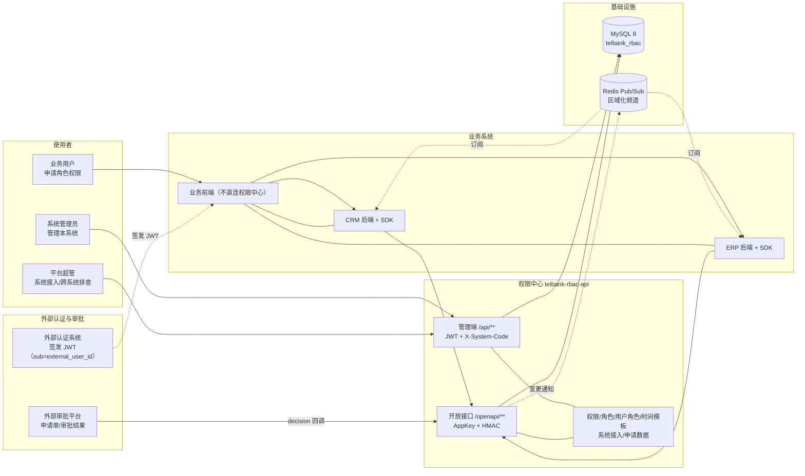

**核心原则**

1. **认证外部化**：权限中心不签发 JWT、不保存密码、不建用户表；`external_user_id` 是唯一用户标识。
2. **系统是隔离边界**：角色、权限码、角色权限、用户角色、页面元素、资源映射均带 `system_id`；一次请求只操作当前系统。
3. **权限数据单一来源**：前端、后端 `@perm`、SDK 都基于同一份权限码与通配匹配口径。
4. **管理端与业务端分离**：管理前端只调用权限中心 `/api/**`；业务系统前端只调用本系统后端，由 SDK 在服务端拦截。
5. **时效在用户-角色上**：角色-权限永久；用户角色带绝对窗口，窗口由全局时间模板计算，过期自动失效。
6. **审批外部化**：权限中心只保存申请单、接收审批结果、自动授权，不实现审批流。

### 2. 系统全景架构

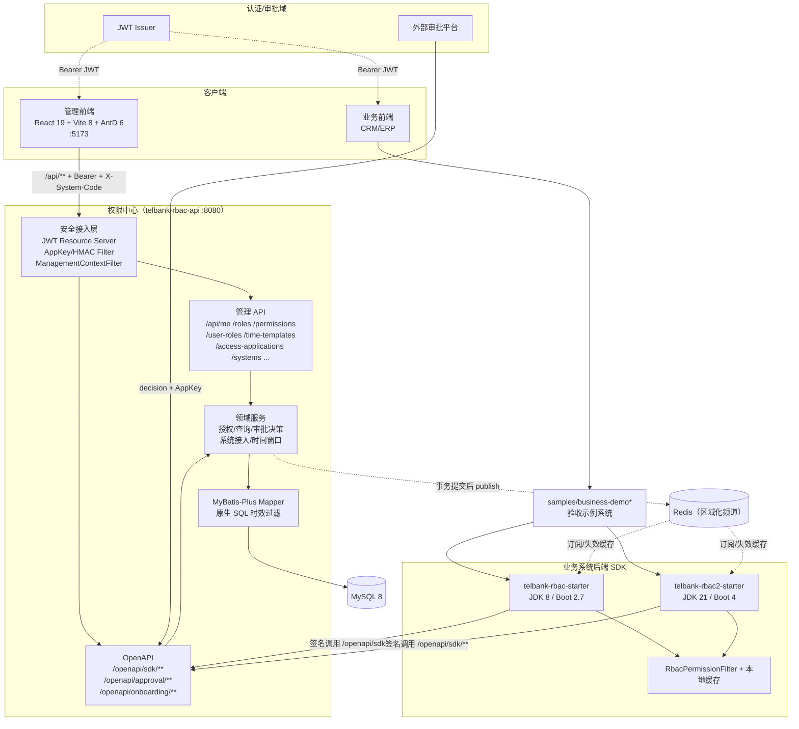

**边界说明**

- 管理前端**只**直连权限中心；业务系统前端不直连权限中心，权限判断由业务后端 SDK 完成。
- SDK 与权限中心可跨进程/跨网络部署；SDK 构建产物按 JDK 8 或 JDK 21 二选一，同一业务系统不能同时引入两版。
- MySQL 是唯一持久化数据源；Redis 只做变更通知，属于可降级组件（不可用时 SDK 依赖兜底轮询）。**例外**：`standalone` 演示/本地模式（A24）使用 H2 内存库 + 本地缓存，无 MySQL/Redis 且数据不持久化（见 §B.1）。
- 外部审批平台不保存权限数据；通过 `/openapi/approval/access-applications/decision` 将结果写回。

### 3. 代码模块与依赖

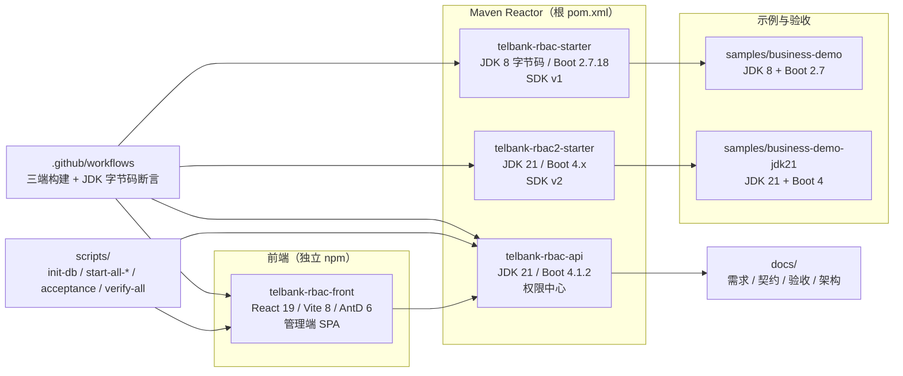

**模块职责**

| 模块 | 职责 | 不负责 |
|---|---|---|
| `telbank-rbac-api` | 权限数据、管理 API、OpenAPI、审批回调、时间窗口、变更通知 | 用户认证、登录页、审批工作流、业务菜单渲染 |
| `telbank-rbac-starter` | 在 JDK 8 业务系统内做接口拦截、缓存、签名调用、端点上报 | 存储权限数据、生成 JWT |
| `telbank-rbac2-starter` | 同协议的 JDK 21/Boot 4 变体 | 与 v1 同时引入 |
| `telbank-rbac-front` | 权限中心管理界面、申请自助页 | 业务流程审批、业务系统页面 |
| `samples/business-demo*` | 验收 SDK 与端到端链路 | 生产使用 |

### 4. 部署拓扑与端口

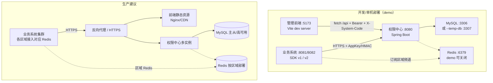

**运行时端口与环境变量**

| 组件 | 默认 | 说明 |
|---|---|---|
| 权限中心 `server.port` | `8080` | 启动脚本用 `API_PORT` 覆盖 |
| 管理前端 Vite | `5173` | `FRONT_PORT`；CORS 默认只允许 `localhost:5173` |
| MySQL | `3306` | `--temp-db` 时用一次性实例 `3307`（`TEMP_MYSQL_PORT`）；`standalone` 模式不需要 MySQL（H2 内存库） |
| Redis | `6379` | `RBAC_REDIS_ENABLED=false` 可关闭，demo 默认关闭；`standalone` 固定关闭（`rbac.redis.enabled=false`） |
| 示例业务系统 | 见各自 `application.yml` | 验收脚本使用 `8081`（JDK 8）/ `8082`（JDK 21） |

**关键环境变量**

| 变量 | 作用 |
|---|---|
| `RBAC_DB_URL / RBAC_DB_USER / RBAC_DB_PASSWORD` | 数据库连接（启动脚本可从 `MYSQL_*` 映射）；standalone 模式被 H2 内存库覆盖，无需设置 |
| `RBAC_JWT_HS256_SECRET` / `RBAC_JWK_SET_URI` / `RBAC_JWT_ISSUER` | JWT 校验参数；模式由配置 `rbac.security.jwt.mode` 决定（demo=hs256 / prod=jwk） |
| `RBAC_APPROVAL_SECRET` | 审批回调 AppSecret（AppKey 固定 `approval-system`） |
| `RBAC_ONBOARDING_ENABLED` / `RBAC_ONBOARDING_APP_KEY` / `RBAC_ONBOARDING_SECRET` | SDK 系统接入上报凭据 |
| `RBAC_ACCESS_APPROVAL_URL_TEMPLATE` | 申请单跳转外部审批平台的 URL 模板（含 `{applicationNo}`） |
| `RBAC_REDIS_ENABLED` / `RBAC_REDIS_REGION_*` | 变更通知开关与区域 Redis 连接 |
| `VITE_API_BASE_URL` | 前端请求后端地址（默认 `http://localhost:8080`） |

**运行形态（A24）**：`demo`（一键脚本，MySQL + Redis 可选）/ `standalone`（H2 内存库 + 本地缓存，**无需 MySQL/Redis**；启动脚本 `--standalone` 或 `java -jar ... --standalone`，数据重启重置，见 §B.1）/ `prod`（MySQL 8 + 按区域 Redis，多实例，见 §B.2）。`standalone` 仅为本地/演示/离线验收形态，**不用于生产**。

### 5. 认证、系统上下文与权限模型

#### 5.1 三层身份与准入

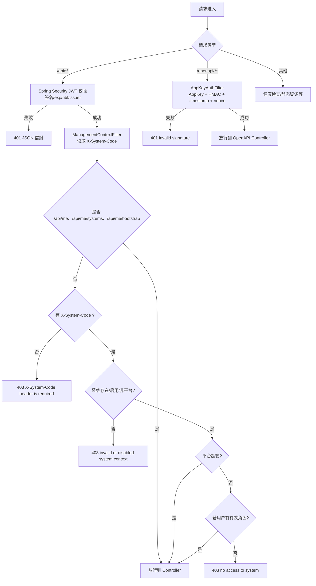

#### 5.2 平台超管判定（数据驱动）

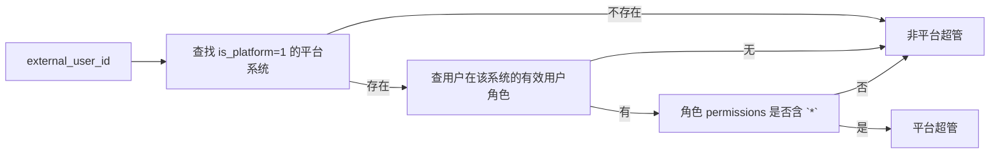

#### 5.3 权限模型

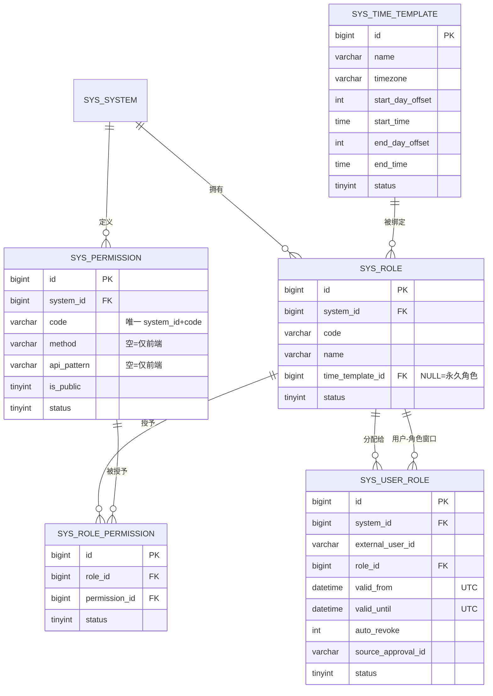

**有效权限判定口径**（后端、前端、SDK 一致）：

1. 角色启用、角色-权限启用、权限启用；
2. 用户-角色 `status=1`，且 `valid_from <= now < valid_until`（NULL 表示无界）；
3. `is_public=1` 的权限对当前系统所有登录用户可见；
4. 命中权限码集合后按 `*` → `前缀:*` → 精确匹配；
5. 平台超管在权限查询接口返回 `["*"]`；系统 admin 角色本身持有 `*`（数据库一条记录）。

### 6. 运行时请求链路（总览）

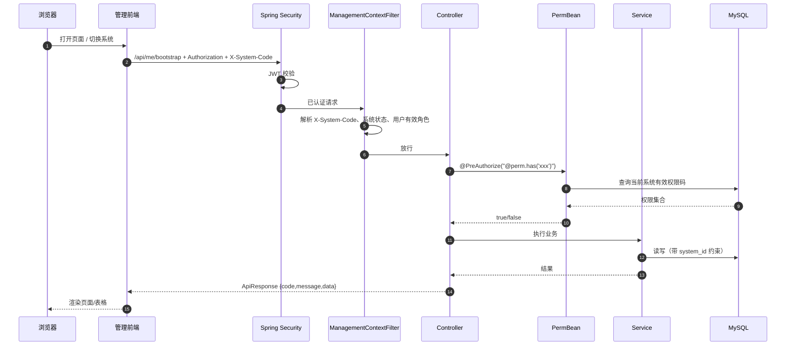

### 7. 状态与失败边界

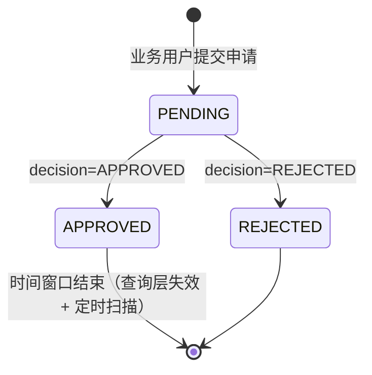

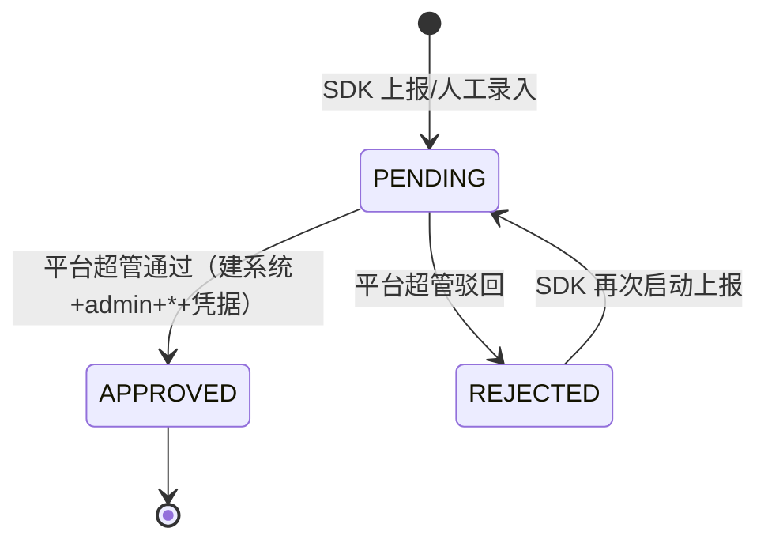

**失败/降级原则**

- 管理 API：401/403 统一 JSON 信封；`X-System-Code` 缺失/非法/越权均拒绝，平台超管也不能单请求跨系统。
- 审批回调：按 `applicationNo` 行锁串行；仅 PENDING 可决策；重复 APPROVED 幂等，窗口不回滚；任一角色失败整体回滚。
- 授权写入：`sys_user_role` 按 `(system_id, external_user_id, role_id)` 唯一，已有关系更新窗口，不新增行；审批按 `approvalId` 幂等。
- 时效：查询层过滤 + 每分钟 `ExpiryScanService` 将过期的 `auto_revoke=1` 用户角色置为停用；Redis 不可用时 SDK 使用短轮询。
- SDK：内部异常/回源失败按可用性优先放行（可通过 `deny-unmatched` 收紧），映射未命中默认 pass。

### 8. 全局数据模型

详细字段与约束见 API/后端章节；当前有效表共 **11 张**（`01_schema` + 后续迁移，`sys_user_system` 已在 04 删除）：

| 表 | 作用 | 系统隔离 |
|---|---|---|
| `sys_system` | 业务系统/平台系统、AppKey、区域 | 平台表 |
| `sys_role` | 角色、绑定时间模板 | `system_id` |
| `sys_permission` | 权限码、接口映射、公共权限 | `system_id` |
| `sys_role_permission` | 角色-权限（永久） | `role_id` 关联 |
| `sys_user_role` | 用户-角色绝对窗口 | `system_id` |
| `sys_page_action` | 页面元素元数据 | `system_id` |
| `sys_sdk_endpoint` | SDK 上报端点/候选码/关联状态 | `system_id` |
| `sys_system_application` | SDK 系统接入申请 | 平台审核 |
| `sys_access_application` | 业务用户权限申请主单 | `system_id` |
| `sys_access_application_role` | 申请角色/模板/窗口快照 | `application_id` |
| `sys_time_template` | 全局角色时间模板 | 全局共享 |

### 9. 相关文档

- 接口契约：[`docs/impl/contracts.md`](impl/contracts.md)
- 需求基线：[`docs/telbank-rbac.md`](telbank-rbac.md)
- 验收矩阵：[`docs/acceptance.md`](acceptance.md)
- 后端/API 细节：本文第二、第三部分
- SDK 接入：本文第四部分
- 前端/运维：本文第五部分

---


<a id="part2"></a>
## 第二部分 后端运行时架构

覆盖权限中心分层与包结构、JWT 与系统上下文、平台超管判定、`@perm`/`SystemScopeGuard`、系统接入、权限申请与审批、时间模板计算、到期扫描与 Redis 通知、数据字典、事务与幂等。

### 1. 分层与包结构

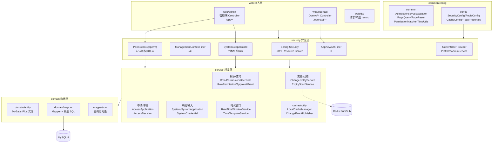

**分包职责**

| 包 | 内容 | 关键约束 |
|---|---|---|
| `web/admin` | 13 个管理端 Controller：`/api/me`、`/api/roles`、`/api/permissions`、`/api/roles/{roleId}/permissions`、`/api/user-roles`、`/api/time-templates`、`/api/access-applications`、`/api/approval-grants`、`/api/expiring-grants`、`/api/sdk-endpoints`、`/api/page-actions`、`/api/systems`、`/api/system-applications`、`/api/system-credentials` | 返回 `ApiResponse<T>`；除 `/api/me*` 外都要求 `X-System-Code`；方法级 `@PreAuthorize` |
| `web/openapi` | `OpenApiSdkController`、`OpenApiApprovalController`、`OpenApiAccessApplicationController`、`OpenApiOnboardingController` | 不做 JWT、不加 `@PreAuthorize`；由 `AppKeyAuthFilter` 验签 |
| `security` | JWT 资源服务器、`ManagementContextFilter`、`AppKeyAuthFilter`、`PermBean`、`SystemScopeGuard`、NonceStore、签名工具 | 认证/上下文/权限判定全部在进入 Service 前完成（AppKey 场景除外） |
| `service` | 领域服务；所有涉及台账的写操作带 `@Transactional`；变更通知在事务提交后发布 | 不依赖 Web 层类型（除 DTO 输出） |
| `domain` | MyBatis-Plus 实体 + Mapper 默认方法 + 原生 SQL | 时间列按 UTC `LocalDateTime` 读写；复杂时效查询走 `@Select` |
| `common` | 信封、异常、分页、通配匹配、时间工具、常量 | 全局异常处理统一输出 `{code,message,data}` |

### 2. 认证、上下文与鉴权

#### 2.1 请求进入顺序

`SecurityConfig` 注册两类过滤器：

| 顺序 | 组件 | 作用范围 |
|---|---|---|
| Spring Security FilterChain（默认 -100） | JWT Resource Server | `/api/**`（`/openapi/**` permitAll，由 AppKey 过滤器另行认证） |
| `FilterRegistrationBean` order `-40` | `ManagementContextFilter` | `/api/**`，豁免 `/api/me`、`/api/me/systems`、`/api/me/bootstrap` |
| `FilterRegistrationBean` order `0` | `AppKeyAuthFilter` | `/openapi/**`，OPTIONS 放行 |

`/api/**` 与 `/openapi/**` 均在 `authorizeHttpRequests` 中按规则放行；`/actuator/health`、`/error`、CORS 预检放行。未认证/无权限分别由 `JsonAuthenticationEntryPoint`/`JsonAccessDeniedHandler` 输出 401/403 信封。

#### 2.2 JWT 认证

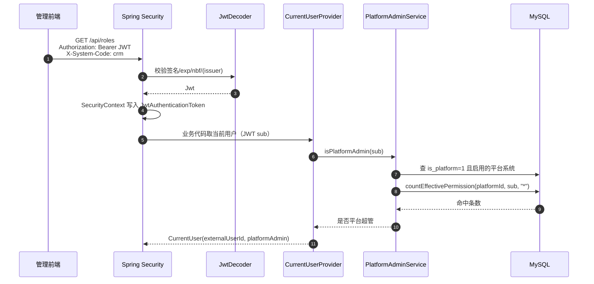

- `rbac.security.jwt.mode=jwk` 时用 `jwk-set-uri` 构建 `NimbusJwtDecoder`；`mode=hs256` 时用 `hs256-secret`（≥32 字节）构建 `NimbusJwtDecoder.withSecretKey`。
- 默认校验 `exp`/`nbf`；配置 `rbac.security.jwt.issuer` 时额外校验 `iss`。**权限中心只校验 JWT，不签发 JWT**。
- `external_user_id = JWT.sub`；平台超管不是配置项，完全数据驱动（见 2.4）。

#### 2.3 管理上下文 `X-System-Code`

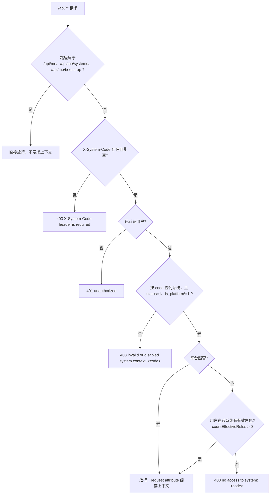

- 上下文对象 `ManagementContext(systemId, code)` 放入 request attribute `rbac.management.context`，`ManagementContextService.currentContext()` 优先读缓存，避免同一请求重复解析。
- **平台系统永远不能作为 `X-System-Code`**；平台超管也只能进入「启用的业务系统」，随后所有按 id 的操作仍受严格隔离限制（2.6）。
- 普通用户的准入只看「有效用户角色」（`sys_user_role.status=1` 且在窗口内），不看权限码。

#### 2.4 平台超管判定（数据驱动）

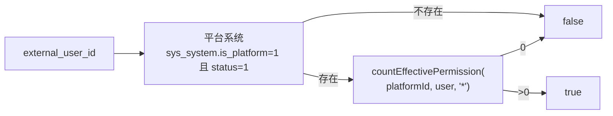

对应 SQL 在 `SysUserRoleMapper.countEffectivePermission`：`sys_user_role`（status=1、窗口过滤）→ `sys_role`（status=1）→ `sys_role_permission`（status=1）→ `sys_permission`（code=`*`、status=1）。平台超管在 `/api/me`、`/api/me/bootstrap`、`/openapi/sdk/user-permissions` 中返回权限码 `["*"]`；`/api/systems/**`、`/api/system-applications/**`、时间模板写接口用 `@perm.isPlatformAdmin()` 校验。

> 注意：平台超管调用 `/api/**` 同样需要 `X-System-Code`（业务系统）；这是「认证 ≠ 上下文」的刻意设计。

#### 2.5 `@perm` 方法级权限

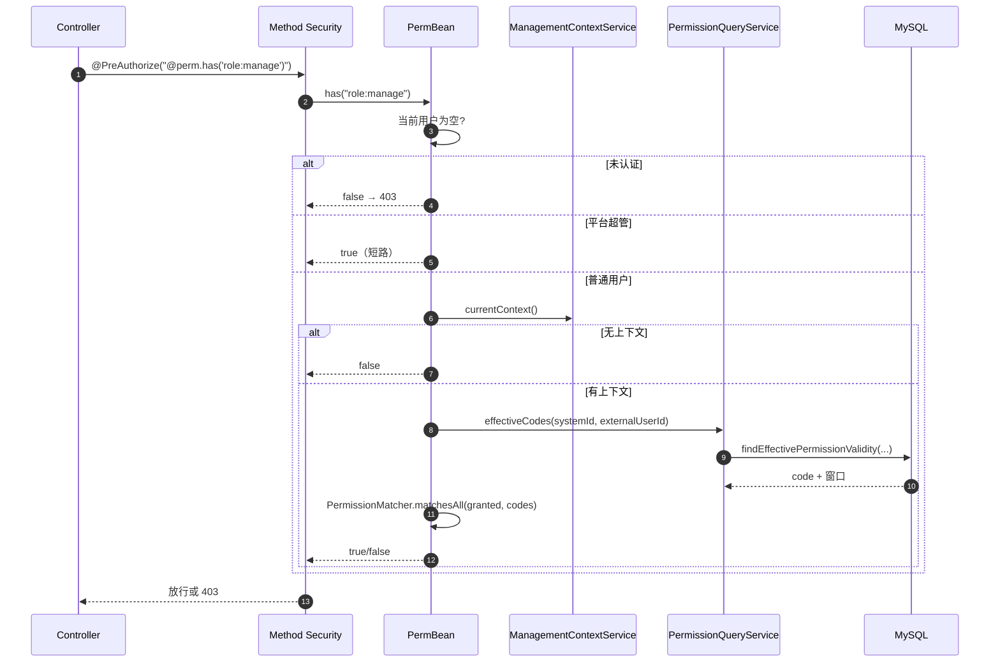

- `has(String... codes)` 为 **AND**；`hasAny(String... codes)` 为 **OR**；空数组返回 `false`。
- 平台超管短路为 `true`（`isPlatformAdmin()` 来自 DB，不读配置）。
- 通配匹配统一走 `common/PermissionMatcher`：`*` 匹配任意；`前缀:*` 匹配同前缀；否则精确匹配。`is_public=0/1` 不参与匹配，公共权限在查询层并集。
- 权限查询结果不缓存（除 SDK 映射/页面元素的一级缓存），保证写后立即可见。

#### 2.6 `SystemScopeGuard` 严格隔离

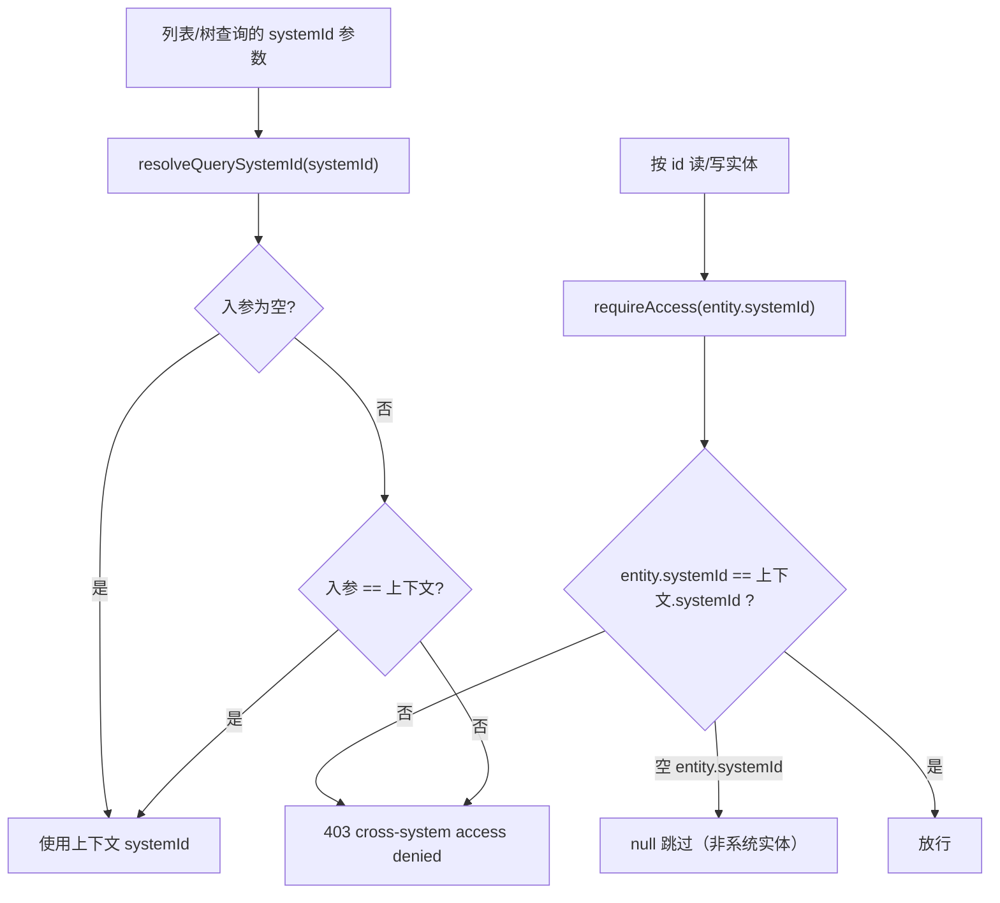

- 超管**没有跨系统豁免**：即使 `platformAdmin=true`，单请求也只能操作上下文系统；跨系统需要切换 `X-System-Code`。
- 所有 by-id 服务（角色、权限、角色权限、用户角色、页面元素、SDK 端点、审批记录、申请单）加载实体后必须调用 `requireAccess`；列表/树查询的 `systemId` 缺省收敛为上下文 id。
- `/api/systems/**` 是平台级接口（无 `system_id` 过滤器），使用 `@perm.isPlatformAdmin()`；`/api/me/*`、`/openapi/*` 不要求管理上下文。

### 3. 权限模型

#### 3.1 概念模型

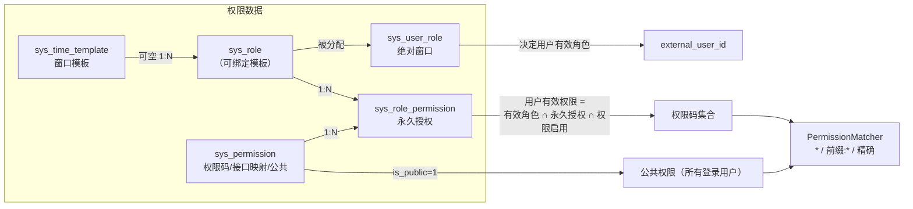

**规则**

| 规则 | 实现位置 | 说明 |
|---|---|---|
| 角色-权限永久 | `sys_role_permission`（11 迁移删除 `valid_from/valid_until`） | 授权/撤销只改 `status`；不再有逐项时效 |
| 用户-角色绝对窗口 | `sys_user_role.valid_from/valid_until`（UTC，可空=永久） | 由角色绑定的时间模板在**写入时刻**计算；到期即查询失效 |
| 通配权限 | `PermissionMatcher` + `RbacConstants.PERM_WILDCARD="*"` | 系统 admin 角色由系统接入自动获得一条 `*`；平台超管在平台系统同样持有 `*` |
| admin 角色保护 | `RolePermissionService` | 对 `role.code='admin'` 的 grant/revoke 返回 400「系统管理员角色默认拥有全部权限，无需授权」；非 admin 角色手工授予 `*` 也 400 |
| 公共权限 | `SysUserRoleMapper` SQL `is_public=1` 分支 | 返回给当前系统所有登录用户，窗口为 NULL（永久） |
| 有效判定 | 查询 SQL | 系统/角色/角色权限/权限均启用；用户角色窗口内；角色权限无时效 |

#### 3.2 有效权限查询 SQL 数据流

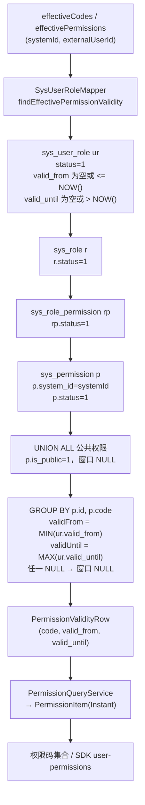

- 同一权限码可能由多条用户角色命中，SQL 用 `MIN(valid_from)`/`MAX(valid_until)` 得到「包络」；任一行窗口为 NULL（永久）时结果窗口也为 NULL。
- `countEffectivePermission` 是另一条轻量 SQL：用于平台超管判定与 `@perm` 相关计数场景，条件同上但只返回条数。
- 平台超管不在 SQL 里短路：`PermissionQueryService.userPermissions` 在调用前判超管，直接返回 `*`（null 窗口）；管理端 `@perm` 则由 `PermBean` 短路，避免查库。
- 角色权限预览（申请 options）走 `SysRolePermissionMapper.findActivePermissionRows`，A21 后不带角色权限时效，仅按 `status=1` 与系统过滤。

### 4. 系统接入：上报 → 审批 → 自动开通

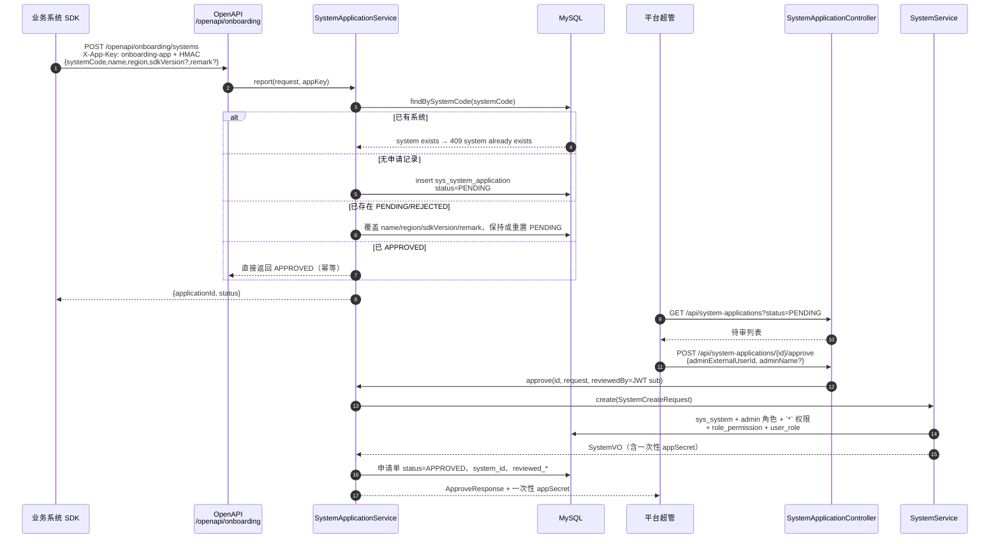

**开通事务（`SystemService.create`，`@Transactional`）**

1. `code` 唯一校验（`sys_system.uk_system_code`），冲突 409。
2. 插入 `sys_system`：`is_platform=0`、`app_key=code`、随机 32 位字母数字 `app_secret`、`admin_external_user_id/admin_name`。
3. 插入默认 `admin` 角色（`code='admin'`，name=系统管理员，status=1，sort=0）。
4. 插入一条 `sys_permission`：`code='*'`、name=全部权限（通配）、type=2、sort=100、status=1。
5. 插入 `sys_role_permission`：admin 角色 ↔ `*` 权限，`auto_revoke=1`。
6. 插入 `sys_user_role`：管理员 ↔ admin 角色，**窗口 NULL（永久）**。
7. 返回 `SystemVO`：列表/详情中 `appSecretMasked`（前 4+****+后 4），只有创建/审批通过响应带完整 `appSecret`（由 `SystemService.toVO` 控制）。

**其它入口**

- 平台超管可直接 `POST /api/systems` 人工接入（字段：code/name/region/adminExternalUserId/adminName?/status?/sort?/remark?），走同一 `create` 逻辑。
- `PUT /api/systems/{id}` 可变更管理员：把旧管理员对应 admin 角色的 user_role 置 `status=0`，再给新管理员插入/恢复 `status=1`（窗口 NULL）。
- `DELETE /api/systems/{id}` 当前已移除；平台系统不能被管理接口修改（`requireBusinessSystem` 对 `is_platform=1` 返回 404）。
- SDK 上报已通过的系统时返回 `APPROVED`（不重建系统）；上报已存在系统但无申请记录返回 409。

### 5. 业务用户临时权限申请（A20 + A21）

#### 5.1 端到端时序

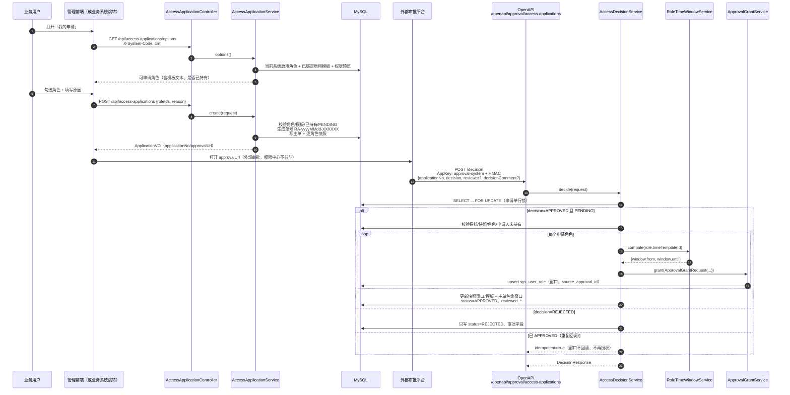

#### 5.2 申请单状态

```mermaid
stateDiagram-v2
    [*] --> PENDING: 用户创建申请（系统内同人唯一 PENDING）
    PENDING --> APPROVED: 审批回调 decision=APPROVED
    PENDING --> REJECTED: 审批回调 decision=REJECTED
    APPROVED --> [*]: 窗口到期（查询层失效；已回写窗口不变）
    REJECTED --> PENDING: 用户重新申请（生成新单）
    APPROVED --> APPROVED: 重复 APPROVED 回调（idempotent=true）
    REJECTED --> REJECTED: 重复 REJECTED 回调（idempotent=true）
    APPROVED --> PENDING: 不允许（409）
    REJECTED --> APPROVED: 不允许（409）
```

**创建规则（`AccessApplicationService.create`）**

- `roleIds` 非空、≤20、去空/去重；`reason` trim 后 1–200 字。
- 角色必须：属于当前系统、启用、非 `admin`、**绑定了启用中的时间模板**（无模板 400「角色未绑定时间模板，不能自助申请」）。
- 用户已有效持有任一申请角色 → 400「已拥有该角色，无需申请」。
- 同系统同用户已有 PENDING → 409（DB 层还有 `pending_user_key` STORED 生成列 + 唯一键兜底；`DataIntegrityViolationException` 转 409）。
- 单号格式 `RA-{UTC yyyyMMdd}-{6 位大写字母数字}`，生成时查重最多 5 次。
- 事务内写主单 `sys_access_application` + 逐角色快照 `sys_access_application_role`（含 role_code/role_name/time_template_id/time_template_name），随后发布通知（事务提交后）。

**决策规则（`AccessDecisionService.decide`）**

- `decision` 大小写不敏感，仅 `APPROVED`/`REJECTED`，否则 400。
- `applicationNo` 不存在/为空 → 404；用 `findByApplicationNoForUpdate` 行锁串行化同一申请单的决策。
- APPROVED：
  - 已 APPROVED → 直接返回 `idempotent=true`、原快照角色与已存窗口，**不重新计算、不回滚窗口**；
  - 非 PENDING → 409；
  - 校验：系统存在且启用、快照非空、逐角色仍存在/启用/非 admin、申请人当前未有效持有任一角色；任一失败 409 且申请保持 PENDING；
  - 逐角色：`timeTemplateId` 为空 → 409「申请角色未绑定时间模板，无法审批」；`requireEnabled` + `compute(template)` 得窗口；调用 `ApprovalGrantService.grant`，`approvalId=applicationNo+":"+roleId`，`grantType=role`；
  - 回写快照：模板 id/name、该角色窗口；主单 `approved_valid_from/until` 写所有角色窗口的**包络**（最早开始、最晚结束）；
  - 整个方法 `@Transactional`：任一角色失败整体回滚，申请保持 PENDING。
- REJECTED：仅 PENDING 可驳回；重复 REJECTED 返回 `idempotent=true`；非 PENDING 409；只写 `status/decision_comment/reviewed_by/reviewed_at`，不动窗口字段。
- `reviewer` 为空时落库 `external-approval`，超长按 128 截断；`decisionComment` 超长按 255 截断（**静默截断**，见 §9 已知限制）。
- 无论成功/驳回，均在事务提交后发布 `PERMISSION_CHANGED` 变更通知。

#### 5.3 旧审批回调 `POST /openapi/approval/grant`

```mermaid
flowchart TD
    A["验签通过"] --> B["approvalId 幂等查询<br/>findFirstBySourceApprovalId"]
    B -->|已存在| I["返回 {success:true, grantId, idempotent:true}"]
    B -->|不存在| C["grantType 必须为 role"]
    C --> D["systemCode → 启用系统"]
    D --> E["roleId → 角色，且 role.systemId == system.id"]
    E --> F{"角色绑定时间模板?"}
    F -->|是| G["以模板窗口覆盖请求 validFrom/validUntil<br/>模板不存在/停用 → 409"]
    F -->|否| H["使用请求 validFrom/validUntil<br/>可空=永久；until<=from → 400"]
    G --> J["permissionCodes 必须是角色已授权码"]
    H --> J
    J --> K["upsert sys_user_role<br/>source_approval_id=approvalId"]
    K --> L["事务提交后发布 PERMISSION_CHANGED"]
```

### 6. 时间模板窗口计算（A21）

```mermaid
flowchart TD
    START["RoleTimeWindowService<br/>windowFor(role)"] --> NT{"role 为空或<br/>timeTemplateId 为空?"}
    NT -->|是| EMPTY["Optional.empty()<br/>= 永久角色"]
    NT -->|否| REQ["requireEnabled(templateId)"]
    REQ -->|缺失/停用| E409A["409 时间模板不存在或已停用"]
    REQ --> COMPUTE["compute(template, anchor=Instant.now())"]
    COMPUTE --> TZ["时区 = template.timezone<br/>空/空白 → Asia/Shanghai<br/>非法 → 400 时区无效"]
    TZ --> DATES["anchor 转模板时区得 anchorDate"]
    DATES --> OFFSETS{"start/end time/offset 完整?"}
    OFFSETS -->|time 空| E400A["400 开始/结束时间不能为空"]
    OFFSETS -->|offset 空| ZERO["offset=0"]
    OFFSETS -->|完整| CALC["startLocal = anchorDate + startOffset 天，startTime<br/>endLocal = anchorDate + endOffset 天，endTime"]
    ZERO --> CALC
    CALC --> ORDER{"endLocal 晚于 startLocal?"}
    ORDER -->|否| E400B["400 时间模板的结束时间必须晚于开始时间"]
    ORDER -->|是| EXPIRED{"endInstant &lt;= anchor?"}
    EXPIRED -->|是| E409B["409 按模板计算的时间窗口已失效<br/>不自动滚动到下一个周期"]
    EXPIRED -->|否| CLAMP["from = max(startInstant, anchor)<br/>（开始已过则从当前时刻起算）<br/>until = endInstant"]
    CLAMP --> OUT["TimeWindow(from, until) → 写 sys_user_role（UTC）"]
```

- **跨天**由 `end_day_offset` 表达：如 `0/19:00 → 1/07:00`（当天 19:00 到次日 07:00）、`0/20:00 → 3/08:00`（跨周末）。
- 模板不按系统隔离，全局共享；一个角色最多绑定一个模板，`timeTemplateId=null` 即永久角色（管理员可直接分配，但业务用户不可自助申请）。
- 审批/分配时立即计算并落库为**绝对 UTC 窗口**；之后模板修改不会影响已写入的窗口。
- 文本展示 `RoleTimeWindowService.describe`：`审批后当天 19:00 ~ 次日 07:00`（offset 0→当天、1→次日、>1→第 N 天）。
- 时间模板自身的写接口（`POST/PUT/DELETE /api/time-templates`）仅平台超管；`GET` 需要当前系统 `role:manage`；删除为逻辑停用。

### 7. 到期扫描与变更通知（含降级）

```mermaid
sequenceDiagram
    autonumber
    participant SC as Spring Scheduler
    participant ES as ExpiryScanService
    participant DB as MySQL
    participant CN as ChangeNotifyService
    participant LC as LocalCacheManager
    participant RP as RedisChangeEventPublisher
    participant R as Redis Pub/Sub

    loop 每分钟（rbac.expiry-scan-cron）
        SC->>ES: scanAndRevoke()
        ES->>DB: findExpiredSystemIds()
        ES->>DB: revokeExpired()<br/>更新已过期用户角色 status=0
        alt 有记录被更新
            loop 每个受影响 systemId
                ES->>CN: publishAfterCommit(systemId, PERMISSION_CHANGED)
                CN->>LC: invalidatePermissions(systemId)
                CN->>DB: findById → system.code/region
                CN->>RP: publish(channel, payload)
                RP->>R: PUBLISH rbac:change:{region}:{code}
            end
        end
    end
```

- 定时任务只清理 `sys_user_role`；A21 起角色-权限不再有时效，`sys_role_permission` 不再参与扫描。
- 扫描 SQL 等价于 `UPDATE sys_user_role SET status=0 WHERE valid_until <= NOW() AND auto_revoke=1 AND status=1`；`findExpiredSystemIds()` 先定位受影响系统，再按系统批量更新。
- **变更通知**由 `ChangeNotifyService.publishAfterCommit` 统一发布：存在活动事务时注册 `afterCommit`，否则立即发布；每次发布先失效本地 Caffeine 缓存（权限/页面元素），再发 Redis。
- 频道：优先用 `rbac.regions.{region}.channel-prefix + systemCode`，未配置时 `rbac:change:{region}:{systemCode}`；消息体 `{"systemCode": "...", "type": "...", "timestamp": "ISO-8601"}`。
- 业务侧订阅任意类型消息后，重拉 `/openapi/sdk/mappings` 与 `/openapi/sdk/page-actions`，并失效本地权限缓存；`PERMISSION_CHANGED` 需同时刷新用户权限。
- **降级**：
  - `rbac.redis.enabled=false` → `LocalChangeEventPublisher` 只打 warn 日志（不阻塞主流程）、`CaffeineNonceStore` 替代 Redis nonce；`/openapi/sdk/connection` 仍返回配置的区域连接信息，SDK 自行降级短轮询。
  - Redis 发布运行期异常：`ChangeNotifyService` catch 后 warn，不回滚主事务。
  - 权限安全不依赖扫描任务：查询 SQL 自带窗口过滤，过期即无权限；扫描只做状态清理与通知。
- 本地 Caffeine 缓存（`CacheConfig`）：权限列表/页面元素元数据，TTL 5 分钟、max 2000；写操作主动失效，TTL 仅兜底。

### 8. 数据模型

#### 8.1 ER 图（当前有效 11 张表）

```mermaid
erDiagram
    sys_system ||--o{ sys_role : "system_id"
    sys_system ||--o{ sys_permission : "system_id"
    sys_system ||--o{ sys_user_role : "system_id"
    sys_system ||--o{ sys_page_action : "system_id"
    sys_system ||--o{ sys_sdk_endpoint : "system_id"
    sys_system ||--o{ sys_access_application : "system_id"
    sys_system ||--o{ sys_system_application : "system_id(审核后)"
    sys_role ||--o{ sys_role_permission : "role_id"
    sys_permission ||--o{ sys_role_permission : "permission_id"
    sys_role ||--o{ sys_user_role : "role_id"
    sys_time_template ||--o{ sys_role : "time_template_id"
    sys_access_application ||--o{ sys_access_application_role : "application_id"
```

#### 8.2 数据字典

| 表 | 作用 | 关键列（类型/约束） | 唯一键 / 索引 | 关系 |
|---|---|---|---|---|
| `sys_system` | 业务系统/平台系统 | `id` BIGINT UNSIGNED PK；`code` VARCHAR(64) NOT NULL；`name` VARCHAR(100)；`region` VARCHAR(32)；`status` TINYINT=1；`sort` INT=0；`is_platform` TINYINT=0；`admin_external_user_id` VARCHAR(255)；`admin_name` VARCHAR(100)；`app_key` VARCHAR(64)；`app_secret` VARCHAR(128) | UNIQUE `uk_system_code(code)`；UNIQUE `uk_system_app_key(app_key)`；KEY `idx_system_region` | 1:N 角色/权限/用户角色/页面元素/端点/申请单 |
| `sys_role` | 角色，可绑定时间模板 | `system_id` BIGINT UNSIGNED NOT NULL；`code` VARCHAR(64)；`name` VARCHAR(100)；`status` TINYINT=1；`sort` INT=0；`time_template_id` BIGINT UNSIGNED NULL | UNIQUE `uk_role_system_code(system_id,code)`；KEY `idx_role_system`；KEY `idx_role_time_template` | N:1 system；N:1 time_template |
| `sys_permission` | 权限码/接口映射/公共权限 | `system_id`；`parent_id` BIGINT=0；`type` TINYINT(1 目录 2 操作 3 纯接口)；`code` VARCHAR(128) NOT NULL；`method` VARCHAR(10) NULL；`api_pattern` VARCHAR(255) NULL；`sort`；`status`=1；`is_public` TINYINT=0；`meta` JSON | UNIQUE `uk_perm_system_code(system_id,code)`；KEY `idx_perm_system_parent`；KEY `idx_perm_api` | N:1 system；1:N role_permission |
| `sys_user_role` | 用户-角色授权（绝对窗口） | `system_id`；`external_user_id` VARCHAR(255) NOT NULL；`role_id`；`valid_from/valid_until` DATETIME NULL（UTC）；`auto_revoke` TINYINT=1；`grant_reason` VARCHAR(255)；`source_approval_id` VARCHAR(128)；`status` TINYINT=1 | UNIQUE `uk_user_role(system_id,external_user_id,role_id)`；KEY `idx_user`；KEY `idx_role`；KEY `idx_valid_until(valid_until,auto_revoke,status)` | N:1 system/role |
| `sys_role_permission` | 角色-权限永久授权 | `system_id`；`role_id`；`permission_id`；`auto_revoke` TINYINT=1；`grant_reason`；`source_approval_id`；`status`=1（11 迁移已删 valid_from/valid_until） | UNIQUE `uk_role_perm(role_id,permission_id)`；KEY `idx_role_system`；KEY `idx_perm` | N:1 role/permission |
| `sys_page_action` | 页面元素元数据（模式 B） | `system_id`；`page_code` VARCHAR(128)；`code` VARCHAR(128)；`text` VARCHAR(64)；`type` VARCHAR(32)（button/link/menu/icon/input）；`action` VARCHAR(32) NOT NULL；`config` JSON；`sort`；`status` | UNIQUE `uk_action(system_id,page_code,code)`；KEY `idx_action_page` | N:1 system |
| `sys_sdk_endpoint` | SDK 上报端点/候选码/关联 | `system_id`；`method` VARCHAR(10)；`path` VARCHAR(255)；`candidate_code` VARCHAR(128)；`source` VARCHAR(32)='GENERATED'；`permission_id` NULL；`reported_at` DATETIME | UNIQUE `uk_endpoint(system_id,method,path)`；KEY `idx_endpoint_permission` | N:1 system；N:1 permission（可空） |
| `sys_system_application` | SDK 系统接入申请 | `id` PK；`system_code` VARCHAR(64)；`name`；`region`；`source` VARCHAR(16)='SDK'；`app_key`；`sdk_version`；`remark`；`status` TINYINT(0 PENDING/1 APPROVED/2 REJECTED)；`reject_reason`；`reviewed_by`；`reviewed_at`；`system_id` NULL | UNIQUE `uk_application_system_code(system_code)`；KEY `idx_application_status` | N:1 system（审核通过后回填） |
| `sys_access_application` | 业务用户临时权限申请主单 | `application_no` VARCHAR(40)；`system_id`；`external_user_id` VARCHAR(255)；`status` TINYINT(0/1/2)；`reason` VARCHAR(200) NOT NULL；`approved_valid_from/until` DATETIME NULL；`decision_comment` VARCHAR(255)；`reviewed_by` VARCHAR(128)；`reviewed_at`；`pending_user_key` VARCHAR(300) STORED 生成列 | UNIQUE(`application_no`)；UNIQUE(`pending_user_key`)；KEY `idx_access_application_user(system_id,external_user_id,created_at)`；KEY `idx_access_application_status(status,created_at)` | N:1 system；1:N 角色快照 |
| `sys_access_application_role` | 申请单角色/模板/窗口快照 | `application_id`；`role_id`；`role_code` VARCHAR(64)；`role_name` VARCHAR(100)；`time_template_id`；`time_template_name` VARCHAR(100)；`approved_valid_from/until` DATETIME NULL | UNIQUE `uk_access_application_role(application_id,role_id)`；KEY `idx_access_application_role_role(role_id)` | N:1 application |
| `sys_time_template` | 全局角色时间模板 | `id` PK；`name` VARCHAR(100) NOT NULL；`timezone` VARCHAR(64) 默认 `Asia/Shanghai`；`start_day_offset` INT（0–3650）；`start_time` TIME；`end_day_offset` INT（0–3650）；`end_time` TIME；`status` TINYINT=1；`remark` VARCHAR(255) | UNIQUE(`name`) | 1:N role（可空绑定） |

> 迁移历史：`sys_user_system` 已在 04 删除；05 删除系统级短管理码、改为每系统一条 `*` 权限；06 清理 admin 冗余业务授权；11 删除 `sys_role_permission.valid_from/valid_until`（先删 `idx_valid_until`），新增时间模板与申请快照字段。

### 9. 事务边界、幂等与异常/降级

#### 9.1 事务边界与幂等键

| 操作 | 事务 | 幂等键 | 冲突/失败语义 |
|---|---|---|---|
| 系统接入（`SystemService.create`） | `@Transactional` | `sys_system.code` 唯一 | 重复 code → 409；审批通过调用时整单回滚 |
| 系统接入审批（approve/reject） | `@Transactional` | 申请单 `id` + `status=PENDING` | 非 PENDING → 409；approve 与建系统同事务 |
| 角色/权限/页面元素/端点写 | `@Transactional` | 唯一键（system+code / system+page+code / system+method+path） | 重复 → 409；停用以 `status=0` |
| 角色权限授权/撤销 | `@Transactional` | `uk_role_perm(role_id,permission_id)` | 同关系更新原行；admin 角色/手工 `*` → 400 |
| 用户角色分配（`UserRoleService.assign`） | `@Transactional` | `uk_user_role(system_id,external_user_id,role_id)` | 同关系更新窗口；无模板 → 永久（窗口 NULL） |
| 审批回调 `/openapi/approval/grant` | `@Transactional` | `sys_user_role.source_approval_id = approvalId` | 已存在 → `idempotent=true`；grantType=permission → 400 |
| 临时权限申请创建 | `@Transactional` | 单号唯一 + `pending_user_key` 唯一 | 已有 PENDING → 409；DB 唯一键冲突 → 409 |
| 临时权限决策 | `@Transactional` + `SELECT ... FOR UPDATE` | 申请单 `applicationNo` + 状态 | 已 APPROVED 重复 → idempotent；其它状态 → 409；任一角色失败整体回滚 |
| 定时到期收回 | `@Transactional` | 无（幂等 UPDATE） | 仅清理 user_role，通知失败不影响事务 |

**通知时机**：所有写操作通过 `ChangeNotifyService.publishAfterCommit` 在**事务提交后**发布，避免通知先于数据落库；本地缓存失效与 Redis 发布都在提交后。

#### 9.2 关键异常与降级

| 场景 | 行为 |
|---|---|
| 无 JWT / JWT 过期 | 401 JSON 信封（`JsonAuthenticationEntryPoint`） |
| 无权限码 / 非平台超管访问超管接口 | 403 JSON 信封（`JsonAccessDeniedHandler` 或 `GlobalExceptionHandler`） |
| 缺/非法 `X-System-Code` | 403，`ManagementContextFilter` 直接写信封 |
| 跨系统 by-id / 列表 systemId 不等于上下文 | 403 `cross-system access denied`（`SystemScopeGuard`） |
| 平台系统作为上下文 | 403 `invalid or disabled system context` |
| OpenAPI 验签失败 | 401 `invalid signature`（时间戳/nonce/签名/appKey 绑定均统一此消息） |
| 模板窗口已失效 | 409「按时间模板计算的时间窗口已失效，请调整模板或稍后再授权」（不自动滚动） |
| 无模板角色申请/审批 | 400（申请端）/ 409（审批端，申请保持 PENDING） |
| Redis 不可用 | 非阻塞：发布只 warn；nonce 用 Caffeine；SDK 短轮询兜底 |
| 数据库唯一冲突 | `GlobalExceptionHandler` 统一 409（或业务层先查后给精确消息） |

#### 9.3 已知限制（待确认）

1. **无审批历史表**：同一 `sys_user_role` 关系被重新授权时覆盖 `source_approval_id`，旧审批 ID 不再可查；回放更早的 `approvalId` 无法识别为幂等。
2. **窗口不滚动**：模板窗口按写入时刻计算，过期后不会自动滚动到下一周期；审批重放（已 APPROVED）不会刷新窗口。
3. **审批回调的 decision 结果幂等**：已 APPROVED 后再次回调只要仍是 APPROVED 即 idempotent；若首次 APPROVED 后窗口已过期，不会重新计算。
4. **静默截断**：`reviewer`（128）与 `decisionComment`（255）超长直接截断，不返回 400。
5. **JWT 不签发**：权限中心只做资源服务器；demo 依赖 `application-demo.yml` 的 HS256 与脚本生成 token。
6. **单实例扫描与缓存**：`ExpiryScanService` 用 `@Scheduled`，多实例部署会重复执行（UPDATE 幂等，但通知会重复）；本地 Caffeine 缓存只在本实例写后失效，跨实例通过 Redis 通知由 SDK 侧处理。
7. **列表严格隔离**：所有列表/树查询的 `systemId` 参数省略时收敛为上下文；当前没有「跨系统汇总」接口（平台超管也需逐系统切换）。
8. **`/api/systems` 仍需上下文**：平台超管调用 `/api/systems/**` 前必须带一个合法业务系统 `X-System-Code`，这是过滤器统一行为，不是接口缺失。
9. **HTTPS/密钥管理**：`app_secret` 明文存库（`sys_system.app_secret`），接口只对授权管理员返回；生产应由密钥管理替代（当前未实现）。
10. **Cron 精度**：默认 `0 * * * * *`（每分钟）；过期后到下一次扫描前靠查询 SQL 时效兜底，状态清理有最多 1 分钟延迟。

---

**未确认项**

- 生产环境 JWT 签发方、JWK 轮换策略与 `issuer` 取值未在仓库内固化（当前由部署方提供）。
- 各业务系统「审批平台链接」的实际域名/协议、回调重试策略由外部审批平台决定，本仓库只定义 `approvalUrlTemplate`。
- Redis 多区域（region_a/region_b）在真实部署中的拓扑与高可用方案未验证；demo 默认 `RBAC_REDIS_ENABLED=false`。
- `app_secret` 轮换接口当前不存在（只能人工改库/重建系统），是否需要在管理端提供待确认。
- 平台超管是否允许跨系统批量查询，产品侧尚未定义 API（当前严格隔离）。
- `sys_sdk_endpoint` 的 candidateCode 与 permissionCode 关联规则、后续自动建权限策略未在源码中实现（仅 link/unlink 手工关联）。

---


<a id="part3"></a>
## 第三部分 API 参考

按管理端 `/api/**`、OpenAPI `/openapi/**` 分类，给出认证方式、请求/响应字段、错误码、curl 示例与契约差异。

### 0. 范围与基地址

| 项 | 值 |
|---|---|
| 默认监听 | `http://localhost:8080`（`server.port`） |
| 管理端前缀 | `/api/**`（JWT + `X-System-Code`） |
| 开放接口前缀 | `/openapi/**`（AppKey + HMAC-SHA256） |
| 管理端端点 | 43 个（13 个 Controller） |
| OpenAPI 端点 | 9 个（4 个 Controller） |
| Content-Type | 请求/响应均为 `application/json`（UTF-8） |
| 数据库时间的语义 | 全部 UTC；JSON 时间字段为 ISO-8601（如 `2026-10-25T11:00:00Z`） |

调用方分三类：

1. **管理前端**（`telbank-rbac-front`）：携带用户 JWT，按系统切换 `X-System-Code`。
2. **业务系统 SDK**（数据面）：用系统凭据 `appKey/appSecret` 签名，调用 `/openapi/sdk/**`。
3. **审批平台 / 接入上报方**：用审批/接入专用 AppKey 签名，调用 `/openapi/approval/**`、`/openapi/onboarding/**`。

### 1. 统一约定

#### 1.1 响应信封

所有接口（含 `/openapi/**`）返回统一信封：

```json
{ "code": 0, "message": "ok", "data": { } }
```

- 成功：HTTP 2xx，`code=0`，`message="ok"`，`data` 为业务数据（无返回值的接口 `data=null`）。
- 失败：HTTP 非 2xx，`code` 等于 HTTP 状态码，`message` 为错误描述，`data=null`。例如未认证：

```json
{ "code": 401, "message": "unauthorized", "data": null }
```

`/openapi/**` 验签失败统一返回（不区分具体原因，见 §2.4）：

```json
{ "code": 401, "message": "invalid signature", "data": null }
```

#### 1.2 分页

所有分页接口使用 query：`page`（从 1 开始）、`size`；非法/缺省时 `page=1`、`size=20`，`size` 上限 200（超过按默认处理，不报错）。

请求：`GET /api/roles?page=1&size=20&X-System-Code: crm`

响应 `data`：

```json
{ "items": [ ], "total": 123, "page": 1, "size": 20 }
```

#### 1.3 时间与时区

- 服务端 JVM 强制 UTC（`TimeZone.setDefault(UTC)`），Hikari 连接初始化 `SET time_zone = '+00:00'`。
- 请求/响应中的时间统一为 ISO-8601 UTC 字符串（`Instant`）；DB 为 UTC `DATETIME`。
- 时间模板计算使用模板自己的 `timezone`（默认 `Asia/Shanghai`），HTTP 层不传本地时间字符串（模板的 `startTime/endTime` 除外，格式 `HH:mm`）。

#### 1.4 错误码

| code | 语义 | 典型来源 |
|---|---|---|
| 400 | 参数错误/业务校验失败 | 校验注解失败、非法 `status`、apiPattern 非法、roleIds 为空、reason 为空、模板时间倒挂、admin 角色绑定模板 |
| 401 | 未认证 / 验签失败 / 时间戳或 nonce 失效 | 无 JWT、JWT 过期、AppKey 签名错误 |
| 403 | 无权限 / 上下文非法 / 跨系统访问 | 缺 `X-System-Code`、平台系统作为上下文、权限码不足、非超管访问超管接口、`SystemScopeGuard` 拒绝 |
| 404 | 资源不存在 | 按 id/单号未找到、跨系统但按业务规则隐藏为 404 的场景 |
| 405 | 方法不支持 | 错误 HTTP method |
| 409 | 冲突 | 唯一键冲突、重复待审批申请、非 PENDING 决策、模板被引用/名称重复、模板窗口过期 |
| 415 | Content-Type 不支持 | 非 JSON 请求体 |
| 500 | 服务端错误 | 未捕获异常（`GlobalExceptionHandler` 兜底） |

`GlobalExceptionHandler` 会输出稳定的 400 文案，如：`invalid request body`、`missing request parameter: x`、`invalid value for parameter: x`；校验注解失败格式为 `field: message`。

### 2. 认证与鉴权

#### 2.1 三类认证总览

```mermaid
flowchart TD
    REQ["HTTP 请求"] --> P{"路径前缀"}
    P -->|" /api/me* "| JWT1["JWT 校验<br/>无需 X-System-Code"]
    P -->|" /api/** "| JWT2["JWT 校验<br/>+ X-System-Code 上下文<br/>+ @perm 权限码"]
    P -->|" /openapi/** "| AK["AppKey + HMAC-SHA256 验签<br/>无需 JWT"]
    JWT2 --> G["SystemScopeGuard<br/>严格系统隔离"]
    JWT1 --> OK["Controller → Service"]
    JWT2 --> OK
    AK --> OK
```

#### 2.2 管理端 JWT

| Header | 必填 | 说明 |
|---|---|---|
| `Authorization` | 是 | `Bearer <JWT>`；JWT 由外部身份平台签发，权限中心只校验不签发 |
| `X-System-Code` | 条件必填 | 业务系统 code；`/api/me`、`/api/me/systems`、`/api/me/bootstrap` 可省略 |

- JWT `sub` 即 `external_user_id`（所有 API 中的 `externalUserId`；管理端接口由后端从 token 解析，不接受客户端传用户 id）。
- 支持两种校验模式（`rbac.security.jwt.mode`）：`jwk`（`jwk-set-uri` 远程 JWK）与 `hs256`（共享密钥，≥32 字节）；配置 `issuer` 时校验 `iss`，默认校验 `exp/nbf`。
- 平台超管**由数据驱动**：在平台系统（`is_platform=1`）内有效持有 `*` 权限的用户；没有配置项。平台超管也需合法 JWT 与 `X-System-Code`，但跳过权限码校验。
- 在 `/api/me/bootstrap` 与 `/openapi/sdk/user-permissions` 中，平台超管的权限码返回 `["*"]`。
- Demo 环境：`application-demo.yml` 使用 HS256（secret `demo-auth` 相关配置），可用 `scripts/gen-demo-jwt.sh <externalUserId>` 生成测试 token。

**管理上下文规则**（`ManagementContextFilter`）：

| 场景 | 结果 |
|---|---|
| 缺 `X-System-Code`（非豁免路径） | 403 `X-System-Code header is required` |
| 系统不存在 / 已停用 / 是平台系统 | 403 `invalid or disabled system context: <code>` |
| 普通用户在该系统无有效角色 | 403 `no access to system: <code>` |
| 平台超管进入任意启用业务系统 | 允许 |
| 按 id 操作、列表 `systemId` 与上下文不一致 | 403 `cross-system access denied`（超管同样受限） |

#### 2.3 方法级权限 `@perm`

| 方法 | 语义 | 示例 |
|---|---|---|
| `@perm.has(codes...)` | 需要全部权限码（AND） | `@perm.has('role:manage')` |
| `@perm.hasAny(codes...)` | 任一权限码（OR） | `@perm.hasAny('user:manage','audit:view')` |
| `@perm.isPlatformAdmin()` | 平台超管 | `/api/systems/**`、时间模板写接口 |

- 权限码匹配规则：精确匹配；或持有 `*`（任意）；或持有 `前缀:*`（如 `order:*` 匹配 `order:delete`）。
- 平台超管短路为 `true`；公共权限（`sys_permission.is_public=1`）由查询层并入所有用户的有效权限集合。
- 常用权限码：`role:manage`、`permission:manage`、`resource:manage`、`page:manage`、`user:manage`、`audit:view`、`system:credential`。

#### 2.4 OpenAPI：AppKey + HMAC-SHA256

##### Headers

| Header | 必填 | 说明 |
|---|---|---|
| `X-App-Key` | 是 | 系统 appKey / 审批 appKey / 接入 appKey |
| `X-Timestamp` | 是 | 当前 epoch 毫秒（服务端允许 ±5 分钟） |
| `X-Nonce` | 是 | 随机字符串，≥16 字符；5 分钟内不可重复（Redis，不可用时 Caffeine） |
| `X-Signature` | 是 | 小写 hex HMAC-SHA256，见下 |

##### 签名串（canonical string）

按固定顺序用 `\n` 连接（**无末尾换行**）：

```text
appKey
timestamp
nonce
HTTP_METHOD（大写）
path（不含 query，不含 host）
sortedQuery（无 query 时为空串）
sha256Hex(body)（GET/无 body 时为空串的 SHA-256，即 e3b0c442...）
```

- `sortedQuery`：把原始 query string 按 `&` 切段，按 `=` 前的**原始 key 字符串**稳定升序（同 key 保持原顺序），再用 `&` 拼回；不做 URL 解码/重编码。
- 签名 = `HMAC-SHA256(appSecret, canonical)`，输出小写 hex。
- 服务端按路径选择凭据：
  - `/openapi/approval/**`：`rbac.approval.app-key/app-secret`（审批平台专用）；
  - `/openapi/onboarding/**`：`rbac.onboarding.enabled/app-key/app-secret`（接入上报专用，不与 systemCode 绑定）；
  - 其它（`/openapi/sdk/**`）：先查 DB `sys_system.app_key/app_secret`（命中但系统停用/密钥为空则直接拒绝，不回退），未命中再回退 YAML `rbac.clients`。
- 非审批/接入路径还会校验请求中的 `systemCode`（query 或 body）等于 appKey 绑定的系统 code。
- 所有验签失败（缺头、时间戳偏移、nonce 重放、签名错误、appKey 不存在、系统停用）都返回 `401 invalid signature`，不泄漏具体原因。

```mermaid
sequenceDiagram
    autonumber
    participant SDK as 业务系统 SDK
    participant AF as AppKeyAuthFilter
    participant SIG as OpenApiSignature
    participant NS as NonceStore
    participant API as OpenAPI Controller

    SDK->>AF: HTTP + X-App-Key/X-Timestamp/X-Nonce/X-Signature
    AF->>AF: 校验头完整性、nonce 长度、时间戳 ±5min
    AF->>AF: 按路径选凭据（审批/接入/系统 DB→YAML）
    AF->>SIG: verify(canonical, signature, appSecret)
    SIG-->>AF: true/false（常量时间比较）
    AF->>NS: putIfAbsent(appKey:nonce, 5min)
    AF->>AF: 校验 systemCode 与 appKey 绑定一致（SDK 路径）
    AF->>API: 写入 OpenApiCaller，缓存 body
    API-->>SDK: 统一信封
```

### 3. 管理端 API（`/api/**`）

> 除特别标注外，所有 `/api/**`（除 `/api/me*`）都必须带 **合法 JWT + `X-System-Code`**；表中「鉴权」列只列额外要求。所有涉及 `systemId` 的按 id 操作都受严格隔离限制。

#### 3.1 当前用户 `/api/me*`（无需上下文）

| 方法+路径 | 用途 | 鉴权 | 请求 | 响应 `data` | 主要错误 |
|---|---|---|---|---|---|
| `GET /api/me` | 当前用户 | JWT | — | `{externalUserId, platformAdmin}` | 401 |
| `GET /api/me/systems` | 可访问系统列表 | JWT | — | `[{id,code,name,region,isDefault}]`（按 sort,id；第一条 `isDefault=true`） | 401 |
| `GET /api/me/bootstrap` | 管理前端引导 | JWT；可选 `X-System-Code` | — | `{externalUserId,platformAdmin,currentSystemCode,permissions[],systems[]}` | 401 |

`bootstrap` 说明：若携带合法 `X-System-Code` 则作为 `currentSystemCode`，否则取第一个可访问系统；`permissions` 为当前系统有效权限码，平台超管为 `["*"]`。这是前端判断菜单/按钮与超管能力的唯一入口。

#### 3.2 系统管理 `/api/systems`（仅平台超管）

| 方法+路径 | 用途 | 鉴权 | 请求 | 响应 `data` | 主要错误 |
|---|---|---|---|---|---|
| `GET /api/systems` | 系统分页 | `isPlatformAdmin` | `keyword?`, `page`, `size` | `PageResult<SystemVO>` | 401/403 |
| `POST /api/systems` | 手工接入系统（自动建 admin + `*`） | `isPlatformAdmin` | `SystemCreateRequest` | `SystemVO`（含**一次性完整 `appSecret`**） | 400/409 `code` 冲突 |
| `PUT /api/systems/{id}` | 更新系统/变更管理员 | `isPlatformAdmin` | `SystemUpdateRequest` | `SystemVO`（`appSecretMasked`） | 404/400 |

- **注意**：即使是平台超管，调用 `/api/systems/**` 也必须带一个合法业务系统的 `X-System-Code`（过滤器统一行为）；平台系统本身不能作为上下文。
- `SystemVO` 字段：`id, code, name, region, status, sort, remark, isPlatform, adminExternalUserId, adminName, appKey, appSecretMasked, appSecret, createdAt, updatedAt`；`appSecret` 仅创建/审批通过响应返回一次，列表/详情为 `null`，`appSecretMasked` 形如 `abcd****wxyz`。
- `POST` 会创建：`sys_system` + `admin` 角色 + 1 条 `*` 权限 + 角色权限 + 管理员 user_role（永久），与 SDK 接入审批通过完全一致。
- `PUT` 中若传 `adminExternalUserId`，旧管理员对应 admin 角色的授权会被撤销，新管理员获得授权。
- 无 `DELETE` 接口（历史已移除）。

`SystemCreateRequest`：

```json
{ "code": "crm", "name": "CRM", "region": "region_a",
  "adminExternalUserId": "crm-admin-001", "adminName": "CRM管理员",
  "status": 1, "sort": 10, "remark": null }
```

`SystemUpdateRequest`：`{name, region, adminExternalUserId?, adminName?, status?, sort?, remark?}`（不含 code）。

#### 3.3 系统接入申请 `/api/system-applications`（仅平台超管）

| 方法+路径 | 用途 | 鉴权 | 请求 | 响应 `data` | 主要错误 |
|---|---|---|---|---|---|
| `GET /api/system-applications` | 接入申请分页 | `isPlatformAdmin` | `status?`（PENDING/APPROVED/REJECTED，大小写不敏感）、`page`, `size` | `PageResult<SystemApplicationVO>` | 400 非法 status |
| `POST /api/system-applications/{id}/approve` | 审批通过并开通系统 | `isPlatformAdmin` | `ApproveRequest` | `ApproveResponse`（含一次性完整 `appSecret`） | 404、409 非 PENDING、409 系统 code 已存在 |
| `POST /api/system-applications/{id}/reject` | 驳回 | `isPlatformAdmin` | `RejectRequest` | `SystemApplicationVO` | 404、409 非 PENDING |

`ApproveRequest`：`{adminExternalUserId, adminName?}`；`RejectRequest`：`{reason}`（1–255）。`ApproveResponse` 字段与 `SystemApplicationVO` 相同，外加 `appSecret`。

#### 3.4 系统凭据 `/api/system-credentials`

| 方法+路径 | 用途 | 鉴权 | 请求 | 响应 `data` | 主要错误 |
|---|---|---|---|---|---|
| `GET /api/system-credentials/current` | 当前系统凭据 | `system:credential`（admin 的 `*` 可通过） | — | `{systemId,systemCode,systemName,region,appKey,appSecret}` | 401/403 |
| `GET /api/system-credentials/{systemId}` | 指定系统凭据 | `isPlatformAdmin` | — | 同上 | 404 平台系统/不存在、403 |

- 返回**明文 `appSecret`**，仅限系统管理员/平台超管；前端需谨慎展示。平台系统不能通过该接口读取。

#### 3.5 时间模板 `/api/time-templates`

| 方法+路径 | 用途 | 鉴权 | 请求 | 响应 `data` | 主要错误 |
|---|---|---|---|---|---|
| `GET /api/time-templates` | 模板列表（按 id 倒序） | `role:manage` | `status?`（0/1） | `[TimeTemplateVO]` | 401/403 |
| `POST /api/time-templates` | 新建模板 | `isPlatformAdmin` | `TimeTemplateCreateRequest` | `TimeTemplateVO` | 400 校验、409 重名 |
| `PUT /api/time-templates/{id}` | 更新模板 | `isPlatformAdmin` | `TimeTemplateUpdateRequest` | `TimeTemplateVO` | 404、400、409 |
| `DELETE /api/time-templates/{id}` | 停用模板（逻辑删除） | `isPlatformAdmin` | — | `null` | 404 |

`TimeTemplateVO`：`{id, name, timezone, startDayOffset, startTime:"HH:mm", endDayOffset, endTime:"HH:mm", status, remark, createdAt, updatedAt}`。

校验：`name` 1–100 且唯一；`timezone` 为合法 IANA（默认 `Asia/Shanghai`）；`start/end_time` 为 `HH:mm`；`*_day_offset` 0–3650；按模板时区算出的 `endLocal` 必须晚于 `startLocal`；`status` 仅 0/1。

#### 3.6 角色 `/api/roles`

| 方法+路径 | 用途 | 鉴权 | 请求 | 响应 `data` | 主要错误 |
|---|---|---|---|---|---|
| `GET /api/roles` | 角色分页 | `role:manage` | `systemId?`（缺省=上下文）、`keyword?`、`page`、`size` | `PageResult<RoleVO>` | 403 跨系统 |
| `POST /api/roles` | 创建角色 | `role:manage` | `RoleCreateRequest` | `RoleVO` | 400 模板/参数、409 code 冲突 |
| `PUT /api/roles/{id}` | 更新角色/mgmt 解绑模板 | `role:manage` | `RoleUpdateRequest` | `RoleVO` | 404、400 |
| `DELETE /api/roles/{id}` | 停用角色（逻辑删除） | `role:manage` | — | `null` | 404 |

`RoleVO`：`{id, systemId, code, name, status, sort, remark, timeTemplateId, timeTemplateName}`。
`RoleCreateRequest`：`{systemId, code, name, status?, sort?, remark?, timeTemplateId?}`；`RoleUpdateRequest`：`{name, status?, sort?, remark?, timeTemplateId?}`。
规则：`timeTemplateId` 非空时模板必须存在且启用；`code='admin'` 的角色**必须** `timeTemplateId=null`（否则 400）；`null` 表示永久角色。更新时传 `null` 表示解绑（变永久）。

#### 3.7 权限 `/api/permissions`

| 方法+路径 | 用途 | 鉴权 | 请求 | 响应 `data` | 主要错误 |
|---|---|---|---|---|---|
| `GET /api/permissions` | 权限树 | `permission:manage` | `systemId?`（缺省=上下文） | `[PermissionNodeVO]`（含 `children` 嵌套） | 403 |
| `GET /api/permissions/{id}` | 权限详情 | `permission:manage` | — | `PermissionNodeVO` | 404/403 |
| `POST /api/permissions` | 创建权限 | `permission:manage` | `PermissionCreateRequest` | `PermissionNodeVO` | 400/409 |
| `PUT /api/permissions/{id}` | 更新权限 | `permission:manage` | `PermissionUpdateRequest` | `PermissionNodeVO` | 400/404 |
| `DELETE /api/permissions/{id}` | 停用权限 | `permission:manage` | — | `null`；有子节点 400 | 404/400 |

`PermissionNodeVO`：`{id, systemId, parentId, type, code, name, method, apiPattern, sort, status, isPublic, meta, children[]}`；`type`：1 目录、2 操作、3 纯接口。
`apiPattern` 约束：以 `/` 开头；`{id}` 仅匹配单段，`*` 匹配单段，`**` 只能在末尾；`method` 与 `apiPattern` 必须同时为空或同时非空。
系统 admin 的 `*` 权限会出现在树中（type=2、code=`*`）。

#### 3.8 角色-权限 `/api/roles/{roleId}/permissions`

| 方法+路径 | 用途 | 鉴权 | 请求 | 响应 `data` | 主要错误 |
|---|---|---|---|---|---|
| `GET /api/roles/{roleId}/permissions` | 角色已授权限 | `role:manage` | — | `{roleId, grants:[{permissionId,code,status}]}` | 404/403 |
| `POST /api/roles/{roleId}/permissions/grant` | 批量授权 | `role:manage` | `{permissionIds[], grantReason?}` | 同上 | 400：admin 角色、手工授 `*`、跨系统权限 |
| `POST /api/roles/{roleId}/permissions/revoke` | 批量撤销 | `role:manage` | `{permissionIds[]}` | 同上 | 400/404 |

- **A21 起角色-权限为永久授权**，不再有 `validFrom/validUntil`；授权/撤销只切 `status`。
- 对 `code='admin'` 的角色授权/撤销一律 400「系统管理员角色默认拥有全部权限，无需授权」；非 admin 角色手工授予 `*` 也 400。

#### 3.9 用户-角色 `/api/user-roles`

| 方法+路径 | 用途 | 鉴权 | 请求 | 响应 `data` | 主要错误 |
|---|---|---|---|---|---|
| `GET /api/user-roles` | 用户角色列表 | `user:manage` | `systemId?`、`externalUserId`（必填）、 | `[UserRoleVO]` | 400 缺 externalUserId、403 |
| `POST /api/user-roles` | 分配角色（按模板算窗口） | `user:manage` | `UserRoleCreateRequest` | `UserRoleVO` | 400/404/409 模板 |
| `DELETE /api/user-roles/{id}` | 撤销用户角色 | `user:manage` | — | `null` | 404/403 |

`UserRoleVO`：`{id, systemId, externalUserId, roleId, roleCode, roleName, validFrom, validUntil, status, grantReason, sourceApprovalId}`。
`UserRoleCreateRequest`：`{systemId, externalUserId, roleId, grantReason?}`——**不再接受时间字段**：服务端按角色绑定模板计算绝对窗口；无模板角色写 `null`（永久）。
同一用户+角色重复分配会更新原行（窗口/grantReason/status）。

#### 3.10 页面元素 `/api/page-actions`

| 方法+路径 | 用途 | 鉴权 | 请求 | 响应 `data` | 主要错误 |
|---|---|---|---|---|---|
| `GET /api/page-actions` | 页面元素分页 | `page:manage` | `systemId?`、`pageCode?`、`page`, `size` | `PageResult<PageActionVO>` | 403 |
| `POST /api/page-actions` | 创建页面元素 | `page:manage` | `PageActionCreateRequest` | `PageActionVO` | 400/409 |
| `PUT /api/page-actions/{id}` | 更新页面元素 | `page:manage` | `PageActionUpdateRequest` | `PageActionVO` | 400/404 |
| `DELETE /api/page-actions/{id}` | 停用 | `page:manage` | — | `null` | 404 |

`PageActionVO`：`{id, systemId, pageCode, code, text, type, action, config, sort, status}`；`config` 在响应中是 **JSON 字符串**（SDK 侧自行反序列化）。
`PageActionCreateRequest`：`{systemId, pageCode, code, text, type?, action, config?(JSON 对象), sort?, status?}`；`PageActionUpdateRequest` 无 `systemId`。
`type` 使用语义值：`button/link/menu/icon/input`（07 迁移已归一）；`action` 为前端行为标识（枚举由前端解释）。

#### 3.11 SDK 端点 `/api/sdk-endpoints`

> 命名说明：需求/旧文档中的「`/api/sdk/**`」在实现中对应 `/api/sdk-endpoints`（没有 `/api/sdk/**` 路由）。

| 方法+路径 | 用途 | 鉴权 | 请求 | 响应 `data` | 主要错误 |
|---|---|---|---|---|---|
| `GET /api/sdk-endpoints` | 端点分页 | `resource:manage` | `systemId?`, `keyword?`, `page`, `size` | `PageResult<SdkEndpointVO>` | 403 |
| `PUT /api/sdk-endpoints/{id}/link` | 关联权限 | `resource:manage` | `{permissionId}` | `SdkEndpointVO` | 404/400 |
| `PUT /api/sdk-endpoints/{id}/unlink` | 解除关联 | `resource:manage` | — | `SdkEndpointVO` | 404 |

`SdkEndpointVO`：`{id, systemId, method, path, candidateCode, source, permissionId, permissionCode, reportedAt}`。数据来自 SDK `POST /openapi/sdk/endpoints/sync` 上报，按 `(system_id, method, path)` 幂等 upsert。

#### 3.12 审批记录 `/api/**`

| 方法+路径 | 用途 | 鉴权 | 请求 | 响应 `data` | 主要错误 |
|---|---|---|---|---|---|
| `GET /api/approval-grants` | 审批授权记录 | `audit:view` | `systemId?`, `externalUserId?`, `page`, `size` | `PageResult<ApprovalGrantItemVO>` | 403 |
| `GET /api/expiring-grants` | 即将到期（默认 7 天） | `audit:view` | `withinDays?`（默认 7）、`systemId?` | `[ApprovalGrantItemVO]`（按 validUntil 升序） | 403 |

`ApprovalGrantItemVO`：`{kind, systemId, externalUserId, roleId, permissionId, sourceApprovalId, grantReason, validFrom, validUntil, status, grantedAt}`；A21 起只返回 `kind="USER_ROLE"`（角色-权限已无时效）。

#### 3.13 我的申请 `/api/access-applications`

> 无 `@PreAuthorize`：靠「JWT + `X-System-Code` + 服务层归属校验」；仅能看/操作当前系统下**本人**数据。

| 方法+路径 | 用途 | 鉴权 | 请求 | 响应 `data` | 主要错误 |
|---|---|---|---|---|---|
| `GET /api/access-applications/options` | 可申请角色 | JWT + 上下文 | — | `OptionsVO` | 403 无上下文 |
| `POST /api/access-applications` | 创建申请 | JWT + 上下文 | `CreateRequest` | `ApplicationVO` | 400/409 |
| `GET /api/access-applications` | 我的申请分页 | JWT + 上下文 | `status?`（PENDING/APPROVED/REJECTED）、`page`, `size` | `PageResult<ApplicationVO>` | 400 非法 status |
| `GET /api/access-applications/{applicationNo}` | 申请详情 | JWT + 上下文 | — | `ApplicationVO` | 404 非本人/非当前系统 |

`OptionsVO`：`{systemId, systemCode, systemName, approvalUrlTemplate, roles:[RoleOptionVO]}`。
`RoleOptionVO`：`{roleId, roleCode, roleName, timeTemplateId, timeTemplateName, timeTemplateText, owned, permissions:[{id,code,name,type}]}`；仅返回「启用 + 非 admin + 绑定启用模板」的角色，`owned=true` 表示用户已有效持有（前端置灰）。
`CreateRequest`：`{roleIds:[1..20], reason:"1..200 字"}`。
`ApplicationVO`：`{id, applicationNo, systemId, systemCode, status, roleCount, roles:[{roleId,roleCode,roleName,timeTemplateName,approvedValidFrom,approvedValidUntil}], reason, approvedValidFrom, approvedValidUntil, decisionComment, reviewedBy, reviewedAt, createdAt, approvalUrl}`。
状态为字符串 `PENDING/APPROVED/REJECTED`；`approvalUrl` 仅 PENDING 且模板包含 `{applicationNo}` 占位符时非空。
创建规则：角色必须绑定启用模板（否则 400「角色未绑定时间模板，不能自助申请」）；已持有任一角色 400；已有 PENDING 409；单号 `RA-yyyyMMdd-XXXXXX`。

### 4. OpenAPI 接口（`/openapi/**`）

> 全部使用 **AppKey + HMAC-SHA256** 验签，不要求 JWT、不需要 `X-System-Code`（systemCode 作为业务参数出现）。

#### 4.1 数据面 `/openapi/sdk`

| 方法+路径 | 用途 | 请求 | 响应 `data` | 主要错误 |
|---|---|---|---|---|
| `GET /openapi/sdk/mappings` | 接口→权限码映射 | `systemCode`（必填） | `{systemCode, mappings:[{method,pattern,code}]}` | 400 缺参、404 系统不存在/停用 |
| `GET /openapi/sdk/user-permissions` | 用户有效权限 | `systemCode`, `externalUserId`（必填） | `{permissions:[{code,validFrom,validUntil}], serverTime}` | 400/404 |
| `GET /openapi/sdk/user-systems` | 用户可访问系统 | `externalUserId`（必填） | `[{code,name,region,isDefault}]` | 400 |
| `GET /openapi/sdk/page-actions` | 页面元素 | `systemCode`（必填）、`pageCode?` | `{systemCode, pageActions:[{id,pageCode,code,text,type,action,config,sort}]}` | 400/404 |
| `GET /openapi/sdk/connection` | 变更通知连接信息 | `systemCode`（必填） | `{channel:"redis", region, host, port, password, channelPrefix}` | 400/404 |
| `POST /openapi/sdk/endpoints/sync` | 上报端点 | `{systemCode, endpoints:[{method,path,candidateCode,source}]}` | `{received,created,updated}` | 400/404 |

- `mappings`：只返回 `status=1` 且 `method/api_pattern` 非空的权限；SDK 用于本地接口→码映射。
- `user-permissions` 的窗口是**包络**（同一 code 多条授权时 `MIN(valid_from)`/`MAX(valid_until)`，任一永久则 `null`）；平台超管返回 `[{code:"*",validFrom:null,validUntil:null}]`；`serverTime` 用于 SDK 校正时钟。
- `user-systems`：`isDefault=true` 表示用户默认进入的系统（第一条）。
- `connection`：返回配置区域（`rbac.regions.{region}`）的 Redis 连接信息；`rbac.redis.enabled=false` 时仍返回，SDK 可降级轮询。
- `endpoints/sync` 对非法条目宽容跳过（不整单失败），返回计数。

#### 4.2 审批授权回调 `/openapi/approval/grant`

| 方法+路径 | 用途 | 请求 | 响应 `data` | 主要错误 |
|---|---|---|---|---|
| `POST /openapi/approval/grant` | 审批通过后写用户角色 | `ApprovalGrantRequest` | `{success:true, grantId, idempotent}` | 400/404/409/401 |

`ApprovalGrantRequest`：`{systemCode, externalUserId, grantType:"role", roleId, permissionCodes?, validFrom?, validUntil?, approvalId, reason?}`。

规则：

1. `approvalId` 幂等：已处理返回 `idempotent=true` + 原 `grantId`。
2. `grantType` 仅支持 `role`（`permission` 400）。
3. `permissionCodes` 必须是该角色已授权的权限码，否则 400。
4. **A21 起**：角色绑定时间模板 → 用模板计算的窗口覆盖请求的 `validFrom/validUntil`（模板不存在/停用 409）；无模板 → 使用请求窗口（可空=永久），`until<=from` 400。
5. 写入 `sys_user_role`（同用户+角色更新原行，`source_approval_id=approvalId`），提交后发布 `PERMISSION_CHANGED`。

#### 4.3 申请审批回调 `/openapi/approval/access-applications/decision`

| 方法+路径 | 用途 | 请求 | 响应 `data` | 主要错误 |
|---|---|---|---|---|
| `POST /openapi/approval/access-applications/decision` | 审批平台回传申请决策 | `DecisionRequest` | `{applicationNo,status,idempotent,grantedRoleIds,approvedValidFrom,approvedValidUntil}` | 400/404/409/401 |

`DecisionRequest`：`{applicationNo, decision:"APPROVED"|"REJECTED", reviewer?, decisionComment?}`（A21 起**不再接受** `validFrom/validUntil`）。

规则：

1. 行锁读取申请单；不存在 404；`decision` 大小写不敏感。
2. 仅 `PENDING` 可决策；已 `APPROVED` 再次 APPROVED → `idempotent=true`（窗口不回滚，不重新授权）；其它状态组合 409。
3. APPROVED：逐角色校验 + 按绑定模板计算窗口 + 调 `ApprovalGrantService`（`approvalId=applicationNo:roleId`）；快照回写模板与窗口，主单写包络；任一失败整体回滚，申请保持 PENDING。
4. REJECTED：只写 `status/decisionComment/reviewedBy/reviewedAt`，重复驳回 `idempotent=true`。
5. 成功/驳回均发布 `PERMISSION_CHANGED`。`reviewer` 空时落库 `external-approval`。

#### 4.4 系统接入上报 `/openapi/onboarding/systems`

| 方法+路径 | 用途 | 请求 | 响应 `data` | 主要错误 |
|---|---|---|---|---|
| `POST /openapi/onboarding/systems` | SDK 上报待接入系统 | `{systemCode, name, region, sdkVersion?, remark?}` | `{applicationId, status}` | 400、409 系统已存在、401 |

- 使用 `rbac.onboarding.app-key/app-secret`（与 systemCode 不绑定）。
- 首次上报 → `PENDING`；重复上报（PENDING/REJECTED）→ 覆盖信息；已 `APPROVED` → 直接返回 `APPROVED`（幂等）。
- 已存在同名系统但无申请记录 → 409 `system already exists: <code>`。
- 审批走管理端 `/api/system-applications/{id}/approve`，通过即开通系统并返回一次性 appSecret。

### 5. 主要数据结构

#### 5.1 枚举与状态映射

| 概念 | 字符串/数值 | 说明 |
|---|---|---|
| 权限类型 `type` | 1/2/3 | 1 目录/页面级、2 操作级、3 纯接口 |
| 启用状态 `status` | 1 启用 / 0 停用 | 各业务表通用；DELETE 类接口多为逻辑停用 |
| 页面元素 `type` | button/link/menu/icon/input | 07 迁移归一后的语义值 |
| 申请状态 | PENDING/APPROVED/REJECTED | API 字符串；DB 0/1/2 |
| 系统接入申请状态 | PENDING/APPROVED/REJECTED | 同上；`0/1/2` |
| 审批记录 `kind` | USER_ROLE | A21 起仅用户-角色（角色权限永久） |
| 时间模板 day offset | 0 当天 / 1 次日 / N 第 N 天 | 模板展示文本如「审批后当天 19:00 ~ 次日 07:00」 |

#### 5.2 关键响应示例

`GET /api/roles?size=2`（片段）：

```json
{
  "code": 0,
  "message": "ok",
  "data": {
    "items": [
      { "id": 1, "systemId": 1, "code": "admin", "name": "系统管理员",
        "status": 1, "sort": 0, "remark": null,
        "timeTemplateId": null, "timeTemplateName": null },
      { "id": 2, "systemId": 1, "code": "operator", "name": "运营",
        "status": 1, "sort": 10, "remark": null,
        "timeTemplateId": 1, "timeTemplateName": "夜间窗口" }
    ],
    "total": 2, "page": 1, "size": 2
  }
}
```

`GET /api/access-applications/{applicationNo}`（片段）：

```json
{
  "code": 0,
  "message": "ok",
  "data": {
    "id": 100, "applicationNo": "RA-20261025-A1B2C3",
    "systemId": 1, "systemCode": "crm", "status": "APPROVED", "roleCount": 1,
    "roles": [{ "roleId": 2, "roleCode": "operator", "roleName": "运营",
                "timeTemplateName": "夜间窗口",
                "approvedValidFrom": "2026-10-25T11:00:00Z",
                "approvedValidUntil": "2026-10-25T23:00:00Z" }],
    "reason": "大促期间需要处理订单",
    "approvedValidFrom": "2026-10-25T11:00:00Z",
    "approvedValidUntil": "2026-10-25T23:00:00Z",
    "decisionComment": "同意", "reviewedBy": "approval-bot",
    "reviewedAt": "2026-10-25T10:30:00Z", "createdAt": "2026-10-25T10:00:00Z",
    "approvalUrl": null
  }
}
```

### 6. curl 示例

#### 6.1 管理端：当前用户（JWT）

```bash
TOKEN="<JWT>"
curl -s "http://localhost:8080/api/me" \
  -H "Authorization: Bearer ${TOKEN}"
```

#### 6.2 管理端：带系统上下文（JWT + X-System-Code）

```bash
curl -s "http://localhost:8080/api/roles?page=1&size=20" \
  -H "Authorization: Bearer ${TOKEN}" \
  -H "X-System-Code: crm"
```

#### 6.3 OpenAPI：审批授权回调（AppKey + HMAC）

```bash
APP_KEY="approval-system"
APP_SECRET="approval-dev-secret"
BODY='{"systemCode":"crm","externalUserId":"13900139000","grantType":"role","roleId":2,"permissionCodes":["order:list"],"validFrom":null,"validUntil":null,"approvalId":"APV-20261025-001","reason":"临时授权"}'
TS=$(($(date +%s%N)/1000000))
NONCE=$(openssl rand -hex 16)
BODY_SHA=$(printf '%s' "$BODY" | openssl dgst -sha256 -hex | awk '{print $2}')
CANONICAL=$(printf '%s\n%s\n%s\n%s\n%s\n%s\n%s' \
  "$APP_KEY" "$TS" "$NONCE" "POST" "/openapi/approval/grant" "" "$BODY_SHA")
SIGNATURE=$(printf '%s' "$CANONICAL" | openssl dgst -sha256 -hmac "$APP_SECRET" -hex | awk '{print $2}')

curl -s -X POST "http://localhost:8080/openapi/approval/grant" \
  -H "Content-Type: application/json" \
  -H "X-App-Key: ${APP_KEY}" \
  -H "X-Timestamp: ${TS}" \
  -H "X-Nonce: ${NONCE}" \
  -H "X-Signature: ${SIGNATURE}" \
  -d "$BODY"
```

响应：

```json
{ "code": 0, "message": "ok", "data": { "success": true, "grantId": 900, "idempotent": false } }
```

#### 6.4 OpenAPI：申请审批决策回调（AppKey + HMAC）

```bash
BODY='{"applicationNo":"RA-20261025-A1B2C3","decision":"APPROVED","reviewer":"approval-bot","decisionComment":"同意"}'
TS=$(($(date +%s%N)/1000000))
NONCE=$(openssl rand -hex 16)
BODY_SHA=$(printf '%s' "$BODY" | openssl dgst -sha256 -hex | awk '{print $2}')
CANONICAL=$(printf '%s\n%s\n%s\n%s\n%s\n%s\n%s' \
  "approval-system" "$TS" "$NONCE" "POST" "/openapi/approval/access-applications/decision" "" "$BODY_SHA")
SIGNATURE=$(printf '%s' "$CANONICAL" | openssl dgst -sha256 -hmac "approval-dev-secret" -hex | awk '{print $2}')

curl -s -X POST "http://localhost:8080/openapi/approval/access-applications/decision" \
  -H "Content-Type: application/json" \
  -H "X-App-Key: approval-system" \
  -H "X-Timestamp: ${TS}" \
  -H "X-Nonce: ${NONCE}" \
  -H "X-Signature: ${SIGNATURE}" \
  -d "$BODY"
```

### 7. 契约与实现差异 / 使用注意

标记说明：⚠️ = 与常见 REST 习惯或旧文档示例不同；🔒 = 仅平台超管；📌 = A21 新行为。

1. ⚠️🔒 **`/api/systems/**` 也必须带合法业务 `X-System-Code`**：`ManagementContextFilter` 对所有 `/api/**`（除 `/api/me*`）统一要求上下文，平台级接口不豁免。调用方（前端）先选一个业务系统即可。
2. ⚠️ **平台超管不是 JWT 里的角色**：由数据库（平台系统内 `*` 权限）推导；JWT 只需合法用户。
3. ⚠️ **严格隔离无超管豁免**：按 id 读写、列表 `systemId` 参数都必须与 `X-System-Code` 解析出的系统一致，否则 403 `cross-system access denied`；跨系统操作请切换 header。
4. ⚠️ **DELETE 多为逻辑停用**：角色、权限、页面元素、时间模板的 `DELETE` 都是 `status=0`；不物理删除。权限有子节点时 `DELETE` 400。
5. ⚠️ **`/api/access-applications` 没有权限码保护**：任何持有合法 JWT 且能进入该系统的用户都可访问；服务层按「当前系统 + 本人」过滤，非本人/非当前系统返回 404（不泄漏存在性）。
6. ⚠️ **申请状态是字符串**：接口用 `PENDING/APPROVED/REJECTED`（大小写不敏感），不是 0/1/2；未知值 400。
7. ⚠️ **跨系统/不存在多数返回 404 或 403**：按 id 操作归属校验在服务层，错误形态以具体接口实现为准（`SystemScopeGuard` 统一 403；申请详情等归属校验返回 404）。
8. 📌 **角色-权限无时效**：`RolePermissionGrantVO` 只有 `{permissionId, code, status}`；授权请求 `{permissionIds, grantReason?}`。前端/调用方若仍传 `validFrom/validUntil` 会被忽略（Jackson 默认忽略未知字段）——建议移除。
9. 📌 **用户角色分配不再收时间**：`UserRoleCreateRequest` 只有 `{systemId, externalUserId, roleId, grantReason?}`；窗口由角色模板决定，无模板=永久。
10. 📌 **申请决策请求不再收窗口**：`DecisionRequest` 只有 `{applicationNo, decision, reviewer?, decisionComment?}`；窗口由角色模板计算，主单写包络。
11. 📌 **旧审批回调 `validFrom/validUntil` 仍保留**：`/openapi/approval/grant` 对**无模板角色**继续使用请求窗口；有模板角色以模板窗口为准（忽略请求值）。
12. ⚠️ **审批记录只返回 `USER_ROLE`**：A21 后角色-权限永久，`/api/approval-grants` 不再返回 `ROLE_PERMISSION` 类记录；即将到期只看用户角色。
13. ⚠️ **`appSecret` 明文且一次性**：系统创建/接入审批通过的响应才返回完整 `appSecret`；其它接口返回 `appSecretMasked`。`/api/system-credentials/current` 会对授权管理员返回当前系统明文密钥，前端应避免日志落盘。
14. ⚠️ **OpenAPI 验签失败统一 `401 invalid signature`**：不区分时间戳过期/nonce 重放/签名错误；排障时先核对 `X-Timestamp` 单位为毫秒、canonical 无末尾换行、query 原样排序。
15. ⚠️ **`X-System-Code` 与 systemCode 参数并存**：管理端用 header 表达上下文；OpenAPI 在 query/body 中显式传 `systemCode`，二者规则不同。
16. ⚠️ **时间模板的窗口不滚动**：审批通过时按「当前时刻」计算一次并落库；模板修改不影响历史窗口；过期后申请/分配同一角色会 409，需要调模板或等待新一轮。
17. ⚠️ **审批重复回调幂等但不刷新窗口**：已 APPROVED 的申请再次 APPROVED 只返回 `idempotent=true`；窗口已过期也不会重算。
18. ⚠️ **分页 `size` 上限 200**：超过上限不会报错，会按默认 `size=20` 处理；调用方不要依赖大页。
19. ⚠️ **时间字段格式**：所有 `Instant` 字段是 UTC ISO-8601，不带时区偏移以外的本地化格式；模板 `startTime/endTime` 例外，为 `HH:mm`。
20. 📌 **示例 DOC 偏差**：`docs/impl/contracts.md` 历史版本里的「角色权限 validFrom/validUntil」「decision 带 validFrom/validUntil」「/api/user-roles 收时间」等字段在当前实现中已移除，以本文为准；如后续前端仍按旧字段传参，后端会忽略未知字段而不报错。
21. ⚠️ **`/api/sdk/**` 已更名为 `/api/sdk-endpoints`**：需求文档中的 `/api/sdk/**` 在当前实现中不存在对应路由，SDK 端点管理统一走 `/api/sdk-endpoints`（`resource:manage`）。
22. ⚠️ **错误码复用**：业务校验失败统一 400；唯一键/状态冲突统一 409；权限/上下文 403；不存在的资源可能 404，但某些跨系统资源为 404 以隐藏存在性。

### 8. 未确认项

- 生产 JWT 的签发方、JWK 轮换与 `issuer` 取值（仓库内只有 demo/配置示例，未固化）。
- 审批平台的真实域名、回调重试/超时策略与签名密钥轮换流程（`approvalUrlTemplate` 由配置注入，重试由外部平台负责）。
- 实际部署中 Redis 多区域（`region_a/region_b`）拓扑、鉴权（当前 `password` 可为空）与高可用方案。
- `/api/sdk-endpoints` 的 `candidateCode`→`permissionCode` 自动关联策略（当前仅 `link/unlink` 手工绑定，自动建权限未实现）。
- `appSecret` 轮换接口（当前只能人工改库或重建系统；管理端是否提供待产品确认）。
- 平台超管是否需要「跨系统汇总查询」接口（当前严格隔离，无此 API）。
- 申请单 `approvalUrl` 模板变量除 `{applicationNo}` 外是否还需要其他占位符（当前仅支持该一个）。
- `application-demo.yml` 的 demo 凭据只用于本地演示，生产凭据注入方式待 DevOps 确认。

---


<a id="part4"></a>
## 第四部分 SDK 架构与运行链路

覆盖 JDK 8 / JDK 21 两版 SDK 的自动配置、权限拦截、映射与权限缓存、Redis 订阅与轮询、端点上报、签名调用、`/rbac/me/*` 集成与接入步骤。

### 0. 本章边界

| 本文覆盖 | 本文不覆盖 |
|---|---|
| 业务系统后端内 SDK 的运行时行为（拦截、缓存、订阅、上报、签名） | 权限中心内部实现（见本文第二部分「后端运行时架构」） |
| SDK 与权限中心之间的 OpenAPI 协议消费方式 | OpenAPI 字段的权威定义（见 `docs/impl/contracts.md` §4/§6/§7） |
| `/rbac/me/*` 自服务接口的返回口径与前端集成方式 | 管理端 `/api/**` 接口（见本文第三部分「API 参考」） |
| 两版 SDK 的差异与同协议约束 | 业务系统自身登录/用户体系实现 |

SDK 的定位是**业务系统进程内的权限中心客户端**：它不持久化权限数据、不签发 JWT、不实现审批，
只做三件事——**缓存权限中心的权限元数据**、**在每个 HTTP 请求上做接口级鉴权**、**把本地端点与系统接入信息上报给权限中心**。

---

### 1. SDK 与权限中心的生产者/消费者边界

```mermaid
flowchart LR
    subgraph CENTER["权限中心 telbank-rbac-api（生产者）"]
        DB[("MySQL<br/>系统/角色/权限/映射/用户角色")]
        API["管理 API /api/**<br/>OpenAPI /openapi/sdk/**"]
        PUB["变更发布<br/>Redis Pub/Sub"]
        DB --- API
        API --- PUB
    end

    subgraph BIZ["业务系统（消费者）"]
        AUTH["宿主认证<br/>登录/JWT → externalUserId"]
        SDK["RBAC SDK<br/>Filter + 缓存 + 签名客户端"]
        MVC["业务 Controller<br/>@RbacPermission / 自动候选码"]
        FE["业务前端<br/>hasPerm / pageActions"]
        AUTH --> SDK
        SDK --> MVC
        FE --> SDK
    end

    API -->|"mappings / user-permissions<br/>page-actions / user-systems / connection"| SDK
    SDK -->|"endpoints/sync<br/>onboarding/systems"| API
    PUB -.->|"rbac:change:{region}:{systemCode}"| SDK
    SDK -.->|"403 / 放行"| FE
```

| 方向 | 数据 | 触发方 | 通道 |
|---|---|---|---|
| 中心 → SDK | 接口映射（method+pattern → permission code） | SDK 启动首轮刷新、变更通知、兜底轮询 | `GET /openapi/sdk/mappings` |
| 中心 → SDK | 用户有效权限集（含 `validFrom/validUntil` 与 `serverTime`） | 首次校验/`/me/bootstrap`、缓存失效后 | `GET /openapi/sdk/user-permissions` |
| 中心 → SDK | 页面元素元数据（pageCode/code/text/type/action/config） | 刷新映射时一并刷新 | `GET /openapi/sdk/page-actions` |
| 中心 → SDK | 当前用户有有效角色的业务系统列表 | `/rbac/me/systems` | `GET /openapi/sdk/user-systems` |
| 中心 → SDK | 本区域 Redis 连接信息（host/port/password/region/channelPrefix） | 订阅启动 | `GET /openapi/sdk/connection` |
| SDK → 中心 | 本地端点全量快照 + 候选权限码 | 启动完成事件 | `POST /openapi/sdk/endpoints/sync` |
| SDK → 中心 | 系统接入申请（可选，独立 AppKey） | 启动完成事件（可关） | `POST /openapi/onboarding/systems` |
| 中心 → SDK | 变更通知（3 种 type） | 中心数据变更 | Redis Pub/Sub |

**边界要点**

- SDK **不信任**自身缓存的持久性：权限中心是唯一事实源，SDK 缓存全部在内存中，进程重启即清空。
- SDK **不负责认证**：`externalUserId` 来自宿主安全上下文（见 §4.2），SDK 不校验 JWT 签名。
- SDK **只服务一个系统**（`rbac-sdk.system-code`）：编程式查询其他系统会抛 `IllegalArgumentException`（见 §10.3）。
- 同一业务系统**只能引入一个变体**：两版包名/类名完全相同（`com.telbank.rbac.sdk.*`），同时出现在 classpath 会冲突。

---

### 2. 模块矩阵与两版差异

| 维度 | v1：`telbank-rbac-starter` | v2：`telbank-rbac2-starter` |
|---|---|---|
| 目标宿主 | JDK 8 字节码 + Spring Boot 2.7.18 | JDK 21 + Spring Boot 4.1.2 |
| 编译口径 | `maven.compiler.release=8`（构建机 JDK 17/21 均可） | `release=21` |
| 字节码 | major 52 | major 65 |
| Web 栈 | `javax.servlet`（Spring MVC 5） | `jakarta.servlet`（Spring MVC 7） |
| HTTP 客户端 | 声明式 Feign 11.10（`feign-core` + `feign-jackson` + `feign-okhttp`）+ OkHttp 3.14.9；`RbacSigningClient` 在最终请求注入签名（A23，2026-10-29） | 声明式 Feign 11.10（`feign-core` + `feign-okhttp`）+ OkHttp 4.12.0 + v2 专属 `RbacJacksonEncoder`/`RbacJacksonDecoder`（Jackson 3）；`RbacSigningClient` 注入签名 |
| JSON | Jackson 2（`com.fasterxml.jackson`） | Jackson 3（`tools.jackson`） |
| 自动配置注册 | `META-INF/spring.factories`（`EnableAutoConfiguration`） | `META-INF/spring/org.springframework.boot.autoconfigure.AutoConfiguration.imports` |
| 响应解码 | `RbacEnvelope<T>` 泛型 POJO + `feign-jackson` `JacksonDecoder`（Feign 声明式接口） | `RbacEnvelope<T>` 泛型 POJO + v2 专属 `RbacJacksonDecoder`（Jackson 3） |
| Redis 客户端 | spring-data-redis 2.x / Lettuce 6 | spring-data-redis 4.x / Lettuce 7 |
| 包名/类名 | `com.telbank.rbac.sdk.**` | 完全相同 |
| 单测 | 121 个（JDK 17 构建机上 `--release 8` 通过） | 122 个（JDK 21） |
| 示例 | `samples/business-demo`（:8081） | `samples/business-demo-jdk21`（:8091） |

**同协议约束**：两版对外行为（OpenAPI 调用、签名串、Redis 频道/消息、`/rbac/me/*` 返回结构、配置键名与默认值）逐字节一致；
差异只存在于**实现层**。因此权限中心不需要感知业务系统接入的是哪一版；SDK 的能力/边界（§13）对两版同样成立。

两版差异共 8 个文件（`diff -rq` 结果）：6 个共有但实现不同的类 `RbacSdkAutoConfiguration`、`client/HttpRbacOpenApiClient`、
`filter/RbacPermissionFilter`、`notify/RbacChangeSubscriber`、`util/RbacRequestUtils`、`web/RbacController`，
加 v2 专属 2 个 `client/RbacJacksonEncoder`、`client/RbacJacksonDecoder`
（仅 jakarta/javax、Jackson 2/3 与 Feign JSON 编解码器差异；两版均为 `RbacOpenApiFeignApi` 声明式接口 + `RbacSigningClient` 注入签名 + `RbacEnvelope<T>` POJO）。

---

### 3. 组件全景与自动配置

#### 3.1 自动注册的组件

入口类：`com.telbank.rbac.sdk.RbacSdkAutoConfiguration`（两版同名，位于包根）。

| 组件 | 类型 | 创建条件 | 职责 |
|---|---|---|---|
| `config/RbacSdkProperties` | `@ConfigurationProperties("rbac-sdk")` | 总是 | 配置模型 + 启动期校验 |
| `client/RbacSigner` | 普通 Bean | 总是 | HMAC-SHA256 签名串生成 |
| `client/RbacOpenApiClient` | 内部开放接口 | 总是 | 调权限中心 OpenAPI（声明式 Feign 接口实现，非业务编程 API） |
| `cache/RbacMappingCache` | 普通 Bean | 总是 | 接口映射快照 + 匹配 |
| `cache/RbacPageActionCache` | 普通 Bean | 总是 | 页面元素元数据快照 |
| `cache/RbacUserPermissionCache` | 普通 Bean | 总是 | 用户权限集缓存 + 时效/时钟偏移判定 |
| `cache/RbacCacheRefresher` | 普通 Bean | 总是 | 全量刷新 mappings/pageActions（变更通知与轮询共用） |
| `notify/RbacPollingFallback` | 普通 Bean | 总是 | 兜底短轮询（不依赖宿主 `@EnableScheduling`） |
| `notify/RbacOnboardingReporter` | 普通 Bean | 总是 | 系统接入自动上报（受开关控制，默认关闭） |
| `client/RbacClient` | 编程式 API | `@ConditionalOnMissingBean(RbacClient.class)` | 业务后端查询权限的**唯一扩展点**（可被业务方自定义 Bean 覆盖） |
| `filter/RbacPermissionFilter` | `FilterRegistrationBean` | Servlet Web 环境 | 接口级鉴权（`/*`，见 §3.2） |
| `web/RbacController` | `@RestController` | Servlet Web 环境 | `/rbac/me/systems`、`/rbac/me/bootstrap` |
| `scan/RbacCodeGenerator` | 普通 Bean | Servlet Web 环境 | 未标注注解端点的候选权限码生成 |
| `scan/RbacEndpointScanner` | 事件监听器 | Servlet Web 环境 | 启动后扫描并全量上报端点 |
| `notify/RbacChangeSubscriber` | 事件监听器 | 存在 Redis 相关类（`spring-data-redis` 可选依赖） | 区域 Redis 订阅变更通知 |

> 除 `RbacClient` 外，SDK **不开放**细粒度 Bean 覆盖/开关；`RbacClient` 覆盖只影响业务读取口径，不影响 Filter 的鉴权结果。

#### 3.2 自动配置条件与总开关

- 总开关：`@ConditionalOnProperty(prefix="rbac-sdk", name="enabled", havingValue="true")`——**默认关闭**，
  引入依赖不配置即完全静默（不注册任何 Bean、不会发起远程调用）。
- 类存在条件：v1 要求 classpath 存在 Jackson 2 的 `ObjectMapper`；v2 要求 Jackson 3 的
  `tools.jackson.databind.ObjectMapper`。
- Web 子配置：`@ConditionalOnWebApplication(type = SERVLET)` + `@ConditionalOnClass`（v1 `javax.servlet.Filter` /
  `DispatcherServlet`；v2 `jakarta.servlet.Filter` / `DispatcherServlet`）。
- Redis 子配置：`@ConditionalOnClass`（`RedisConnectionFactory`、`RedisMessageListenerContainer`、
  `LettuceConnectionFactory`、`io.lettuce.core.RedisClient`）——依赖为 `optional`，业务系统未引入 Redis
  客户端时 SDK 自动退化为纯轮询模式。
- 启动期快速失败：`RbacSdkProperties#validate()` 在自动配置构造时执行——`enabled=true` 时
  `systemCode/platformBaseUrl/appKey/appSecret` 缺失或非法直接抛 `IllegalStateException`，让问题在启动期暴露，
  而不是在首个请求/首次回源时才失败。

**Filter 注册**：`FilterRegistrationBean<RbacPermissionFilter>`，

- name = `rbacPermissionFilter`
- URL pattern = `/*`（覆盖所有请求，含静态资源；由 exclude 列表与映射缓存决定是否真正鉴权）
- order = `Ordered.LOWEST_PRECEDENCE - 100`（即 `Integer.MAX_VALUE - 100`，**排在 Spring Security 过滤器链之后**，
  业务安全上下文已完成认证；同时给后续 Filter 留出余地）

#### 3.3 启动时序

SDK 的所有远程依赖都在 `ApplicationReadyEvent` 之后异步初始化，**不阻塞宿主启动**：

```mermaid
sequenceDiagram
    autonumber
    participant BOOT as Spring Boot
    participant CFG as RbacSdkAutoConfiguration
    participant SCAN as RbacEndpointScanner
    participant SUB as RbacChangeSubscriber
    participant POLL as RbacPollingFallback
    participant ONB as RbacOnboardingReporter
    participant CENTER as 权限中心
    participant REDIS as 区域 Redis

    BOOT->>CFG: 创建 SDK Bean（enabled=true）
    CFG->>CFG: properties.validate() 快速失败
    BOOT-->>SCAN: ApplicationReadyEvent
    BOOT-->>SUB: ApplicationReadyEvent
    BOOT-->>POLL: ApplicationReadyEvent
    BOOT-->>ONB: ApplicationReadyEvent（若 onboarding.enabled）

    par 端点上报（daemon rbac-sdk-endpoint-report）
        SCAN->>SCAN: 扫描 RequestMappingHandlerMapping
        SCAN->>CENTER: POST /openapi/sdk/endpoints/sync（失败仅 WARN）
    and 变更订阅（daemon rbac-sdk-subscriber）
        SUB->>CENTER: GET /openapi/sdk/connection
        CENTER-->>SUB: host/port/password/region/channelPrefix
        SUB->>REDIS: 建独立连接 + ping + 订阅 rbac:change:{region}:{systemCode}
        Note over SUB,REDIS: 连接/订阅失败 → WARN，仅依赖轮询
    and 兜底轮询（daemon rbac-sdk-polling）
        POLL->>CENTER: 首轮立即全量刷新 mappings + pageActions
        Note over POLL: initialDelay=0，随后每 fallbackPollInterval 刷新
    and 接入上报（daemon rbac-sdk-onboarding-reporter）
        ONB->>CENTER: POST /openapi/onboarding/systems（onboarding 独立 AppKey）
    end
```

关键事实：

1. **首次权限数据加载发生在兜底轮询的第一轮**（`scheduleWithFixedDelay(initialDelay=0)`），不是启动阻塞逻辑；
   在首轮刷新完成前的极短窗口内，映射缓存为空（`isLoaded()==false`），请求行为见 §13「冷启动窗口」。
2. 用户权限集缓存是**懒加载**的：首个命中受控接口的请求或首个 `/rbac/me/bootstrap` 调用才回源。
3. 四个启动动作互不依赖，任一失败只 WARN，不影响另外三个，也不影响宿主启动。
4. 全部线程均为 daemon 线程，名称分别为 `rbac-sdk-subscriber`、`rbac-sdk-polling`、`rbac-sdk-endpoint-report`、
   `rbac-sdk-onboarding-reporter`，便于线上线程排查。

#### 3.4 启动期失败降级

| 失败点 | 行为 | 对业务的影响 |
|---|---|---|
| 配置缺失/非法（enabled=true） | 启动失败（`IllegalStateException`） | 显式暴露配置错误，属于预期快速失败 |
| mappings/pageActions 首轮回源失败 | WARN，保留空快照，下一轮轮询重试（默认 300s） | 映射未命中 → 按 `unmatched-strategy` 处理（默认 pass） |
| Redis connection 接口失败 / Redis 不可达 | WARN，跳过订阅 | 变更通知退化，靠轮询刷新 mappings/pageActions；用户缓存不刷新（见 §13） |
| 端点上报失败（中心不可达/4xx/5xx） | WARN，不影响业务 | 权限中心可能缺映射，需人工补充或下次启动重报 |
| 接入上报失败 | WARN，不影响业务；下次启动可重报 | 申请单未创建，需人工录入或恢复后重启 |
| 单个用户权限回源失败 | WARN；有旧缓存则继续用旧缓存（stale） | 见 §6.3 |
| 下游业务异常 | Filter 不捕获（`chain.doFilter` 不在 try 内） | 保持 MVC 异常处理/错误页语义不变 |

---

### 4. `RbacPermissionFilter` 判定流程

#### 4.1 完整判定流程

`filter/RbacPermissionFilter extends OncePerRequestFilter`：每个请求只执行一次。判定顺序严格遵循契约 §7.2：

```mermaid
flowchart TD
    A["HTTP 请求 /**"] --> B{"① 命中 exclude 列表？<br/>（含 {base-path}/**）"}
    B -- 是 --> P1["放行"]
    B -- 否 --> C{"② HTTP 方法为 OPTIONS？"}
    C -- 是 --> P2["放行（含 CORS 预检；SDK 不鉴权 OPTIONS）"]
    C -- 否 --> D["解析 method + path（去 query/contextPath，规范化）"]
    D --> E{"③ 映射缓存命中？<br/>match(method, path)"}
    E -- "无映射" --> F{"unmatched-strategy = deny？"}
    F -- 否（默认 pass） --> P3["放行"]
    F -- 是 --> X1["403 JSON<br/>request is not configured in rbac mapping"]
    E -- "有映射（得到 permission code）" --> G["解析 externalUserId"]
    G --> H{"④ 身份为空？"}
    H -- 是 --> X2["403 JSON<br/>anonymous user is not allowed to access {code}"]
    H -- 否 --> I{"⑤ 用户权限集判定<br/>userPermissionCache.check(uid, systemCode, code)"}
    I -- ALLOW --> P4["放行"]
    I -- DENY --> X3["403 JSON<br/>no permission: {code}"]
    I -- UNAVAILABLE --> J{"unmatched-strategy = deny？"}
    J -- 否（默认） --> P5["放行（可用性优先）"]
    J -- 是 --> X4["403 JSON<br/>no permission: {code}<br/>（WARN：中心不可用且无旧缓存）"]

    P1 --> N["chain.doFilter"]
    P2 --> N
    P3 --> N
    P4 --> N
    P5 --> N
    N --> END["下游 MVC / 业务 Controller"]

    X1 --> Z["响应 403<br/>Content-Type: application/json;charset=UTF-8"]
    X2 --> Z
    X3 --> Z
    X4 --> Z

    E -. "运行时异常" .-> EX["⑥ log.error 后放行"]
    G -. "解析异常" .-> EX
    I -. "运行时异常" .-> EX
    EX --> N
```

#### 4.2 各步骤说明

| 步骤 | 判定 | 实现要点 |
|---|---|---|
| ① exclude | `interceptor.exclude-paths` 配置项（默认 `/actuator/**`、`/error`、`/favicon.ico`）+ **始终追加** `{base-path}/**`（默认 `/rbac/**`，保证 `/rbac/me/*` 永不参与接口鉴权） | Ant 风格匹配；非法 pattern 启动时 WARN 并跳过 |
| ② OPTIONS | 任意 `OPTIONS` 请求（含浏览器 CORS 预检） | 直接放行，不参与权限判定（预检响应由 MVC/CORS 处理；SDK 不区分是否带 `Access-Control-Request-Method`） |
| ③ 映射查询 | `mappingCache.match(method, path)`，path 已经过 `RbacRequestUtils.resolvePath`（去 contextPath/query）并由 `RbacPathMatcher.normalize` 规范化 | 未命中结果区分 null（无映射）与异常（异常按内部错误放行） |
| ④ 身份解析 | 见 §4.3；解析结果为空 → 403 | 身份解析异常按内部错误放行 |
| ⑤ 权限缓存 | `userPermissionCache.check(...)` 返回 `ALLOW/DENY/UNAVAILABLE` | `UNAVAILABLE` = 回源失败且无旧缓存；此时 deny 策略的 403 message 同为 `no permission: {code}`（WARN 日志注明中心不可用） |
| ⑥ 内部异常 | 映射查询/身份解析/权限判定抛 `RuntimeException` | `log.error` 后放行，避免 SDK 缺陷阻断业务 |

**403 响应体**（步骤 ③④⑤ 统一格式，`message` 做 JSON 转义）：

```json
{"code":403,"message":"no permission: order:delete"}
```

#### 4.3 请求身份解析（`RbacRequestUtils.resolveExternalUserId`）

按优先级：

1. `HttpServletRequest.getUserPrincipal().getName()`（宿主已认证并写入 principal）；
2. `Authorization: Bearer <JWT>` 的 **payload `sub`**：base64url 解码，不校验签名/有效期/issuer（认证由宿主负责，
   此路径只用于宿主直接把外部 JWT 透传给业务后端的场景）；
3. 都没有 → 匿名（null）。

**不支持**自定义用户头（如 `X-User-Id`），避免业务方误以为 SDK 会做认证；也不读取 `X-System-Code`——
SDK 只服务 `rbac-sdk.system-code` 一个系统。

#### 4.4 单请求回源时序

```mermaid
sequenceDiagram
    autonumber
    participant C as 客户端（业务前端）
    participant F as RbacPermissionFilter
    participant MC as RbacMappingCache
    participant UC as RbacUserPermissionCache
    participant API as 权限中心

    C->>F: DELETE /api/order/1（Bearer JWT）
    F->>MC: match("DELETE", "/api/order/1")
    MC-->>F: code=order:delete
    F->>UC: check(uid, "crm", "order:delete")
    alt 缓存有效
        UC-->>F: ALLOW
        F->>C: 放行（进入业务 Controller）
    else 无缓存 / stale
        UC->>API: GET /openapi/sdk/user-permissions?...
        API-->>UC: permissions + serverTime
        UC->>UC: 记录 clockOffset，替换快照
        UC-->>F: ALLOW / DENY
        F->>C: 放行或 403
    else 回源失败且有旧缓存
        UC->>UC: 标记 stale，继续使用旧快照
        UC-->>F: 按旧缓存判定
    else 回源失败且无旧缓存
        UC-->>F: UNAVAILABLE → 按策略（默认放行）
    end
```

---

### 5. 映射缓存与路径匹配

#### 5.1 数据结构

`cache/RbacMappingCache` 持有**不可变全量快照**（`AtomicReference<Snapshot>`；`volatile loaded`），刷新即整体替换：

```text
Snapshot
├── exactByMethod:   Map<METHOD, Map<normalizedPath, permissionCode>>   // 精确映射（按方法分组）
├── anyMethodExact:  Map<normalizedPath, permissionCode>                 // method 为空 = 任意方法
├── wildcardByMethod:Map<METHOD, List<Rule>>                            // 通配映射（已排序）
├── anyMethodWildcards: List<Rule>                                      // 任意方法通配
├── size:            int                                                // 去重后条目数
Rule { code, CompiledPattern pattern, int index(配置顺序) }
```

- 每个映射来自权限中心 `sys_permission` 的 `(http_method, api_pattern, code)`；`method` 为空表示任意方法。
- 重复 `(method, pattern)`：**保留第一条**，WARN「忽略重复映射」。
- 非法 pattern（`**` 不在末尾）：WARN 后跳过，不影响其余映射。
- 缓存**无 TTL**：只由「启动首轮刷新 + Redis 变更通知 + 兜底轮询」替换；刷新失败保留旧快照。
- `getMappings()` 返回只读全量列表，用于诊断/测试；`isLoaded()` 表示是否已完成过至少一次成功刷新。

#### 5.2 路径规范化（`RbacPathMatcher`）

`normalize(path)` 对请求路径与配置 pattern 使用同一口径：

1. 去掉 query（`?...`）与 fragment（`#...`）；
2. 按 `/` 切分并**忽略空段**（`//` 折叠为 `/`；末尾 `/` 等价于无末尾斜杠）；
3. 重新拼成 `/seg1/seg2/...`；空路径 → `/`。

#### 5.3 匹配优先级

对同一请求 `(method, path)`，依次尝试：

1. **精确映射**：`exactByMethod[method][normalizedPath]`；
2. **通配映射**：`wildcardByMethod[method]` 列表（已按 §5.4 排序）逐个 `matches`；
3. **任意方法精确映射**：`anyMethodExact[normalizedPath]`；
4. **任意方法通配映射**：`anyMethodWildcards` 列表逐个 `matches`；
5. 全部未命中 → `null`（Filter 按 §4.1 第③步处理）。

#### 5.4 通配列表排序（`wildcardByMethod`）

同一方法内多条通配 pattern 时，按以下顺序排序后**取第一个命中**：

| 优先级 | 规则 | 目的 |
|---|---|---|
| 1 | `**` 结尾的规则后置（非 `**` 在前） | 让 `*` 单段规则优先于全路径兜底 |
| 2 | wildcard 段数更少者优先 | 更具体的 pattern 优先 |
| 3 | 段数更多者优先 | 长前缀更具体 |
| 4 | 配置顺序（`index` 升序） | 完全相同时保留稳定顺序 |

#### 5.5 pattern 语法

| pattern | 含义 | 示例 |
|---|---|---|
| `/api/order/{id}` / `/api/order/*` | 单段通配（匹配一个非空路径段） | 匹配 `/api/order/1`，不匹配 `/api/order/1/detail` |
| `/api/order/**` | 末尾 `**`：零段或多段 | 匹配 `/api/order`、`/api/order/1`、`/api/order/1/detail` |
| 段内 `*` / `?` | 段内通配（`*`→任意长度，`?`→单个字符） | `/api/order/*-detail` 匹配 `/api/order/1-detail` |
| 其他段 | 字面量（正则特殊字符转义） | `/api/order/list` |

约束：`**` **只能出现在末尾**；出现其他位置时该 pattern 视为非法（跳过并告警，不影响启动）。

#### 5.6 匹配示例

| 请求 method | 请求 path | 配置 pattern（code） | 结果 |
|---|---|---|---|
| GET | `/api/order/list` | `/api/order/list`（`order:list`） | 精确命中 `order:list` |
| GET | `/api/order/list/` | `/api/order/list`（`order:list`） | 规范化后精确命中 |
| GET | `/api/order/1` | `/api/order/{id}`（`order:detail`） | 单段通配命中 |
| DELETE | `/api/order/1` | `/api/order/**`（`order:manage`） | `**` 命中 |
| GET | `/api/order/1/detail` | `/api/order/*`（`order:detail`） | 不命中（`*` 只匹配一段） |
| GET | `/api/common/health` | 无任何映射 | 未命中 → 默认放行 |

---

### 6. 用户权限缓存

#### 6.1 数据结构

`cache/RbacUserPermissionCache`（无 TTL）：

```text
ConcurrentHashMap<userIdSystemKey, CachedUserPermissions>
  userIdSystemKey = externalUserId + '\u0000' + systemCode
CachedUserPermissions
  ├── permissions:        Map<code, CachedPermission>（不可变快照）
  ├── volatile stale:     boolean   // 失效标记：失效只置位，不清数据（用于回源失败降级）
  └── volatile lastReloadAttemptMillis: long  // 回源退避时间戳
CachedPermission { code, Long validFromMillis, Long validUntilMillis }
volatile long clockOffsetMillis      // 权限中心 serverTime - 本地时钟（每次成功回源重算）
ConcurrentHashMap<userIdSystemKey, Object> loadLocks  // 每用户-系统一把回源锁，避免击穿
```

#### 6.2 时效判定（右开区间）

判定使用**本地时钟 + 偏移**：`now = System.currentTimeMillis() + clockOffsetMillis`，
单条授权有效当且仅当：

```text
(validFrom == null || now >= validFrom)  &&  (validUntil == null || now < validUntil)
```

- `validFrom == null` → 立即生效；`validUntil == null` → 永久有效；
- `validUntil` 为**排他上界**（到期时刻即失效），与权限中心 SQL 的 `valid_until > now` 口径一致；
- `clockOffsetMillis` 在**每次成功回源**时用响应的 `serverTime` 重算（`serverTime - 本地当前时间`），
  用于抵消业务机与权限中心的时钟偏差；`serverTime` 缺失/非法时保留旧偏移并 WARN；
- 时间字符串解析失败（无论 `validFrom`/`validUntil`）→ 整个响应视为失败（`RbacRemoteException`），
  避免"脏数据被当永久授权"。

#### 6.3 读取、回源与失效

`check(externalUserId, systemCode, code)`：

1. 参数为空 → `DENY`（不抛异常）；
2. `obtain()`：缓存命中且非 stale → 直接返回；否则进入回源流程；
3. `obtain()` 返回 null（回源失败且无旧缓存）→ `UNAVAILABLE`；
4. 否则：精确匹配 → `ALLOW`；通配匹配（§6.4）→ `ALLOW`；都不中 → `DENY`。

回源流程（`obtain`，每个 user+system 加锁防击穿）：

```mermaid
stateDiagram-v2
    [*] --> EMPTY: 进程启动（无缓存）
    EMPTY --> LOADING: 首次 check / bootstrap
    LOADING --> FRESH: 回源成功（替换快照、更新 clockOffset、stale=false）
    LOADING --> UNAVAILABLE: 回源失败且无旧缓存
    UNAVAILABLE --> LOADING: 下一次 check（受 2s 退避限制）
    FRESH --> STALE: 收到变更通知（invalidate）
    STALE --> FRESH: 回源成功
    STALE --> FRESH: 回源失败但有旧缓存（继续用旧数据，保持 stale）
    STALE --> STALE: 2s 退避窗口内直接复用旧数据
```

- **退避**：同一 user+system 回源失败后，2 秒内（`RELOAD_BACKOFF_MILLIS=2000`）请求直接使用旧快照/返回 UNAVAILABLE，
  防止中心故障时每个请求都打网络；
- **stale 语义**：`invalidate*()` 只把快照标记 stale、保留旧数据；下一次读取才回源；回源失败则继续用旧数据，
  保证中心抖动时业务不中断；
- **失效接口**：`invalidateAll()`（PERMISSION_CHANGED 未指定用户时）、`invalidateUser(uid)`（消息带 `externalUserId`）、
  `invalidate(uid, systemCode)`（精确）；
- **预热**：`/rbac/me/bootstrap` 会调用缓存读取（无缓存时触发回源），即"预热"；命中缓存则不回源。

#### 6.4 通配权限匹配

用户权限集中可能出现三种形态：`*`、`前缀:*`（如 `order:*`）、精确码。`check` 的匹配口径与平台/前端一致
（`util/RbacPermissionMatcher`）：

1. 精确相等 → 命中；
2. `*` → 命中任意权限码；
3. `前缀:*` → 命中以 `前缀:` 开头（**保留冒号边界**）的权限码；
4. 其他形态不视为通配（避免把 `order*` 误解为前缀匹配）。

`getValidPermissions()` 返回**当前有效**的权限码集合；若 `*` 有效则归一化为 `["*"]`（不再返回具体码），
供 `/rbac/me/bootstrap` 与诊断接口使用。

> A 方案提示：角色绑定 admin 的系统管理员同样拥有 `*`，因此 SDK 的 `isPlatformAdmin()` 语义是
> "**当前系统内拥有全部权限**"，不能区分"平台超管"与"系统管理员"；需要区分时用权限中心的管理端接口。

---

### 7. Redis Pub/Sub 变更订阅 + 兜底轮询

#### 7.1 获取本区域 Redis 连接

`notify/RbacChangeSubscriber` 在 `ApplicationReadyEvent` 的 daemon 线程中：

1. 以 SDK AppKey 签名调用 `GET /openapi/sdk/connection?systemCode=...`，拿到本系统所属区域的 Redis 连接信息
   （`host/port/password/channelPrefix/region`）——**不使用宿主应用的 `spring.data.redis.*` 配置**，
   避免多系统共用宿主 Redis 时串消息；
2. 建**独立的** `LettuceConnectionFactory`（standalone，连接超时 3s），先 `ping` 探活，再建
   `RedisMessageListenerContainer` 订阅频道；
3. 任一环节失败 → WARN「RBAC 变更订阅启动失败，将依赖兜底轮询」，不重试、不阻塞启动；其中"连接信息缺少
   channelPrefix/region"按协议错误处理。

**频道解析**（`resolveChannel`）：

```text
若 connectionInfo.channelPrefix 非空  → channelPrefix + systemCode
否则若 connectionInfo.region 非空     → "rbac:change:" + region + ":" + systemCode
否则                                  → RbacRemoteException（依赖轮询）
```

例：`rbac:change:region_a:crm`（region=`region_a`、systemCode=`crm`）。

#### 7.2 消息格式与处理规则

消息为 JSON 字符串（契约 §6）：

```json
{"systemCode":"crm","type":"PERMISSION_CHANGED","timestamp":"2026-10-25T05:00:00Z"}
```

| `type` | 权限中心触发场景 | SDK 处理 |
|---|---|---|
| `PERMISSION_CHANGED` | 角色-权限、用户-角色、角色、权限码/接口映射变更 | 全量刷新 mappings；`externalUserId` 存在时失效该用户缓存，否则失效全部用户缓存 |
| `PAGE_ACTION_CHANGED` | 页面元素元数据变更 | 只刷新 pageActions |
| `ENDPOINT_CHANGED` | 端点上报/映射变更 | 只刷新 mappings |
| 其他/缺失 | 兼容未来消息 | 最保守：全量刷新 mappings+pageActions 并失效全部用户缓存 |

`systemCode` 与本地不一致的消息直接忽略（DEBUG 日志）；消息中的 `timestamp` **不参与判定**（仅用于日志排查）。

```mermaid
sequenceDiagram
    autonumber
    participant API as 权限中心
    participant R as 区域 Redis
    participant SUB as RbacChangeSubscriber
    participant REF as RbacCacheRefresher
    participant MC as RbacMappingCache
    participant PAC as RbacPageActionCache
    participant UC as RbacUserPermissionCache

    API->>R: PUBLISH rbac:change:region_a:crm {type:"PERMISSION_CHANGED"}
    R-->>SUB: message
    SUB->>SUB: 解析 JSON / 校验 systemCode / 判 type
    SUB->>REF: refreshMappingsAndPageActions()
    REF->>API: GET /openapi/sdk/mappings?systemCode=crm
    REF->>API: GET /openapi/sdk/page-actions?systemCode=crm
    API-->>REF: 全量快照
    REF->>MC: replace(mappings)
    REF->>PAC: replace(pageActions)
    SUB->>UC: invalidateAll()
```

刷新失败（中心暂时不可达）只 WARN、保留旧快照；监听器内异常全部捕获，不影响后续消息。

#### 7.3 兜底轮询（`notify/RbacPollingFallback`）

- 自持单线程 `ScheduledExecutorService`（daemon，名 `rbac-sdk-polling`），**不要求宿主 `@EnableScheduling`**；
- `scheduleWithFixedDelay(initialDelay=0, interval=fallbackPollInterval)`：**启动即执行首轮全量刷新**，
  之后每 `rbac-sdk.cache.fallback-poll-interval`（默认 `300s`）刷新 mappings + pageActions；
- 任务异常全部捕获并 WARN，调度不中断；容器关闭时 `shutdownNow`；
- 轮询**不动**用户权限集缓存（不扫描用户）——用户缓存只由变更通知/懒加载回源更新，见 §13 限制。

#### 7.4 降级矩阵

| 场景 | mappings/pageActions | 用户权限集 | 业务影响 |
|---|---|---|---|
| Redis 正常 | 变更通知秒级刷新 | 变更通知失效 | 最佳 |
| Redis 不可用/未引入客户端 | 轮询（默认 300s）刷新 | **不刷新**（无 TTL、无通知） | 系统权限变更最多滞后 300s；用户授权/收回需等进程重启或缓存被手动失效 |
| 权限中心不可达 | 保留旧快照，轮询重试 | 有旧缓存→旧数据；无缓存→UNAVAILABLE→按策略 | 可用性优先（默认 pass） |
| Redis 消息解析失败 | 忽略该条，后续消息继续 | 不变 | 无影响 |
| 订阅建立失败（缺 channelPrefix/region） | 退化为轮询 | 同"Redis 不可用" | 可接受 |

---

### 8. 端点扫描、权限码生成与上报

#### 8.1 扫描流程

`scan/RbacEndpointScanner` 监听 `ApplicationReadyEvent`：遍历容器内所有 `RequestMappingHandlerMapping` 的
`getHandlerMethods()`，对逐个 `RequestMappingInfo` 的每个 pattern × HTTP method 生成端点：

```mermaid
flowchart TD
    A["ApplicationReadyEvent"] --> B["遍历 RequestMappingHandlerMapping"]
    B --> C{"方法/所在类有<br/>@PreAuthorize 或 @Secured？"}
    C -- 是 --> S1["跳过（skippedCount++）<br/>由业务系统自己鉴权"]
    C -- 否 --> D{"RequestMappingInfo 有 HTTP method？"}
    D -- 否 --> S2["跳过（如纯 GET 兜底路由）"]
    D -- 是 --> E{"scan.base-packages 非空且<br/>类包名不在列表？"}
    E -- 是 --> S3["跳过"]
    E -- 否 --> F{"方法上有 @RbacPermission？"}
    F -- 是 --> G["code = @RbacPermission.value()"]
    F -- 否 --> H["code = CodeGenerator<br/>{systemCode}:{resource}:{action}"]
    G --> I["按 METHOD+pattern 去重"]
    H --> I
    I --> J["异步上报<br/>POST /openapi/sdk/endpoints/sync"]
    J --> K{"成功？"}
    K -- 是 --> L["INFO：上报 N 条 + skippedCount"]
    K -- 否 --> M["WARN：上报失败，不影响业务"]
```

- 扫描**不注册**额外 HandlerInterceptor，不改变 MVC 映射；只做元数据采集。
- 被 `@PreAuthorize`/`@Secured` 标注的端点视为"业务系统自行鉴权"，SDK 不校验、不上报（避免误拦截）。
- 上报为**全量覆盖**（同一系统重复上报幂等），由权限中心落库为 `sys_sdk_endpoint` 并回填映射。
- 上报线程 daemon（`rbac-sdk-endpoint-report`），失败仅 WARN；`rbac-sdk.scan.report-on-startup=false`
  可关闭（例如希望完全人工维护映射）。

#### 8.2 候选权限码生成（`scan/RbacCodeGenerator`）

默认 `pattern = {systemCode}:{resource}:{action}`：

| 占位符 | 规则 | 示例 |
|---|---|---|
| `{systemCode}` | `rbac-sdk.system-code` 原值 | `crm` |
| `{resource}` | Controller 简单类名去 `Controller` 后缀，再转 **lower-kebab**（连续大写缩写按词拆分）；空则 `api` | `OrderController`→`order`；`OrderItemController`→`order-item`；`SkuController`→`sku` |
| `{action}` | GET→`list`、POST→`create`、PUT→`update`、DELETE→`delete`、PATCH→`patch`、其他→方法小写 | `DELETE /api/order/{id}` → `crm:order:delete` |

例：`OrderController#delete` → `crm:order:delete`；`CommonController#health`（GET）→ `crm:common:list`。
`resource-from`/`action-from` 目前只支持 `controller-class`/`http-method`，配置其他值会 WARN 并回退默认。

> 生成的只是**候选码**：最终仍需平台超管在管理端把端点关联到权限码（或人工修正），否则该端点不会有映射、
> 在 SDK 侧就是"未命中→默认放行"。

#### 8.3 上报报文

```json
POST /openapi/sdk/endpoints/sync
{
  "systemCode": "crm",
  "endpoints": [
    {"method": "GET",    "path": "/api/order/list",    "candidateCode": "crm:order:list",   "source": "annotation|generated"},
    {"method": "DELETE", "path": "/api/order/{id}",    "candidateCode": "crm:order:delete", "source": "generated"}
  ]
}
```

请求同样走 AppKey + HMAC 签名（§9）；中心侧对已存在的 `(method,path)` 幂等更新候选码。
扫描/上报的单元测试覆盖：注解优先、自动生成、Security 注解跳过、包过滤、去重、上报失败不影响启动。

---

### 9. 签名与开放接口客户端

#### 9.1 签名串（`client/RbacSigner`）

SDK → 权限中心的每个请求都携带：

| Header | 值 |
|---|---|
| `X-App-Key` | `rbac-sdk.app-key` |
| `X-Timestamp` | 毫秒时间戳（`System.currentTimeMillis()` 十进制字符串） |
| `X-Nonce` | 每次请求随机的 32 位小写十六进制串 |
| `X-Signature` | `HMAC-SHA256(appSecret, canonicalString)` 的小写 hex |

规范化串（字段间以 `\n` 连接，末尾无换行）：

```text
canonical = appKey + "\n"
          + timestamp + "\n"
          + nonce + "\n"
          + HTTP_METHOD + "\n"
          + requestPath + "\n"
          + sortedQuery + "\n"
          + sha256Hex(requestBody)
```

- `requestPath`：不含 query 的路径，如 `/openapi/sdk/mappings`；
- `sortedQuery`：对**实际发送的原始 query 串**按 `&` 切分后，按参数名（`=` 前部分）**稳定升序**重排再拼接，
  **不做解码/重编码**（保证签名内容与实际发送字节一致）；实际发送串通常由 `buildQuery` 构造（key 升序、
  value 用 UTF-8 `URLEncoder` 编码，空值保留 `key=`）；无 query 则空串；
- `sha256Hex(requestBody)`：空 body 的哈希为固定值
  `e3b0c44298fc1c149afbf4c8996fb92427ae41e4649b934ca495991b7852b855`；
- 签名**先对原始 body 计算哈希**再参与规范化，签名后不再改动 body；
- 权限中心侧校验 AppKey 存在、时间戳窗口、nonce 防重放、签名一致；不一致返回 401。

**已知向量**（用于联调/单测）：

```text
appKey=crm-dev  secret=crm-dev-secret  method=GET
path=/openapi/sdk/mappings  query={"systemCode":"crm"}
timestamp=1792819200000  nonce=6f1c2c9a34b84b7f9a51
canonical = "crm-dev\n1792819200000\n6f1c2c9a34b84b7f9a51\nGET\n/openapi/sdk/mappings\nsystemCode=crm\ne3b0c442...b855"
signature = a156b38fb5f966beaf5fc1ce0222990a8dd8ca63b6f07aa525b643ae758a1425
```

#### 9.2 请求流程

```mermaid
sequenceDiagram
    autonumber
    participant SDK as SDK 客户端（声明式 Feign 接口）
    participant SG as RbacSigner
    participant API as 权限中心 /openapi/sdk/**

    SDK->>SDK: 组装 method + path + query + body
    SDK->>SG: sign(method, path, query, body)
    SG-->>SDK: (appKey, timestamp, nonce, signature)
    SDK->>API: 请求 + X-App-Key/X-Timestamp/X-Nonce/X-Signature
    alt 2xx
        API-->>SDK: 业务数据（JSON）
        SDK->>SDK: 解码为 RbacEnvelope<T> POJO（Feign Jackson 解码器）
    else 4xx/5xx
        API-->>SDK: 错误响应
        SDK-->>SDK: 抛 RbacRemoteException（含 status/code）
    end
```

实现差异（协议不变）：

- 接口声明：`client/RbacOpenApiFeignApi`（mappings/user-permissions/page-actions/connection/endpoints-sync/user-systems 共 6 个开放接口，`@RequestLine`/`@Param`/`@Headers` 声明）+ `client/RbacOnboardingFeignApi`（onboarding 上报，独立 AppKey 签名）；
- v1 `client/HttpRbacOpenApiClient`：`Feign.builder().client(new RbacSigningClient(okHttpClient, signer, appVersion))`
  `.encoder(new JacksonEncoder(...)).decoder(new JacksonDecoder(...))`，OkHttp 3.14.9、超时 3s（connect）/ 8s（read）；
- v2 `client/HttpRbacOpenApiClient`：同款声明式 Feign 组装，编解码器换为 v2 专属 `RbacJacksonEncoder`/`RbacJacksonDecoder`（Jackson 3），OkHttp 4.12.0、超时同为 3s/8s；
- 两版均由 `RbacSigningClient`（Feign `Client` 装饰器）在 Feign 完成 URL/body 编码后的最终请求上注入签名头；响应由 Feign Jackson 解码器反序列化为 `RbacEnvelope<T>`，`HttpRbacOpenApiClient` 只做代理调用/解包 `data`/异常映射；
- 业务层只调用接口方法、只收发 POJO；不再手工拼 URL / 构造 `Request` / 处理字节流；
- 两版都统一 `User-Agent: telbank-rbac-sdk/{appVersion}`、`Accept: application/json`；POST 由 `@Headers("Content-Type: application/json")` 声明请求体类型；
- 非 2xx/网络异常统一抛 `client/RbacRemoteException`，调用方（缓存刷新/订阅/上报）各自捕获降级，不向业务线程扩散。

#### 9.3 开放接口清单（SDK 消费）

| 方法 | 路径 | 用途 | 调用时机 |
|---|---|---|---|
| GET | `/openapi/sdk/mappings?systemCode={systemCode}` | 全量接口映射 | 首轮/变更通知/轮询 |
| GET | `/openapi/sdk/user-permissions?systemCode={systemCode}&externalUserId={uid}` | 用户有效权限集（含有效期与 `serverTime`） | 首次校验/缓存失效/bootstrap |
| GET | `/openapi/sdk/user-systems?externalUserId={uid}` | 用户有有效角色的业务系统列表 | `/rbac/me/systems` |
| GET | `/openapi/sdk/page-actions?systemCode={systemCode}` | 页面元素元数据 | 首轮/变更通知/轮询 |
| GET | `/openapi/sdk/connection?systemCode={systemCode}` | 本区域 Redis 连接信息 | 订阅启动 |
| POST | `/openapi/sdk/endpoints/sync` | 本系统端点全量快照 | 启动完成事件 |
| POST | `/openapi/onboarding/systems` | 系统接入申请（可选） | 启动完成事件（`onboarding.enabled=true`） |

除 onboarding 使用 `rbac-sdk.onboarding.app-key/app-secret` 独立凭据外，其余统一使用 `rbac-sdk.app-key/app-secret`。

#### 9.4 系统接入自动上报（可选，默认关闭）

- 开关：`rbac-sdk.onboarding.enabled=true` 且 `report-on-startup=true`（默认 true）且配置了独立 AppKey/Secret；
- daemon 线程 `rbac-sdk-onboarding-reporter` 在 `ApplicationReadyEvent` 后上报
  `{systemCode, name(默认=systemCode), region, sdkVersion(默认=app-version), remark}`；
- 成功后仅 INFO 记录 `applicationId/status`；任何失败只 WARN「系统接入自动上报失败（不影响业务启动）」；
- 该动作只创建/更新**待审核的接入申请**，不会自动获取凭据，最终由平台超管审核（见本文第二部分「系统接入」章节）。

---

### 10. `/rbac/me/*` 接口与前端集成

#### 10.1 接口口径

`web/RbacController`（`@RequestMapping("${rbac-sdk.endpoint.base-path:/rbac}")`，Servlet 环境）：

**`GET {base-path}/me/systems`** → 当前用户有有效角色的业务系统列表：

```json
[
  {"code": "crm", "name": "CRM 系统", "region": "region_a", "isDefault": true},
  {"code": "erp", "name": "ERP 系统", "region": "region_a", "isDefault": false}
]
```

- 数据来自权限中心 `user-systems`（由有效 `user_role` 推导、排除平台系统）；
- 用户无有效角色 → `[]`（**不回退**为本系统单例）；
- 匿名 → 仅返回本系统单例；回源失败 → 仅返回本系统单例（可用性降级）。

**`GET {base-path}/me/bootstrap`** → 前端渲染初始权限（并预热该用户权限集缓存）：

```json
{
  "permissions": ["order:list", "order:detail", "order:*"],
  "pageActions": [
    {"id": 1, "pageCode": "order-list", "code": "order:export", "text": "导出",
     "type": "button", "action": "export", "config": null, "sort": 10}
  ],
  "platformAdmin": false
}
```

- `permissions`：**当前有效**权限码原样返回；若用户拥有 `*`，返回 `["*"]`（前端据此跳过逐项判断）；
- `pageActions`：当前系统全部页面元素元数据（**不按权限过滤**）；前端用 `permissions` 决定是否展示，
  SDK 不返回菜单树、不做页面路由控制；
- `platformAdmin`：`permissions` 中含有效 `*` 时为 true（语义=当前系统全部权限，见 §6.4）；
- 匿名/缓存不可用：返回空权限（200），避免业务前端因权限中心故障白屏。

#### 10.2 前端集成方式

```mermaid
sequenceDiagram
    autonumber
    participant FE as 业务前端
    participant BE as 业务后端
    participant SDK as SDK RbacController
    participant UC as RbacUserPermissionCache
    participant API as 权限中心

    FE->>BE: 登录完成，请求 /rbac/me/bootstrap
    BE->>SDK: GET /rbac/me/bootstrap（宿主认证）
    SDK->>UC: getValidPermissions(uid)
    alt 缓存命中
        UC-->>SDK: 有效权限集
    else 无缓存/stale
        UC->>API: GET /openapi/sdk/user-permissions
        API-->>UC: permissions + serverTime
    end
    SDK-->>FE: permissions + pageActions + platformAdmin
    FE->>FE: 存内存状态，hasPerm 控制按钮/菜单
    FE->>SDK: 切换系统时 GET /rbac/me/systems
```

前端 `hasPerm` 口径（与 SDK/平台一致）：

```text
hasPerm(code) = permissions 包含 "*"
             || permissions 包含 code
             || permissions 中存在 "prefix:*" 且 code 以 "prefix:" 开头
```

`pageActions` 用法：前端按 `pageCode` 取当前页面元素，按 `action`/`code` 绑定按钮，`hasPerm(action 对应的权限码)`
控制可见性；`type`/`config` 用于不同组件形态（button/link 等）。这是"页面元素元数据由权限中心统一维护"的 B 方案。

#### 10.3 编程式 API（`client/RbacClient`）

业务后端可选注入（v1/v2 同名接口；默认实现 `DefaultRbacClient`，可被业务自定义 Bean 覆盖）：

| 方法 | 说明 |
|---|---|
| `List<SystemInfo> getSystems(String externalUserId)` | 用户有有效角色的系统列表（与 `/me/systems` 同口径） |
| `List<String> getPermissions(String externalUserId, String systemCode)` | 用户有效权限集（含 `*` 时返回 `["*"]`） |
| `List<PageAction> getPageActions(String systemCode, String pageCode)` | 页面元素（pageCode 空=全部） |
| `boolean isPlatformAdmin(String externalUserId)` | 当前系统内是否拥有 `*` |

- `systemCode` 必须为 null（默认本系统）或等于 `rbac-sdk.system-code`，否则抛
  `IllegalArgumentException("当前 SDK 只服务系统[..]，不支持查询系统[..]")`；
- 读取走本地缓存（懒加载回源），失败抛 `RbacRemoteException`（与 Filter 的降级策略不同：编程式调用需要显式错误）；
- 覆盖 `RbacClient` 只改变业务读取口径，**不影响** Filter 的鉴权结果。

---

### 11. 配置键清单与示例

#### 11.1 配置键（`rbac-sdk.*`）

| 键 | 类型/默认 | 说明 |
|---|---|---|
| `enabled` | boolean，默认 `false` | 总开关；false 时不注册任何 Bean |
| `system-code` | String，必填 | 本业务系统编码（权限中心 `sys_system.code`） |
| `system-name` | String，默认=`system-code` | 仅用于接入上报展示名 |
| `region` | String，默认空 | 部署区域（用于接入上报/日志；订阅频道优先用 connection 接口返回值） |
| `platform-base-url` | String，必填 | 权限中心地址（须 `http(s)://`；末尾 `/` 自动去掉） |
| `app-key` / `app-secret` | String，必填 | 开放接口凭据（签名） |
| `app-version` | String，默认空 | 仅用于 `User-Agent` 与接入上报的 `sdkVersion` |
| `onboarding.enabled` | boolean，默认 `false` | 是否启用系统接入自动上报 |
| `onboarding.app-key` / `onboarding.app-secret` | String，默认空 | 接入上报专用凭据 |
| `onboarding.report-on-startup` | boolean，默认 `true` | 启动时是否上报（enabled=true 时生效） |
| `endpoint.base-path` | String，默认 `/rbac` | `/rbac/me/*` 的基础路径；同时自动加入 Filter 放行列表 |
| `scan.base-packages` | List<String>，默认空 | 端点扫描的包过滤；空=全部 |
| `scan.report-on-startup` | boolean，默认 `true` | 启动时是否上报端点 |
| `interceptor.unmatched-strategy` | `pass`/`deny`，默认 `pass` | 映射未命中/回源不可用时的策略 |
| `interceptor.exclude-paths` | List<String>，默认 `["/actuator/**","/error","/favicon.ico"]` | 免鉴权路径（**始终**额外包含 `{endpoint.base-path}/**`；显式配置空列表可覆盖默认，但 basePath 始终放行） |
| `cache.fallback-poll-interval` | Duration，默认 `300s` | 兜底轮询间隔（配置非法时回退 300s） |
| `code-generator.pattern` | String，默认 `{systemCode}:{resource}:{action}` | 候选码模板 |
| `code-generator.resource-from` | `controller-class`（默认） | 资源名来源；其他值 WARN 回退 |
| `code-generator.action-from` | `http-method`（默认） | 动作名来源；其他值 WARN 回退 |

> 两版配置键、默认值、语义完全一致；Spring Boot relaxed binding 支持环境变量形式（如
> `RBAC_SDK_ENABLED`、`RBAC_SDK_APP_SECRET`、`RBAC_SDK_PLATFORM_BASE_URL`）。

#### 11.2 配置示例

```yaml
rbac-sdk:
  enabled: true
  system-code: crm
  system-name: CRM 系统
  region: region_a
  platform-base-url: https://rbac.example.com
  app-key: crm
  app-secret: ${RBAC_SDK_APP_SECRET}
  app-version: 1.0.0

  endpoint:
    base-path: /rbac

  scan:
    base-packages:
      - com.telbank.crm
    report-on-startup: true

  interceptor:
    unmatched-strategy: deny        # 生产建议 deny；需确认映射已全量维护
    exclude-paths:
      - /api/public/**
      - /api/webhooks/**

  cache:
    fallback-poll-interval: 300s

  code-generator:
    pattern: "{systemCode}:{resource}:{action}"

  onboarding:
    enabled: true
    app-key: ${RBAC_ONBOARDING_APP_KEY}
    app-secret: ${RBAC_ONBOARDING_APP_SECRET}
    report-on-startup: true
```

最小可用配置（开发环境）：

```yaml
rbac-sdk:
  enabled: true
  system-code: crm
  platform-base-url: http://localhost:8080
  app-key: crm
  app-secret: crm-dev-secret
```

---

### 12. 接入步骤（业务系统视角）

1. **选版本、加依赖**：JDK 8/Boot 2.7 引 `telbank-rbac-starter`；JDK 21/Boot 4 引 `telbank-rbac2-starter`；
   同一应用只能引入一个（包名冲突）。
2. **配置**：至少配置 `enabled/system-code/platform-base-url/app-key/app-secret`；生产建议 `unmatched-strategy: deny`。
3. **权限中心侧准备**：系统条目 + AppKey/Secret 由平台超管在「系统接入」审核（或 SDK 自动上报申请后审核）；
   admin 角色、权限码、接口映射在管理端维护/确认。
4. **业务后端**：确保受控接口有映射（注解 `@RbacPermission` 或启动上报后人工关联）；宿主认证链把已认证用户放进
   SecurityContext 或透传 Bearer JWT（`sub`=externalUserId）。
5. **业务前端**：登录后调 `/rbac/me/bootstrap` 存权限，实现 `hasPerm`（`*`/`前缀:*`/精确）；系统切换用 `/rbac/me/systems`；
   页面元素由 `pageActions` 驱动。
6. **验证**：启动日志确认 4 个 daemon 线程行为（订阅是否成功、首轮刷新、上报条数）；用测试账号验证 200/403；
   在权限中心改权限后验证变更通知/轮询生效；Redis 断连演练验证降级（见 §13）。

---

### 13. 关键边界与已知限制

#### 13.1 缓存与一致性

1. **映射/pageActions 无 TTL**：只靠变更通知与轮询刷新；Redis 不可用时最长滞后 `fallback-poll-interval`（默认 300s）。
2. **用户权限集无 TTL、且轮询不刷新用户缓存**：Redis 不可用时，用户授权/收回只能等进程重启或下一次
   `invalidate`（当前代码没有定时失效入口）；**生产必须保证 Redis 可用**，或接受"用户缓存冻结"的降级风险。
3. **stale 语义是"旧数据可用"**：回源失败时继续用旧权限集判定，属于可用性优先取舍；`deny` 策略下"无旧缓存"才拒绝。
4. **2s 回源退避**：中心抖动恢复后，单个用户最多滞后 2s 才重试。
5. **冷启动窗口**：`ApplicationReadyEvent` 之后首轮刷新是异步的；在完成前映射缓存为空，此时：
   `pass` 策略 → 受控接口短暂放行；`deny` 策略 → 受控接口短暂 403（业务应保证启动期无强依赖流量，
   或将 `deny` 与健康检查/就绪探针结合）。

#### 13.2 时间与时钟

6. **时钟偏移只在成功回源时校准**，且是进程级共享值；若业务机时钟漂移严重（NTP 失效），本地窗口判定会偏移，
   需依赖基础设施时钟同步。SDK 不主动向中心对时。
7. **窗口右开区间**：`validUntil` 到期时刻即失效；跨时区展示由前端/中心负责，SDK 只做 UTC 毫秒比较。
8. **签名时间戳窗口**由权限中心校验（见契约 §4.1），业务机与中心时钟偏差过大时请求会被 401 拒绝。

#### 13.3 网络与故障

9. **中心不可达**：`pass` 策略下"无映射/无缓存"全部放行；`deny` 策略下 403。这是**可用性 vs 安全性**的显式取舍，
   生产建议 `deny` + 监控 SDK WARN 日志（`unable to load permissions`）。
10. **Redis 不可达**：见 §7.4；不阻塞启动，订阅线程仅尝试一次（不自动重连/重建订阅——失败后一直依赖轮询，
    直到应用重启）。
11. **开放接口超时 3s/8s**：映射/权限刷新是同步网络调用，中心慢时会拖慢首个请求（用户缓存回源）或该轮刷新；
    变更通知/轮询在独立线程中，不阻塞业务请求。

#### 13.4 协议与实现

12. **两版同包名**：同一 classpath 只能有一个变体；升级 JDK/Boot 时需整体替换依赖，不能并存。
13. **Redis 连接仅支持 standalone**：不支持 cluster/sentinel/TLS；连接信息来自中心 `connection` 接口，口令以配置/接口值为准。
14. **订阅只覆盖本系统本区域**：多区域部署时每个实例订阅自己区域的频道（由中心返回的 region/channelPrefix 决定）。
15. **身份只认 SecurityContext 或 Bearer JWT `sub`**：不支持自定义头；JWT 不验签（信任宿主认证链）。
16. **端点扫描的局限**：只扫描 Spring MVC `RequestMappingHandlerMapping`；`@PreAuthorize`/`@Secured` 端点被跳过；
    无 HTTP method 的映射被跳过；动态路由/函数式端点可能不完整；上报的是**候选码**，仍需管理端确认。
17. **`isPlatformAdmin()` 语义**：等于"当前系统内拥有 `*`"，不能区分平台超管与系统管理员。
18. **`pageActions` 不按权限过滤**：SDK 返回全量元数据，展示控制在前端（`hasPerm`）。

---

### 14. 未确认点（待 Lead/最终文档确认）

1. **权限中心侧签名时间戳窗口的精确值**：本文按契约 §4.1 与 SDK 实现描述，未逐字核对服务端校验代码；
   最终文档建议以 `ApiSignatureFilter`/契约 §4.1 为准。
2. **变更消息 `timestamp` 字段的用途**：SDK 当前只打印日志、不参与判定；权限中心是否用它做乱序保护待确认。
3. **`connection` 接口返回的 `channel` 字段**：SDK 实际用 `channelPrefix/region` 自行拼接频道，`channel` 字段未被使用，
   是否保留/移除待契约确认。
4. **冷启动是否应改为"启动期同步首轮刷新"**：当前实现不阻塞启动；若生产要求"就绪即鉴权完整"，需评估阻塞风险。
5. **Redis 断开后是否自动重建订阅**：当前只在启动时尝试一次；是否需要断线重连（Lettuce 自带重连，但容器/订阅重建逻辑未实现）待确认。
6. **前端 `hasPerm` 的最终实现位置**（业务前端各自实现 vs 提供工具包）：本文只描述口径，具体见前端章节。

---

#### 附：Mermaid 图清单

| 图 | 类型 | 位置 |
|---|---|---|
| SDK 与权限中心边界 | flowchart LR | §1 |
| 启动时序 | sequenceDiagram | §3.3 |
| Filter 完整判定流程 | flowchart TD | §4.1 |
| 单请求回源时序 | sequenceDiagram | §4.4 |
| 用户权限缓存状态机 | stateDiagram-v2 | §6.3 |
| Redis 变更通知链路 | sequenceDiagram | §7.2 |
| 端点扫描与上报 | flowchart TD | §8.1 |
| 签名请求时序 | sequenceDiagram | §9.2 |
| 前端 bootstrap 时序 | sequenceDiagram | §10.2 |

共 9 张图（sequenceDiagram 5、flowchart 3、stateDiagram 1）。

---


<a id="part5"></a>
## 第五部分 前端架构与启动运维

覆盖管理前端路由/菜单/守卫、登录与 bootstrap、11 个核心页面、请求封装与缓存；以及三平台一键启动、生产拓扑、迁移顺序、CI 与故障排查。

### 0. 阅读指引与本章边界

| 主题 | 本文位置 | 权威来源 |
|---|---|---|
| 前端技术栈、目录、Provider 装配 | §A.1 | `telbank-rbac-front/package.json`、`src/main.tsx` |
| 路由、菜单 IA、三类守卫 | §A.2 | `src/router.tsx`、`src/config/menu.ts`、`src/components/PermissionGuard.tsx` |
| 登录 / JWT / bootstrap / 系统切换 | §A.3 | `src/api/me.ts`、`src/stores/app.ts`、`src/layouts/AdminLayout.tsx` |
| 核心页面与数据流、展示约定 | §A.4 | `src/pages/**`、`src/components/**`、`src/utils/**` |
| API 封装、错误、缓存 key | §A.5 | `src/api/request.ts`、各 `src/api/*.ts` |
| 权限码（通配）与页面元素元数据 | §A.6 | `src/stores/app.ts`、契约 §3.13/§6 |
| 本地一键启动、端口、降级 | §B.1 | `scripts/start-all-macos.sh` / `-linux.sh` / `-windows.ps1`、`scripts/init-db.sh` |
| 生产拓扑、环境变量、迁移顺序、Redis | §B.2 | `application.yml` / `-demo.yml` / `-prod.yml`、`db/manual/*.sql`、契约 §2 |
| CI、verify-all、acceptance 矩阵 | §B.3 | `.github/workflows/sdk-jdk8-compat.yml`、`scripts/verify-all.sh`、`scripts/acceptance.py` |
| 故障排查、日志、清理 | §B.4 | 根 `README.md` §10、启动脚本、`logs/` |

**本章不展开**：后端领域服务实现、SDK 拦截链路、审批回调签名细节、数据表字段级说明——分别见 API/SDK/后端章节与契约 §3/§4/§5。

---

### A. 前端架构

#### A.1 技术栈、工程结构与启动

**技术栈（`package.json` 锁定版本）**

| 类别 | 依赖 | 版本 | 用途 |
|---|---|---|---|
| 视图框架 | `react` / `react-dom` | `~19.2.0` | 函数组件 + StrictMode |
| 构建 | `vite` | `^8.3.5` | dev server / 生产构建 |
| 构建插件 | `@vitejs/plugin-react` | `^6.1.2` | JSX/HMR |
| 语言 | `typescript` | `~5.9.3` | `tsc -b` 类型检查（build 必过） |
| 组件库 | `antd` + `@ant-design/icons` | `^6.6.7` / `^6.3.4` | 管理台 UI（中文 locale：`zh_CN`） |
| 路由 | `react-router` | `^8.5.0` | `createBrowserRouter` + `RouterProvider`（**从 `react-router` 导入**，非 `react-router-dom`） |
| 服务端状态 | `@tanstack/react-query` | `^5.104.5` | 查询缓存、失效、重取 |
| 客户端状态 | `zustand` | `^5.0.16` | 会话/系统上下文/权限集合 |
| 时间 | `dayjs` | `^1.11.23` | 时间格式化（`zh-cn` locale） |

- **不引入 Axios**：统一使用原生 `fetch` 封装（`src/api/request.ts`），便于控制 JWT / `X-System-Code` / 信封解析。
- Node 要求 **22.22+**（React Router 8 要求；仓库环境用 nvm Node 22，实测 v22.23.1）。
- `npm run build` = `tsc -b && vite build`，**类型检查是构建门禁**；`npm run typecheck` 只跑 `tsc -b`。

**命令与默认端口**

| 命令 | 行为 |
|---|---|
| `npm install` | 安装依赖（仓库已含 `package-lock.json`，CI 用 `npm ci`） |
| `npm run dev` | Vite dev server：`host=0.0.0.0`、`port=5173`、`strictPort=true`（被占用直接失败） |
| `npm run build` | `tsc -b` 类型检查 + `vite build` 到 `dist/`（`sourcemap=false`，`chunkSizeWarningLimit=2000`） |
| `npm run preview` | 预览构建产物（`host=0.0.0.0`、`port=4173`） |

**目录结构（`telbank-rbac-front/src`）**

```text
src/
├── main.tsx                 # Provider 装配：ConfigProvider(zhCN) → AntApp → ErrorBoundary → QueryClient → AppNotifier → Router
├── router.tsx               # 登录页 + AdminLayout 受保护布局 + 各页面（守卫按路由包裹）
├── config/menu.ts           # 管理权限短码常量、菜单项定义（分组/平台超管/alwaysVisible）、可见性与首页重定向规则
├── api/
│   ├── request.ts           # 原生 fetch：Bearer JWT、X-System-Code、信封解析、ApiError、401 处理器
│   ├── types.ts             # 契约类型（信封/分页/各实体 VO/Payload）
│   ├── me.ts                # /api/me、/api/me/systems、/api/me/bootstrap、loadAdminSession 串联
│   ├── systems.ts roles.ts permissions.ts rolePermissions.ts
│   ├── userRoles.ts pageActions.ts sdkEndpoints.ts grants.ts
│   ├── systemCredentials.ts systemApplications.ts accessApplications.ts
│   ├── timeTemplates.ts     # 时间模板 CRUD（平台超管）
│   └── index.ts             # 统一 barrel export
├── stores/app.ts            # Zustand：token/currentUser/systems/currentSystemCode/platformAdmin/permissions/hasPerm
├── layouts/AdminLayout.tsx  # 侧边菜单 + 顶部系统切换器 + 会话引导 + 退出登录
├── components/              # PermissionGuard/PlatformAdminGuard/HomeRedirect/NoPermission/PageShell/SystemGate/
│                            # StatusTags/AppNotifier/AppErrorBoundary/TimeRangeLines
├── pages/                   # 13 个页面组件（含 LoginPage、NotFoundPage）
├── utils/                   # format（时间）、labels（状态/文案）、pagination（分页参数）、antPattern（Ant 路径校验）
└── styles/global.css        # 100% 视口布局、表格/折叠/消息样式
```

**Provider 装配顺序（`main.tsx`）**：`ConfigProvider(locale=zhCN, theme=token)` → antd `App`（提供 `message`/`modal` 上下文）→ `AppErrorBoundary`（渲染异常兜底）→ `QueryClientProvider`（`retry:1`、`staleTime:15s`、`refetchOnWindowFocus:false`、mutation `retry:0`）→ `AppNotifier`（向 `request.ts` 注入 message 与 401 处理器）→ `RouterProvider`。

**构建产物（最近记录，来自 `telbank-rbac-front/README.md`）**：`3259 modules transformed`；`dist/index.html 0.60 kB`；CSS `4.00 kB`（gzip `1.43 kB`）；JS `1,456.05 kB`（gzip `459.13 kB`）；`vite build` 约 `323ms`，含 `tsc -b` 总耗时约 3.8s，`dist/` 约 1.4 MB。**已知限制**：未做路由级 code splitting（单 chunk），后续可用 `React.lazy` + `manualChunks` 优化首屏。

---

#### A.2 路由、菜单与三类守卫

##### A.2.1 路由表（`src/router.tsx`）

| 路径 | 页面 | 守卫 | 说明 |
|---|---|---|---|
| `/login` | `LoginPage` | 无 | 粘贴外部 JWT；已登录访问自动回 `/` |
| `/`（布局） | `AdminLayout` | 仅认证（无 token → `/login`） | 会话/bootstrap 引导、菜单、系统切换器 |
| `/`（index） | `HomeRedirect` | — | 重定向到第一个可见菜单 |
| `/access-applications` | `AccessApplicationsPage` | 无（`alwaysVisible` 菜单） | 「我的申请」自助入口，路由在 `PermissionGuard` 之外 |
| `/systems` | `SystemsPage` | `PlatformAdminGuard` | 系统接入（业务系统 + 接入申请两个 Tab），仅平台超管 |
| `/time-templates` | `TimeTemplatesPage` | `PlatformAdminGuard` | 全局角色时间模板，仅平台超管 |
| `/system-credential` | `SystemCredentialPage` | `PermissionGuard(system:credential)` | 接入凭据（当前系统 AppKey/AppSecret） |
| `/roles` | `RolesPage` | `PermissionGuard(role:manage)` | 角色 CRUD + 绑定时间模板 |
| `/permissions` | `PermissionsPage` | `PermissionGuard(permission:manage)` | 权限码树 CRUD |
| `/role-permissions` | `RolePermissionsPage` | `PermissionGuard(role:manage)` | 角色-权限静态授权 |
| `/user-roles` | `UserRolesPage` | `PermissionGuard(user:manage)` | 用户-角色分配（窗口由模板计算） |
| `/sdk-endpoints` | `SdkEndpointsPage` | `PermissionGuard(resource:manage)` | SDK 端点上报与权限码关联 |
| `/page-actions` | `PageActionsPage` | `PermissionGuard(page:manage)` | 页面元素元数据 |
| `/approval-grants` | `ApprovalGrantsPage` | `PermissionGuard(audit:view)` | 授权记录（只读查询） |
| `*` | `NotFoundPage` | — | 404 |

##### A.2.2 菜单 IA（`src/config/menu.ts`）

菜单项顺序即展示顺序，`MENU_GROUP_ORDER = ['权限管理']`；顶级项 + 一个菜单分组：

- **顶级**
  - 「我的申请」`/access-applications`（`alwaysVisible`：所有登录用户可见，不依赖权限码）
  - 「系统接入」`/systems`（`platformAdminOnly`）
  - 「时间模板」`/time-templates`（`platformAdminOnly`）
- **权限管理组**（`role:manage` → 角色管理 / 角色权限；`permission:manage` → 权限管理；`user:manage` → 用户角色；`resource:manage` → 资源管理；`page:manage` → 页面元素；`audit:view` → 授权记录；`system:credential` → 接入凭据）

管理权限码定义为当前系统内的**短码常量**（`MANAGEMENT_PERMISSIONS`），与后端 `@perm.has(...)` 口径一致：

| 常量 | 权限码 | 菜单 |
|---|---|---|
| `role` | `role:manage` | 角色管理、角色权限 |
| `permission` | `permission:manage` | 权限管理 |
| `resource` | `resource:manage` | 资源管理 |
| `page` | `page:manage` | 页面元素 |
| `user` | `user:manage` | 用户角色 |
| `audit` | `audit:view` | 授权记录 |
| `credential` | `system:credential` | 接入凭据 |

菜单可见性规则：`alwaysVisible` 恒可见 → `platformAdminOnly` 看 `platformAdmin` → 有 `permission` 看 `hasPerm(permission)` → 其余可见。菜单为空时 `AdminLayout` 展示「暂无可用菜单」并在内容区兜底无权限空态。

##### A.2.3 三类守卫与首页重定向

| 守卫 | 行为 | 失败表现 |
|---|---|---|
| `PermissionGuard permission=...` | `useHasPerm()` 判断当前系统权限码（含通配；平台超管旁路） | `NoPermission` 403 页：显示所需权限码 + 「前往可用页面 / 刷新页面」，不白屏 |
| `PlatformAdminGuard` | 仅 `platformAdmin === true` 放行 | 403 页：「该页面仅平台超管可访问」 |
| 认证兜底（`AdminLayout`） | `token` 缺失 → 跳 `/login`；会话加载失败 → `Result` 重试/重新登录；无系统 → 空态；无可见菜单 → 空态 | 不渲染 `Outlet`，避免无权限页面数据请求 |
| `HomeRedirect` | `getFirstPermittedPath()`：优先第一个非 `alwaysVisible` 可见管理页，否则回退 `alwaysVisible`（`/access-applications`），都没有 → 403 | 普通运营（无管理权限）登录后直接落到「我的申请」 |

> **关键设计**：`AdminLayout` 不再因「无管理权限」整页拦截——只要存在可见菜单（至少 `alwaysVisible` 的「我的申请」）就渲染 `Outlet`；仅当任何菜单都不可见时才展示整区空态。

```mermaid
flowchart TD
    LOGIN["/login<br/>粘贴外部 JWT"] -->|"已存 token"| LAYOUT
    LAYOUT["AdminLayout<br/>/api/me → systems → bootstrap"] --> HOME{"HomeRedirect<br/>getFirstPermittedPath"}
    HOME -->|"有管理菜单"| MGMT["权限管理组页面<br/>/roles /permissions /role-permissions<br/>/user-roles /sdk-endpoints /page-actions<br/>/approval-grants /system-credential"]
    HOME -->|"无管理菜单"| SELF["我的申请<br/>/access-applications<br/>alwaysVisible"]
    HOME -->|"无任何菜单"| N403A["403 空态"]
    LAYOUT -->|"platformAdmin"| PLAT["系统接入 /systems<br/>时间模板 /time-templates"]
    PLAT -->|"PlatformAdminGuard 不通过"| N403B["403 无权限页"]
    MGMT -->|"PermissionGuard 不通过"| N403C["403 无权限页<br/>所需权限码 + 前往可用页面"]
    SELF -->|"路由无守卫"| OK["渲染页面"]
```

---

#### A.3 登录、JWT、bootstrap 与系统切换

##### A.3.1 登录流程

1. 权限中心**不签发、不保存 JWT**（认证外部化）。`/login` 由管理员粘贴外部认证系统签发的 JWT；本地 demo 用 `scripts/gen-demo-jwt.sh` 生成 HS256 token（默认 TTL 24h，`sub=external_user_id`）。
2. 提交时调用 `loadAdminSession(token)`：`GET /api/me` → `GET /api/me/systems` → 决定 `currentSystemCode`（沿用 `localStorage["rbac.currentSystemCode"]`，若不在可访问列表则取第一个，优先 `isDefault`）→ `GET /api/me/bootstrap`（此时带 `X-System-Code`）。
3. 成功后 `setSession(token)` 写 `localStorage["rbac.token"]`、`setCurrentUser(me)`、`setSystems(systems)`、`setBootstrap(bootstrap)`，`navigate('/')`（由 `HomeRedirect` 落地）。
4. 失败（401/网络/信封错误）保持登录页并提示；401 会清空本地会话与查询缓存，跳回 `/login`。

**bootstrap 契约（当前系统上下文）**

```json
{
  "externalUserId": "crm-admin-001",
  "platformAdmin": false,
  "currentSystemCode": "crm",
  "permissions": ["role:manage", "permission:manage", "resource:manage",
                  "page:manage", "user:manage", "audit:view", "system:credential"],
  "systems": [{ "id": 1, "code": "crm", "name": "CRM系统", "region": "region_a", "isDefault": true }]
}
```

- `platformAdmin` 由后端数据驱动判定（平台系统内有效角色 + `*` 权限），前端以此为唯一依据；超管 `permissions = ["*"]`。
- `permissions` 是**当前系统内**的权限码集合（短码），切换系统后重新拉取。

##### A.3.2 Zustand 会话状态（`src/stores/app.ts`）

| 字段 / 方法 | 说明 |
|---|---|
| `token` | 管理端 JWT，初始值读 `localStorage["rbac.token"]` |
| `currentUser` | `/api/me` 返回（`externalUserId`、`platformAdmin` 等） |
| `systems` | `/api/me/systems` 返回、或 bootstrap 内 `systems`（优先） |
| `currentSystemCode` | 当前系统上下文，持久化到 `localStorage["rbac.currentSystemCode"]`，即请求头 `X-System-Code` |
| `platformAdmin` | 平台超管标记 |
| `permissions: Set<string>` | 当前系统权限码集合 |
| `setBootstrap(bootstrap)` | 写入 `currentSystemCode` / `permissions` / `platformAdmin` 并持久化 |
| `hasPerm(code)` | `platformAdmin` 恒 true；否则 `matchesPermissionCode` |
| `logout()` | 清 localStorage 两个 key 与全部内存状态 |
| `useHasPerm()` | Hook 版：订阅 `permissions/platformAdmin`，避免依赖稳定函数引用导致不重渲染 |
| `useCurrentSystem()` / `useCurrentSystemId()` | 当前系统对象 / id（页面查询 key 与参数来源） |

##### A.3.3 系统切换（不整页刷新、不触发旧 systemId 查询）

`AdminLayout.handleSystemChange(code)` 的顺序与注意事项：

1. `setCurrentSystemCode(code)`：更新 store + `localStorage["rbac.currentSystemCode"]`，此后 `request()` 自动带新的 `X-System-Code`；
2. `sessionQuery.refetch()`：重新跑 `/api/me/bootstrap`（新系统头）并 `setBootstrap`；
3. **不做全局 `queryClient.invalidateQueries()`**：页面查询的 queryKey 已含 `systemId`，`currentSystemCode` 变化 → `useCurrentSystemId()` 变化 → 生成新 key 自动重取；旧的未激活缓存不会发请求。若全局失效，会立即用「旧 systemId + 新系统头」重取，被后端系统上下文校验判定为跨系统访问而 403；
4. 切换后提示 `已切换到系统：xxx`；平台超管可切全部业务系统，普通管理员只看到系统列表内系统；系统数 = 1 时显示「当前系统：xxx」标签而非切换器。

```mermaid
sequenceDiagram
    autonumber
    participant U as 管理员浏览器
    participant F as 管理前端
    participant Q as React Query
    participant S as Zustand
    participant A as 权限中心 /api

    U->>F: 登录页粘贴 JWT → 验证并进入
    F->>A: GET /api/me（Bearer，无 X-System-Code）
    A-->>F: currentUser
    F->>A: GET /api/me/systems
    A-->>F: systems[]（由有效角色推导）
    F->>F: 选 currentSystemCode（localStorage 或首个系统）
    F->>A: GET /api/me/bootstrap（X-System-Code=当前系统）
    A-->>F: platformAdmin / permissions[] / systems[]
    F->>S: setSession / setCurrentUser / setSystems / setBootstrap
    F->>Q: 页面查询（queryKey 含 systemId）
    U->>F: 顶部切换系统 ERP
    F->>S: setCurrentSystemCode('erp')（同步 localStorage）
    F->>Q: sessionQuery.refetch()（不全局失效）
    Q->>A: GET /api/me/bootstrap（X-System-Code=erp）
    A-->>Q: ERP 的 permissions / platformAdmin
    Q-->>U: 新 systemId 的页面查询自动以新 key 重取
```

---

#### A.4 核心页面 IA 与数据流

| 页面 | 路由 | 守卫/权限码 | 主要数据流（queryKey 均含 `systemId`） |
|---|---|---|---|
| 登录 | `/login` | 无 | `loadAdminSession` 串联 me → systems → bootstrap |
| 我的申请 | `/access-applications` | 无（alwaysVisible） | options `['access-application-options', systemId]`；列表 `['access-applications', systemId, status/page/size]`；详情 `['access-application', systemId, applicationNo]` |
| 系统接入 | `/systems` | 平台超管 | 业务系统 `['systems', keyword/page/size]`；接入申请 `['system-applications', status/page/size]`；写后失效前缀并刷新 `['admin-session']` |
| 时间模板 | `/time-templates` | 平台超管 | `['time-templates', status]`；写后失效模板与角色下拉 |
| 接入凭据 | `/system-credential` | `system:credential` | `GET /api/system-credentials/current`（按当前 `X-System-Code`） |
| 角色管理 | `/roles` | `role:manage` | `['roles', systemId, keyword/page/size]`；模板下拉复用 `['time-templates','enabled']` |
| 权限管理 | `/permissions` | `permission:manage` | `['permissions', systemId, keyword]` 树；CRUD 后失效 |
| 角色权限 | `/role-permissions` | `role:manage` | `['roles', systemId, ...]`、`['permissions', systemId, ...]`、`['role-permissions', systemId, roleId]`；静态 grant/revoke 后失效 |
| 用户角色 | `/user-roles` | `user:manage` | `['roles', systemId, ...]`；`['user-roles', systemId, externalUserId]`；提交无时间字段 |
| 资源管理 | `/sdk-endpoints` | `resource:manage` | `['sdk-endpoints', systemId, keyword/page/size]`；关联/解除关联后失效 |
| 页面元素 | `/page-actions` | `page:manage` | `['page-actions', systemId, pageCode/page/size]` |
| 授权记录 | `/approval-grants` | `audit:view` | `['approval-grants', systemId, keyword/page/size]`（只读） |

**页面内关键交互约定**

- **角色管理（A21）**：列表含「时间模板」列（未绑定显示「永久角色」），新建/编辑弹窗可选模板（清空 = 永久），admin 角色不提供模板选择（后端 400 兜底）；角色编码不可改。
- **角色权限（A21）**：左右布局。左侧选角色 → 权限树勾选（**递归过滤 `*` 通配节点**）→ 本次授权清单（名称/移除）→ 一次提交 `grantRolePermissions(roleId, {permissionIds, grantReason})`；右侧为静态已授权列表（状态 + 单条撤销）。admin 角色不出现在下拉；已授权含通配时顶部提示「已拥有通配权限，通配由系统默认规则管理，不参与逐项授权」。
- **用户角色（A21）**：去日期选择；选中角色展示模板说明（无模板显示「永久角色，窗口为空」）；提交 `{systemId, externalUserId, roleId, grantReason?}`；列表仍展示后端返回的 `validFrom/validUntil`。
- **我的申请（A20/A21）**：当前系统只读；角色多选（排除 admin、无模板不可申请），展示时间模板摘要与权限预览；提交 `{roleIds, reason}`；列表单号跳 `approvalUrl`（外部审批平台，新窗口）；详情抽屉展示逐角色模板名与审批窗口；APPROVED 记录按当前时间附「待生效/生效中/已过期」展示文案（不改 status 字段）。
- **系统接入（A16/A17/A18）**：「业务系统」Tab 含 AppKey 列与掩码 AppSecret、查看密钥弹窗；新建/编辑必填系统管理员账号（后端自动建 admin 角色）；新建/审核通过后弹窗仅展示一次完整 AppSecret。「接入申请」Tab 带待审核 Badge，超管可审核（必填管理员账号）或驳回（必填原因）。
- **时间模板**：全局配置（不按系统隔离）；字段 name/timezone（默认 `Asia/Shanghai`）/startDayOffset+startTime/endDayOffset+endTime/status/remark；`TimePicker` 为 `HH:mm`；校验结束晚于开始（支持跨天）；删除 = 逻辑停用。

**表格 / 分页 / 状态展示约定（A19）**

| 约定 | 规则 |
|---|---|
| 分页 | 请求 `?page=1&size=20`；分页器 `showSizeChanger`、`PAGE_SIZE_OPTIONS`（`src/utils/pagination.ts`）；响应 `{items,total,page,size}` |
| 表格布局 | `table-layout:auto`，宽度足够不换行、不够时换行完整展示，**不使用省略号、不出现横向滚动**；`scrollWidth === clientWidth` 为验收口径 |
| 时间 | 统一 `YYYY-MM-DD HH:mm:ss`；时间区间用「开始：… / 结束：…」两行展示（`TimeRangeLines`）；后端 JSON 为 ISO-8601 UTC，前端按本地时区展示 |
| 状态标签 | 统一用 `StatusTags` 组件：系统/角色/权限/端点 `启用/停用`；用户角色 `生效中/待生效/已过期/停用`；申请单 `待审批/已通过/已驳回`（APPROVED 另附窗口阶段） |
| 弹窗表单 | `Form layout="vertical"`，同行 `Row+Col`，控件 `width:100%`；错误信息由 `Form.Item` 与后端 message 双提示 |
| 空态/错误 | 查询失败展示 `Alert` + 「重试」；空列表用 Table `locale.emptyText` 文案；无系统上下文用 `SystemRequired` 占位；不白屏 |

---

#### A.5 API 封装、错误处理与缓存约定

##### A.5.1 `request.ts` 行为

- `API_BASE_URL = VITE_API_BASE_URL ?? 'http://localhost:8080'`（构建期注入；末尾斜杠去掉）。
- 请求头：`Authorization: Bearer <token>`（localStorage `rbac.token`）；默认注入 `X-System-Code: <localStorage rbac.currentSystemCode>`；`/api/me`、`/api/me/systems`、`/api/me/bootstrap` 通过 `withSystemCode:false` 跳过（仅认证）。
- 信封解析：`{code,message,data}`；HTTP 非 2xx 或 `code !== 0` → 抛 `ApiError(status, code, message)`；非信封响应 →「响应格式不符合 {code,message,data} 约定」。
- 错误提示：默认 `message.error(后端 message)`；网络失败提示「无法连接权限中心后端（地址）…」；401 清 `rbac.token`/`rbac.currentSystemCode` 并触发全局未认证处理器（`AppNotifier` → `logout()` + `queryClient.clear()` + `router.navigate('/login')`）；登录校验场景传 `skipUnauthorizedHandler:true`。
- `requestPage<T>()` 便捷返回 `PageResult<T>`。
- 导出 `TOKEN_KEY`、`CURRENT_SYSTEM_CODE_KEY`、`persistCurrentSystemCode()`、`clearSessionStorage()` 供 store 复用。

##### A.5.2 API 模块与类型

`src/api/` 按领域拆分 barrel 导出：`me`（会话）、`systems`/`systemApplications`/`systemCredentials`（系统接入与凭据）、`roles`、`permissions`、`rolePermissions`、`userRoles`、`pageActions`、`sdkEndpoints`、`grants`（授权记录）、`timeTemplates`、`accessApplications`；类型集中在 `types.ts`，字段以契约 §3 为准，不允许前端自创字段。

##### A.5.3 React Query 缓存策略

- 默认：`retry:1`、`staleTime:15s`、`refetchOnWindowFocus:false`；mutation `retry:0`。
- **queryKey 必须按 `systemId` 隔离**（`useCurrentSystemId()`），并在参数变化时作为 key 组成部分（如 `keyword/page/size`）。这样切换系统后组件以新 `systemId` 生成新 key 自动重取，不产生旧 systemId + 新系统头的跨系统请求。
- 全局会话查询 `['admin-session']` 由 `loadAdminSession` 串联 `/api/me` → `/api/me/systems` → `/api/me/bootstrap`；切换系统只 refetch 该查询，不全局失效。
- 写操作成功后按领域失效：角色/权限/用户角色/模板等失效对应前缀；系统接入的审核/驳回/新建同时失效 `['system-applications']`、`['systems']` 与 `['admin-session']`；页面元素写后失效 `['page-actions']`（部分页面同时失效会话，保证菜单权限即时刷新）。
- 查询失败不重试页面级错误展示（`retry:1` 后由 `Alert` 兜底），避免后端未启动时反复请求。

---

#### A.6 权限码在前端的使用（通配语义 / 页面元素）

**匹配语义（前端与后端、SDK 同一口径）**：`matchesPermissionCode(permissions, code)`

1. 集合含 `*` → 恒 true（平台超管与业务系统 admin 角色都只授这一条）；
2. 集合含 `前缀:*`（如 `order:*`、`role:*`）→ 请求码以 `前缀:` 开头即 true；
3. 否则精确匹配。

`useAppStore.hasPerm(code)`：`platformAdmin` 恒 true；否则上述匹配。用于：菜单可见性、路由守卫（`PermissionGuard`）、页面内按钮级显隐/禁用（如系统接入与时间模板的顶级入口、角色权限的 admin 排除）。**前端隐藏只是体验优化，安全边界在后端 `@perm.has` 与 `X-System-Code` 系统隔离**（契约 §1/§7.2）。

**权限码模型（A 方案）**：`sys_permission` 的 `code` 在系统内唯一，菜单/按钮/接口共用；`is_public=1` 的权限对当前系统所有登录用户可见；`type`（目录/页面/操作/纯接口）、`method + api_pattern` 决定是否进入 SDK 接口映射（两者同时非空才参与拦截，`api_pattern` 支持 `{var}` 与 `**`）。前端管理页只维护 `type/isPublic/method/apiPattern` 等元数据，通配 `*` 节点在角色授权树中**递归过滤**，不参与逐项授权；已存在的通配授权在右侧列表只读展示。

**页面元素元数据（`sys_page_action`）**：管理端只维护 `pageCode / code / text / type`（语义类型：button/link/menu/icon/input），不维护样式（07 迁移把历史 `primary/danger/default` 归一为语义类型）；`action/config` 仍在 API/SDK 契约中保留。页面元素用于前端按钮级权限判断与 SDK 页面级校验的数据来源，页面本身不在权限中心渲染。

---

### B. 部署 / 启动 / CI 运维

#### B.1 本地一键启动（macOS / Linux / Windows）

三个平台各一个**自包含**脚本，逻辑一致、不共享 helper 分发器（`verify-all.sh` 会断言只有这 3 个且无 `start-all.sh`/`start-api.sh` 等残留）：

| 平台 | 入口 | 参数 |
|---|---|---|
| macOS | `./scripts/start-all-macos.sh` | `--temp-db`、`--init-db`、`--standalone`、`-h/--help`；端口检测用 `lsof` |
| Linux | `./scripts/start-all-linux.sh` | 同上；端口检测依次尝试 `lsof` → `ss` → `fuser` |
| Windows | `powershell -NoProfile -ExecutionPolicy Bypass -File .\scripts\start-all-windows.ps1` | `-TempDb`、`-InitDb`、`-Standalone`、`-ApiPort 8080`、`-FrontPort 5173`、`-TempMysqlPort 3307`、`-Help` |

**脚本执行顺序（与健康检查）**

1. **预检**：`--temp-db` 与显式 `RBAC_DB_URL` 冲突报错；端口占用直接失败（提示可改 `API_PORT/FRONT_PORT`）；探测 JDK 21+（`JAVA_HOME_21`、SDKMAN、Homebrew、`/usr/libexec/java_home`）。
2. **数据库准备**：
   - `--standalone`：**跳过本步**——后端使用 H2 内存库，schema/data 由 `application-standalone.yml` 的 `spring.sql.init` 自动执行，无需 MySQL。
   - `--temp-db`：启动一次性 MySQL（默认 `3307`，datadir 默认 `/tmp/telbank-rbac-mysql/data`，可用 `RBAC_TEMP_MYSQL_DATADIR` 覆盖）→ 创建 `telbank_rbac` → 执行 `scripts/init-db.sh` 导入 `db/manual/*.sql`；脚本退出时停库并 `rm -rf` 数据目录。
   - `--init-db`：针对已有 MySQL 执行 `init-db.sh`（`MYSQL_HOST/PORT/USER/PASSWORD`、`RBAC_DB_NAME`；已有 `sys_system` 表则跳过导入）。
   - 未启动临时库时把 `MYSQL_*` 映射为后端 `RBAC_DB_*`（避免只传密码导致 `Access denied`）。
3. **启动后端**：`mvn -pl telbank-rbac-api -am spring-boot:run -Dspring-boot.run.profiles=demo --server.port=${API_PORT}`（`--standalone` 时脚本改用 `API_PROFILE=standalone`），日志 `logs/api.log`；轮询 `GET /api/me`，**HTTP 401 或 200 视为就绪**，最多等待 **180s**；失败打印日志尾部并退出。
4. **启动前端**：nvm 切 Node 22（缺失 `node_modules` 时先 `npm install`），`VITE_API_BASE_URL=${VITE_API_BASE_URL:-http://localhost:${API_PORT}} npm run dev -- --port ${FRONT_PORT}`，日志 `logs/front.log`；轮询 `GET /`，**200 视为就绪**，最多等待 **120s**。
5. **打印访问信息**：后端/前端 URL、`--temp-db` 时的临时库、演示 JWT 命令（`./scripts/gen-demo-jwt.sh superadmin`）、演示账号（`superadmin` 平台超管 / `crm-admin-001` / `erp-admin-001`），随后 `wait`。
6. **退出清理**（Ctrl+C / kill / EXIT trap）：停 `logs` 中进程 → `kill_port` 释放后端/前端端口 → 若本脚本启动了临时库则停库并清理 datadir；端口释放后退出。

```mermaid
flowchart TD
    START(["执行 start-all-*"]) --> PRE{"预检"}
    PRE -->|"端口占用 / JDK 缺失 / temp-db 与 RBAC_DB_URL 冲突"| FAIL["打印原因并退出"]
    PRE -->|"OK"| DB{"--temp-db ?"}
    DB -->|"是"| TDB["启动临时 MySQL:3307<br/>CREATE telbank_rbac<br/>init-db.sh 导入 01→11"]
    DB -->|"否"| EXDB{"--init-db ?"}
    EXDB -->|"是"| INITDB["init-db.sh（已有 sys_system 则跳过导入）"]
    EXDB -->|"否"| MAP["MYSQL_* → RBAC_DB_* 映射"]
    TDB --> API["mvn spring-boot:run<br/>profile=demo → :8080"]
    INITDB --> API
    MAP --> API
    API --> HEALTH{"GET /api/me<br/>401 或 200 ?"}
    HEALTH -->|"180s 内未就绪"| FAIL
    HEALTH -->|"就绪"| FRONT["npm run dev<br/>VITE_API_BASE_URL → :5173"]
    FRONT --> FHEALTH{"GET /<br/>200 ?"}
    FHEALTH -->|"120s 内未就绪"| FAIL
    FHEALTH -->|"就绪"| READY["打印 URL / 演示账号 / JWT 命令<br/>wait（前台运行）"]
    READY -->|"Ctrl+C / kill"| CLEAN["停止前后端 + kill_port<br/>停临时 MySQL 并 rm -rf datadir"]
```

> 上图为 demo/MySQL 主路径；`--standalone` 分支**跳过数据库准备**（步骤 2），直接以 H2 内存库启动（见下文「standalone 模式」）。

**端口与依赖（本地）**

| 组件 | 默认端口 | 说明 |
|---|---|---|
| 权限中心后端 | `8080` | `server.port`，脚本 `API_PORT` 覆盖 |
| 管理前端 dev server | `5173` | `FRONT_PORT`；`strictPort`；demo CORS 仅允许 `localhost:5173` / `127.0.0.1:5173` |
| MySQL | `3306` | `--temp-db` 时用一次性实例 `3307`（`TEMP_MYSQL_PORT`）；standalone 模式不需要 MySQL |
| Redis | `6379` | demo/standalone profile **关闭**（`rbac.redis.enabled=false`）；生产启用心跳/发布 |
| 示例业务系统（SDK v1） | `8081`（CRM）/ `8082`（ERP） | `samples/business-demo`，验收 §9.1b 用 |
| 示例业务系统（SDK v2/JDK21） | `8091` / `8092` | `samples/business-demo-jdk21`，验收 §9.1c 用 |

**demo 降级行为**

- **MySQL 必需（demo/prod）**：持久层 MyBatis-Plus 不自动建表，库/表须由 `init-db.sh` 或 `--temp-db` 准备；后端不会自动迁移。`standalone` 模式例外（H2 内存库，见下）。
- **Redis 可缺席**：`application-demo.yml` 设 `rbac.redis.enabled=false`，nonce 校验用本地 Caffeine 兜底、变更发布为 no-op（只打 warn）；但**区域 Redis 连接配置仍会通过 `/openapi/sdk/connection` 下发给 SDK**（SDK 侧可降级短轮询）。
- **JWT 用 HS256**：demo profile 使用 `rbac.security.jwt.mode=hs256` + `RBAC_JWT_HS256_SECRET`（默认 `telbank-rbac-demo-secret-please-change`，`issuer=demo-auth`）；`scripts/gen-demo-jwt.sh` 必须使用同一 secret/issuer，否则 401。
- **日志**：`logs/api.log`、`logs/front.log`、`logs/temp-mysql.log`、`logs/temp-mysql-init.log`（`logs/` 已被 `.gitignore` 忽略）。

**standalone 模式（A24：H2 内存库 + 本地缓存，无需 MySQL/Redis）**

启动方式（三选一，均等价于 `--spring.profiles.active=standalone`）：

| 方式 | 命令 / 参数 | 说明 |
|---|---|---|
| 一键脚本 | `./scripts/start-all-macos.sh --standalone`（Linux 同名；Windows `start-all-windows.ps1 -Standalone`） | 跳过 MySQL 初始化/临时库，直接以 standalone 启动后端 + 前端 |
| 启动参数 | `java -jar telbank-rbac-api/target/telbank-rbac-api-*.jar --standalone` | `RbacApiApplication.prepareArgs` 把 `--standalone` 转为 `--spring.profiles.active=standalone`，其它 Spring 参数照常透传 |
| 显式 profile | `--spring.profiles.active=standalone` | 等价写法 |

- **profile group**：`application.yml` 的 `spring.profiles.group.standalone: demo`——复用 demo 的 HS256 演示 JWT/CORS 与本地降级，只额外叠加 standalone 的数据源与初始化配置；
- **数据源与初始化**：`application-standalone.yml` 使用 H2 内存库 `jdbc:h2:mem:telbank_rbac;MODE=MySQL;DATABASE_TO_LOWER=TRUE;DB_CLOSE_DELAY=-1;DB_CLOSE_ON_EXIT=FALSE`（Hikari `connection-init-sql: SET TIME ZONE 'UTC'`，等价 MySQL 的 UTC 会话），`spring.sql.init.mode=always` 依次执行 `classpath:db/standalone/schema.sql`（11 张表）与 `classpath:db/standalone/data.sql`（55 条 INSERT）；两份 SQL 由 `db/manual/01~11` 最终态转换生成、与 MySQL 干净库逐行一致，MySQL 部署仍走 `db/manual`；
- **Redis 降级**：`rbac.redis.enabled=false` → nonce 用本地 `CaffeineNonceStore`、变更通知用本地 `ChangeEventPublisher`（不连 Redis）；管理端查询缓存本就是 Caffeine；`/openapi/sdk/connection` 仍按 `rbac.regions` 返回连接信息，SDK 自行降级短轮询；
- **数据生命周期**：数据仅在内存，**进程退出即丢失、重启自动重新初始化演示数据**；不写盘、无需 MySQL，脚本跳过 MySQL 初始化与临时库；
- **与 MySQL 部署的选择关系**：standalone 用于本地演示/无 MySQL 环境/快速验收，**不是生产形态**；生产用 `prod` profile（MySQL 8 + 按区域 Redis，数据持久化、多实例，见 §B.2）。

**已知差异（仅 standalone；MySQL 模式行为不变）**

- 类型：`sys_page_action.config` / `sys_permission.meta` 在 H2 用 `VARCHAR`，保持 String 行为；
- 主键/索引：自增起始为 `MAX(id)+1`；索引名全局唯一（如 `idx_role_perm_system`）；H2 默认大小写敏感（MySQL 为 `ai_ci` 不敏感）；
- DDL：H2 MySQL 兼容模式下生成列去掉 `STORED`、唯一键保留、`ON UPDATE` 生效；
- 兼容改造：MyBatis-Plus 分页方言自动识别 MySQL/H2（不再固定 `DbType.MYSQL`）；`SysUserRoleMapper.findEffectivePermissionValidity` 去掉 MySQL 专用 `DATE_FORMAT`，`PermissionValidityRow` 时间字段改为驱动原生类型、服务层统一转 UTC ISO；
- 仅用于本地/演示：未做生产级持久化与并发验证，重启即重置。

**手动启动（等价步骤）**

```bash
# 1) 数据库（已有 MySQL）
MYSQL_USER=root MYSQL_PASSWORD='***' ./scripts/init-db.sh

# 2) 后端（JDK 21）
mvn -pl telbank-rbac-api -am spring-boot:run \
  -Dspring-boot.run.profiles=demo -Dspring-boot.run.arguments=--server.port=8080

# 3) 前端（Node 22）
cd telbank-rbac-front && npm install && npm run dev -- --port 5173

# 4) 演示 JWT（另开终端）
TOKEN=$(./scripts/gen-demo-jwt.sh superadmin)
```

standalone 等价启动（A24，无需 MySQL/Redis；前端步骤同上）：

```bash
java -jar telbank-rbac-api/target/telbank-rbac-api-*.jar --standalone
# 或一键脚本：./scripts/start-all-macos.sh --standalone（Linux 同名；Windows 用 -Standalone）
```

其他辅助脚本：`scripts/demo-temp-permission.sh`（给 `demo-1min` 临时授予通配 `*`，1 分钟后过期演示）；`scripts/mock-access-approval.py`（模拟外部审批平台：`list / show / approve / reject`，走 `/openapi/approval/access-applications/decision`，AppKey `approval-system`，默认 `RBAC_BASE_URL=http://localhost:8080`）；`scripts/sign-request.py`（手动构造 OpenAPI HMAC 签名）；`scripts/build-sdk.sh`（JDK 17 → Java 8 字节码）。

---

#### B.2 生产部署拓扑、环境变量与迁移

##### B.2.1 推荐拓扑

```mermaid
flowchart TB
    subgraph EDGE["接入层（HTTPS）"]
        LB["反向代理 / API 网关<br/>TLS 终止"]
    end
    subgraph STATIC["前端静态资源"]
        NGX["Nginx / CDN<br/>telbank-rbac-front/dist"]
    end
    subgraph APP["权限中心（无状态，可多实例）"]
        API1["telbank-rbac-api :8080"]
        API2["telbank-rbac-api :8080"]
    end
    subgraph DATA["数据层"]
        MYSQL[("MySQL 8<br/>telbank_rbac")]
        REDIS[("Redis（按区域）<br/>rbac:change:region_*")]
    end
    subgraph EXT["外部依赖"]
        IDP["认证系统 JWKS<br/>（JWT 签发/验签）"]
        APPR["外部审批平台"]
    end
    subgraph BIZ["业务系统（SDK）"]
        CRM["CRM 后端 + SDK"]
        ERP["ERP 后端 + SDK"]
    end

    BROWSER["管理员浏览器"] --> LB
    LB --> NGX
    NGX -->|"静态 index.html/js/css"| BROWSER
    BROWSER -->|"/api/** + Bearer + X-System-Code"| LB
    LB --> API1 & API2
    API1 & API2 --> MYSQL
    API1 & API2 -.->|"发布变更"| REDIS
    API1 & API2 -->|"JWK Set 拉取/缓存"| IDP
    APPR -->|"decision + AppKey/HMAC"| LB
    CRM & ERP -->|"HTTPS /openapi/**"| LB
    REDIS -.->|"订阅区域频道"| CRM & ERP
```

**与 standalone 模式的关系（A24）**：上述为**生产形态**（MySQL 8 + 按区域 Redis、应用无状态可多实例）。`standalone` 模式（§B.1）仅用于本地/演示/离线验收，用 H2 内存库 + 本地缓存替代 MySQL/Redis，数据重启重置，**不用于生产部署**。

**前端部署要点**

1. 构建期注入后端地址：`VITE_API_BASE_URL=https://rbac-api.example.com npm run build`；产物为纯静态 `dist/`（`index.html` + `assets/`）。
2. 推荐同源反代：Nginx 将 `/api/` 与 `/openapi/` 反代到权限中心，`VITE_API_BASE_URL` 可为空/同源地址，避免 CORS；若前后端**跨域**，生产必须设置后端 `RBAC_CORS_ALLOWED_ORIGINS`（逗号分隔，默认空 = 不允许跨域）。
3. SPA 路由回退：Nginx `try_files $uri $uri/ /index.html`（`/roles` 等前端路由直接刷新不能 404）。
4. 缓存：`index.html` 不缓存；带 hash 的 `assets/*` 可长缓存。无 service worker。
5. 前端无运行时配置：环境差异（API 地址）在**构建期**确定，多环境需分别构建或使用同源反代。

##### B.2.2 关键环境变量

| 变量 | 作用 | 默认/备注 |
|---|---|---|
| `RBAC_DB_URL` | JDBC URL（MySQL 8，`serverTimezone=UTC`） | `jdbc:mysql://localhost:3306/telbank_rbac?...` |
| `RBAC_DB_USER` / `RBAC_DB_PASSWORD` | 数据库账号 | `root` / 空 |
| `RBAC_JWK_SET_URI` | 生产 JWK Set 地址 | prod profile **必填** |
| `RBAC_JWT_ISSUER` | JWT `iss` 校验值 | 可空（不校验 issuer） |
| `RBAC_JWT_HS256_SECRET` | demo HS256 密钥 | 仅 demo；生产 `mode=jwk` |
| `RBAC_CORS_ALLOWED_ORIGINS` | 生产允许的跨域来源（逗号分隔） | prod profile 默认空 |
| `RBAC_REDIS_ENABLED` | 是否启用 Redis（变更发布/nonce） | prod 默认 `true`；demo/standalone 固定关闭 |
| `RBAC_REDIS_HOST/PORT/PASSWORD` | 生产 Redis 连接 | `127.0.0.1:6379` |
| `RBAC_REDIS_REGION_A_HOST/PORT/PASSWORD`、`..._REGION_B_...` | 各区域 Redis（下发给 SDK） | `127.0.0.1:6379` |
| `RBAC_CRM_SECRET` / `RBAC_ERP_SECRET` | 业务系统 AppSecret（AppKey=crm/erp） | demo 默认 `*-dev-secret` |
| `RBAC_APPROVAL_SECRET` | 审批回调 AppSecret（AppKey `approval-system`） | demo 默认 `approval-dev-secret` |
| `RBAC_ONBOARDING_ENABLED` / `RBAC_ONBOARDING_APP_KEY` / `RBAC_ONBOARDING_SECRET` | SDK 系统接入上报开关与凭据 | enabled 默认 true |
| `RBAC_ACCESS_APPROVAL_URL_TEMPLATE` | 「我的申请」审批链接模板（含 `{applicationNo}`） | 默认 `http://localhost:8090/approval/access?applicationNo={applicationNo}` |
| `VITE_API_BASE_URL` | 前端请求后端地址 | 默认 `http://localhost:8080`，**构建期**生效 |
| `API_PORT` / `FRONT_PORT` / `TEMP_MYSQL_PORT` | 启动脚本端口 | `8080` / `5173` / `3307` |

> 说明：`rbac.security.jwt.mode` 是 **yml 配置项**（`application.yml` 默认 `jwk`，`application-demo.yml` 覆盖 `hs256`，`application-prod.yml` 显式 `jwk`），当前代码**没有** `RBAC_JWT_MODE` 环境变量映射（见 §B.5 未确认点）。
>
> `standalone` profile（A24）会覆盖数据源为 H2 内存库（`application-standalone.yml`）并固定 `rbac.redis.enabled=false`；上表 `RBAC_DB_*` 与 Redis 相关变量在该 profile 下不生效。

##### B.2.3 数据库迁移顺序（手动 SQL，无 Flyway）

项目**不使用 Flyway**；`telbank-rbac-api/src/main/resources/db/manual/` 下 SQL 按文件名顺序执行，`scripts/init-db.sh` 负责建库 + 按序导入（已有 `sys_system` 表时跳过，`--drop` 才删库重建）。全新库（v11）执行顺序：

| # | 文件 | 内容/作用 |
|---|---|---|
| 01 | `01_schema.sql` | 基础表结构（系统/角色/权限/角色权限/用户角色/页面元素/端点等） |
| 02 | `02_seed_data.sql` | CRM/ERP 示例系统、角色、权限码、演示用户 |
| 03 | `03_rbac_self_onboarding.sql` | V3 历史：权限中心自身 `rbac` 系统自接入（04 会删除） |
| 04 | `04_system_isolation.sql` | 删除 `sys_user_system` 与 `rbac` 系统；`sys_system` 加平台/管理员字段；新增 `platform` 系统 + `superadmin`；CRM/ERP 管理短码；新增系统管理员演示账号 |
| 05 | `05_wildcard_permissions.sql` | admin/超管角色收敛为单条 `*` 通配权限，删除冗余短码/`platform:admin` |
| 06 | `06_cleanup_admin_redundant_grants.sql` | 清理 admin 角色残留的冗余业务授权 |
| 07 | `07_page_action_semantic_type.sql` | 页面元素历史样式类型归一为语义类型（button/link/menu/icon/input） |
| 08 | `08_system_application.sql` | `sys_system_application`：SDK 系统接入申请（system_code 唯一、最新状态） |
| 09 | `09_system_appkey.sql` | `sys_system` 增加 `app_key/app_secret` 并回填 crm/erp |
| 10 | `10_access_application.sql` | `sys_access_application` / `sys_access_application_role`（自助申请与角色快照） |
| 11 | `11_time_template.sql` | 全局 `sys_time_template`；`sys_role.time_template_id`；申请角色快照模板/窗口字段；删除 `sys_role_permission` 的时效列 |

**生产升级规则**：新增变更**不改历史文件**，新增 `12_xxx.sql` 并登记到 README/验收文档；升级前备份数据库；`init-db.sh` 对已存在库会跳过导入，**已有库必须手工按顺序执行新增迁移**；回滚以应用镜像回退 + 数据库逻辑备份恢复为主（SQL 无 down 脚本，未在仓库提供自动回滚）。

**standalone 模式的数据初始化（A24）**：不经过 `init-db.sh`/`db/manual` 导入流程——`application-standalone.yml` 的 `spring.sql.init.mode=always` 在启动时依次执行 `classpath:db/standalone/schema.sql`（11 表、234 行）与 `classpath:db/standalone/data.sql`（55 条 INSERT）；两份 SQL 由 `db/manual/01~11` 的最终态转换生成，与 MySQL 干净库逐行一致（H2 以 MySQL 兼容模式运行：生成列去 `STORED`、唯一键保留、`ON UPDATE` 生效）。MySQL 部署仍用 `db/manual`，不受影响。

##### B.2.4 JWT 与 Redis

- **JWT**：生产 `mode=jwk`，由 OAuth2 Resource Server 按 `jwk-set-uri` 拉取 JWKS 校验签名，校验 `exp/nbf`，按配置校验 `iss`；`sub` 即 `external_user_id`，权限中心不建用户表、不签发 token。demo 用 HS256（`gen-demo-jwt.sh`）仅供本地。401 语义：未认证/验签失败/过期。
- **Redis**：生产 `rbac.redis.enabled=true`，写操作提交后按区域频道发布变更通知（`rbac:change:region_a:*` / `region_b:*`），SDK 订阅并失效本地缓存；同时用于 OpenAPI nonce 防重放（demo 用 Caffeine 兜底）。SDK 侧 Redis 不可用时降级短轮询（契约 §6/§9）。
- **standalone（A24）**：`spring.profiles.group.standalone: demo` 复用 demo 的 HS256 演示 JWT；`rbac.redis.enabled=false` → nonce 用 `CaffeineNonceStore`、变更发布用本地 `ChangeEventPublisher`（不连 Redis）；数据源为 H2 内存库（无 MySQL），数据重启重置。

---

#### B.3 CI、一键验证与验收矩阵

##### B.3.1 GitHub Actions（`.github/workflows/sdk-jdk8-compat.yml`）

触发：`push` 到 `main`/`master`（路径过滤 api/starter/2-starter/front/samples/scripts/workflow 自身）；`pull_request`（路径过滤 api/starter/2-starter/front/samples）；`workflow_dispatch`。6 个 job：

| Job | 运行环境 | 检查内容 |
|---|---|---|
| `build-api-jdk21` | ubuntu-24.04 + JDK 21 | `scripts/*.sh` bash 语法检查；`mvn -pl telbank-rbac-api clean test`；`javap` 断言主类字节码 `major=65` |
| `build-sdk-jdk17` | ubuntu-24.04 + JDK 17 | `./scripts/build-sdk.sh`（JDK 17 → Java 8 字节码）+ SDK 单测；断言 `major=52`；构建 JDK 8 示例业务系统并上传产物 |
| `build-sdk-jdk21` | ubuntu-24.04 + JDK 21 | `mvn -pl telbank-rbac2-starter clean test`；断言 `major=65`；构建 JDK 21 示例业务系统 |
| `build-front` | ubuntu-24.04 + Node 22 | `npm ci` + `npm run build`（含 `tsc -b` 类型检查） |
| `windows-scripts` | windows-latest | PowerShell 启动脚本语法解析；断言平台启动脚本恰好 3 个 |
| `runtime-jdk8` | ubuntu-24.04 + JDK 8（仅测试运行时） | 下载示例 jar，在真实 JDK 8 运行时启动并探测 `/api/health` |

> 交付口径：SDK 产物为 Java 8 字节码（`major=52`），构建工具链 JDK 17；JDK 8 仅作为运行时兼容性验证。

##### B.3.2 `scripts/verify-all.sh`（5 组 / 18 项，无需数据库/Redis）

| 组 | 检查项 |
|---|---|
| 1/5 后端 | JDK 21 定位；`mvn -pl telbank-rbac-api clean test`；字节码 `major=65` |
| 2/5 SDK v1 | `build-sdk.sh`（JDK 17 工具链）；字节码 `major=52` |
| 3/5 SDK v2 | `mvn -pl telbank-rbac2-starter clean test`；字节码 `major=65` |
| 4/5 前端 | nvm Node 22；`npm run build`；`dist/index.html` 存在；`src` 不得再引用 `expiring-grants` |
| 5/5 产物核对 | 两个 SDK 自动配置注册；`db/manual` 存在、SQL ≥3 且无 Flyway；04–11 迁移与 `PermissionMatcher`/`ManagementContextService`/`PlatformAdminService`/无 `UserSystemController`；MyBatis-Plus（无 JPA/Hibernate）；A18 凭据页/菜单/Controller；A20 申请页/API/审批 Controller/Service/mock 脚本；A21 `11_time_template.sql`/`/api/time-templates`/`RoleTimeWindowService`/时间模板页/菜单更名/契约 v3.0；**架构文档**（`docs/architecture.md` 存在、5 个部分、Mermaid 图 ≥30 张、代码围栏成对、无 `_drafts` 残留、文档总览已索引）；文档与脚本齐备且可执行；3 个平台启动脚本自包含（无分发器/helper）、macOS/Linux `--help` 正常；**A23 SDK 声明式 Feign 接口**（`RbacOpenApiFeignApi`/`RbacOnboardingFeignApi` + `RbacSigningClient` + `RbacEnvelope<T>`；无旧字节级解码器）；**A24 standalone 模式**（`application-standalone.yml` + H2 依赖 + `db/standalone/schema.sql`/`data.sql` + `--standalone` 参数与三平台脚本） |

用法：`./scripts/verify-all.sh`（可选 `RBAC_M2_REPO=/tmp/rbac-m2repo` 隔离 Maven 本地仓库）。**18 项全过**为合并前最低门禁（见 README §11 验证记录）。第 18 项为架构文档门禁；本文 41 张 Mermaid 图已用 Mermaid CLI 11.17 逐图渲染验证（failures=0）。

##### B.3.3 端到端验收 `scripts/acceptance.py`

- 仅依赖 Python 3 标准库；前置：MySQL 已初始化（`init-db.sh`）+ demo profile 后端监听 `8080`（示例业务系统可选）。**standalone 模式（A24）可免 MySQL**：以 `--standalone` 启动 H2 内存库后端即可跑全量验收（standalone 下 159/159 PASS）。
- 用法：`python3 scripts/acceptance.py [--base-url ...] [--only 9.1,9.12]`；SDK 端到端环境变量 `RBAC_DEMO_CRM_URL`（默认 8081）/ `RBAC_DEMO_ERP_URL`（默认 8082）。
- 章节矩阵（按执行顺序）：

| 顺序 | 章节 | 覆盖 |
|---|---|---|
| 1 | §9.14 | 安全底线（未认证/错误签名/越权） |
| 2 | §9.15 | 系统隔离 / 数据驱动超管 / bootstrap |
| 3 | §9.1 | 多系统隔离 |
| 4 | §9.16 | 系统接入（仅超管）与管理员自动开通 |
| 5 | §9.16b | SDK 自动上报系统接入 + 超管审核 |
| 6 | §9.16c | 系统接入凭据查看 + admin 角色授权保护 |
| 7 | §9.2 | 权限码模型 |
| 8 | §9.7 | 公共权限与平台超管 |
| 9 | §9.5 | 模式 B 元数据驱动（page action） |
| 10 | §9.13 | 开放接口鉴权 / §9.8 端点上报 / §9.11 区域化通道 |
| 11 | §9.10 | 映射表与通配符 / §9.2 权限码 model 保全 |
| 12 | §9.12 | 权限时效与审批集成 |
| 13 | §9.4 | SDK 数据前置（bootstrap 所需数据 API） |
| 14 | §9.1b | SDK 端到端（JDK 8 示例业务系统，可选） |
| 15 | §9.1c | SDK 端到端（JDK 21 示例业务系统，可选） |
| 16 | §9.17 | 业务用户临时权限申请（A21 模板化审批窗口） |
| 17 | §9.18 | 角色时间模板（A21 CRUD/绑定/窗口/停用） |

- 交付记录（README §11，`main@16278a2` 时点）：全量验收 **159/159 PASS**（§9.17 35/35、§9.18 24/24，两版 SDK e2e 各 4/4，v11 全新库 01→11）；`verify-all.sh` **18 项**（2026-10-28 13:48 入库前复跑，含架构文档门禁）；后端单测 **219/219**；CI 6 job 全绿（历史 run 40094016169）。
- 当前态（A24，2026-10-30）：后端单测 **223/223**（新增 `RbacApiApplicationTest` 4 个 `--standalone` 用例）、SDK v1 **121/121**、v2 **122/122**；standalone 模式下全量验收 **159/159 PASS**，`--standalone` 参数与三平台脚本实测启动（后端 `18082` / 前端 `5174`）；`verify-all.sh` 已并入 A24 产物检查（同 18 项口径）。

```mermaid
flowchart LR
    DEV["开发者提交"] --> PRE["本地门禁"]
    PRE --> V["verify-all.sh<br/>5 组 / 18 项<br/>无 DB/Redis"]
    PRE --> ACC["acceptance.py<br/>17 章节 / 159 用例<br/>需要 demo 库 + API"]
    PRE --> FE["front: npm run build<br/>tsc + vite"]
    V & ACC & FE -->|"失败"| FIX["修复后重跑"]
    V & ACC & FE -->|"通过"| PR["PR / push"]
    PR --> CI["GitHub Actions 6 job<br/>api/sdk v1/sdk v2/front/windows/jdk8-runtime"]
    CI -->|"失败"| FIX
    CI -->|"通过"| MERGE["合并 main"]
```

---

#### B.4 常见故障、端口、日志与清理

**故障排查表**

| 现象 | 常见原因 | 处理 |
|---|---|---|
| 启动报 `Access denied ... (using password: NO)` 或数据库连接/方言错误 | 连不上库：MySQL 未启动/未初始化/密码未传给后端 | `MYSQL_USER=root MYSQL_PASSWORD='***' ./scripts/start-all-macos.sh --init-db`（脚本自动映射 `MYSQL_*`→`RBAC_DB_*`）；或显式设 `RBAC_DB_URL/USER/PASSWORD` |
| `端口 8080/5173 已被占用` | 残留后端/前端或其它进程 | `lsof -nP -iTCP:8080 -sTCP:LISTEN` 找到并停止；或用 `API_PORT=18080 FRONT_PORT=5174` 启动 |
| `未找到 JDK 21+` | 本机 JDK 版本不对 | 安装/切换到 JDK 21，设 `JAVA_HOME_21=/path/to/jdk21` |
| 前端 401 | JWT 过期（demo 默认 24h）、issuer/签名不匹配 | 重新 `./scripts/gen-demo-jwt.sh <account>`；确认 demo secret/issuer 与 `application-demo.yml` 一致 |
| 切系统后接口 403 | 用户在该系统无有效角色；或请求 `systemId` 与 `X-System-Code` 不一致 | 在「用户角色」给用户分配该系统内角色；切换系统后由页面按新 systemId 重取，不要手工拼跨系统请求 |
| 管理接口 403 | 当前系统内无对应管理权限码；超管也不能单请求跨系统 | 确认 `X-System-Code` 与 `systemId` 一致，角色含 `*` 或对应短码；先切系统再查询 |
| SDK 接口未被拦截 | 权限码未同时维护 `method + api_pattern`；或 `system-code` 与 `rbac.clients` 不一致 | 在「权限管理」补齐 method/api_pattern；核对业务系统 `system-code` 与后端 `rbac.clients` |
| 前端页面提示「无法连接权限中心后端」 | 后端未启动 / `VITE_API_BASE_URL` 指向错误 | 启动后端；检查 `VITE_API_BASE_URL`（构建期）或反代 `/api` |
| 前端连接后端被 CORS 拒绝 | 跨域且来源不在 `rbac.cors.allowed-origins` | demo 用 5173；生产配置 `RBAC_CORS_ALLOWED_ORIGINS` 或同源反代 |
| `--temp-db` 启动报找不到 `mysqld` | 未安装 MySQL 或路径未识别 | 安装 MySQL / 设置 `MYSQLD` 与 `MYSQL_BIN` |
| `--standalone` 启动报 H2/schema 初始化失败 | `db/standalone/schema.sql`/`data.sql` 缺失或与实体不一致 | 检查 classpath 资源与 A24 产物；`spring.sql.init.mode=always` 会在启动期直接报错 |
| standalone 重启后数据回到初始状态 | **预期行为**：H2 内存库随进程重建 | 需要持久化请改用 MySQL（demo/prod）；standalone 仅用于本地/演示 |
| 前端刷新 404（生产） | 静态服务器未做 SPA 回退 | Nginx `try_files $uri $uri/ /index.html` |
| 401 后一直跳登录 | token 被清、未重新登录；或 401 处理器被跳过 | 重新粘贴 JWT；检查 `skipUnauthorizedHandler` 仅用于登录校验场景 |

**日志与清理**

| 路径/对象 | 内容 | 清理 |
|---|---|---|
| `logs/api.log` | 后端 spring-boot:run 输出 | Ctrl+C 停止；可清空文件 |
| `logs/front.log` | 前端 dev server 输出 | 同上 |
| `logs/temp-mysql.log` / `logs/temp-mysql-init.log` | 临时 MySQL 启动/初始化 | 脚本退出时自动停库并删除 datadir |
| `/tmp/telbank-rbac-mysql/` | 临时 MySQL datadir（`RBAC_TEMP_MYSQL_DATADIR` 可覆盖） | `rm -rf /tmp/telbank-rbac-mysql` |
| `telbank-rbac-front/dist/` | 前端构建产物 | `rm -rf dist` 后重新 build |
| `telbank-rbac-front/node_modules/` | 前端依赖 | 可删除后 `npm ci` |
| 数据库 | `telbank_rbac` | `./scripts/init-db.sh --drop`（仅本地，5 秒确认） |
| Maven 本地仓库 | 依赖缓存 | `RBAC_M2_REPO=/tmp/rbac-m2repo` 隔离；或清理 `~/.m2/repository` |

**巡检/健康检查**

- 本地：`curl -o /dev/null -w '%{http_code}' http://localhost:8080/api/me` 返回 **401** 即后端存活（未带 token 属正常）；`curl -I http://localhost:5173/` 返回 200 即前端存活。
- 生产：`application-prod.yml` 仅暴露 `management.endpoints.web.exposure.include=health`，用 `/actuator/health` 做存活/就绪探针（demo/standalone profile 未开启 actuator，本地用 `/api/me` 探测）。
- 变更发布后：核对 Redis 区域频道发布是否成功（后端日志）与 SDK 缓存刷新；审批/授权窗口类功能建议回归 acceptance §9.17/§9.18。

---

### B.5 未确认点 / 待最终版确认

1. **生产部署产物缺失**：仓库没有 Dockerfile、K8s manifest、Nginx 配置样例；上文拓扑为推荐形态，非仓库已验证部署脚本。
2. **JWT 模式切换方式**：`rbac.security.jwt.mode` 是 yml 配置项（`application.yml` 默认 `jwk`，`-demo.yml` 覆盖 `hs256`，`-prod.yml` 显式 `jwk`），没有 `RBAC_JWT_MODE` 环境变量映射；切换模式需改配置或使用 profile。是否补一个环境变量映射待后端 owner 确认。
3. **数量类表述**：当前态为后端 **223** / SDK v1 **121** / v2 **122** 单测（A24；`main@16278a2` 时点为 219/121/122）、159/159 验收、18 项 verify-all（含架构文档检查）、CI 6 job 全绿；分别取自 `README.md` §11 与 `docs/README.md` 的交付记录。本文未重新执行 `acceptance.py` 全量验收，`verify-all.sh` 18 项已于 2026-10-26 08:40 复跑通过（A24 后同口径）。
4. **Windows 启动脚本**：CI `windows-scripts` job 只做 PowerShell 语法解析与脚本数量断言，无 Windows 真机运行证据；本地已验证路径为 macOS 脚本。
5. **生产 HTTPS 链路**：本机验收为 HTTP demo；JWKS 缓存策略、时钟偏移容忍、TLS 终止细节以外部认证系统/网关为准，仓库未固化。
6. **Redis 故障演练**：降级行为见契约 §6（SDK 短轮询、nonce 兜底），但仓库无对应故障注入测试记录。
7. **已初始化的旧库升级**：`init-db.sh` 对已有库跳过导入，需人工按新增 SQL 顺序执行；本文档未提供自动迁移工具，迁移脚本无 down 版本。
8. **standalone 模式的边界（A24）**：H2 内存库数据随进程重置，仅用于本地/演示/离线验收；H2 MySQL 兼容模式与 MySQL 并非逐位等价（已知差异见 §B.1「standalone 模式」小节），未做生产级持久化与并发验证。
